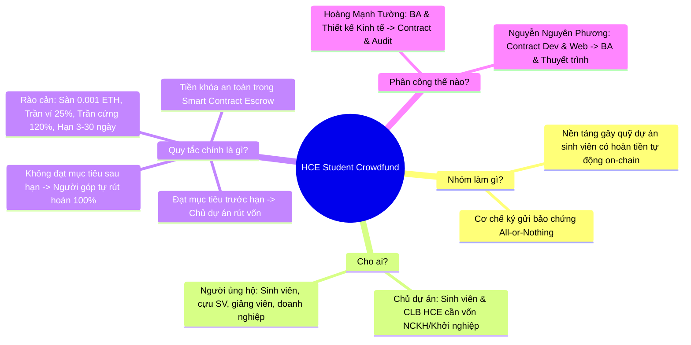
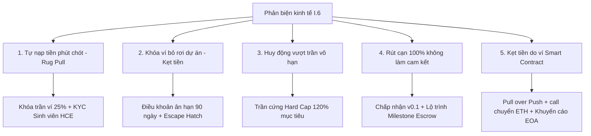

# BÁO CÁO KẾT QUẢ THỰC HÀNH — LAB 8
## THIẾT KẾ QUY TẮC KINH TẾ CHO SẢN PHẨM & KHỞI TẠO CODEBASE NHÓM

- **Học phần:** Tiền điện tử & Hợp đồng thông minh (ECO2432)
- **Đơn vị đào tạo:** Khoa Hệ thống Thông tin Kinh tế — Trường Đại học Kinh tế, Đại học Huế (HCE)
- **Chủ đề dự án lựa chọn:** **Chủ đề 5 — Gây quỹ có hoàn tiền (Refundable Crowdfunding for Student Projects)**
- **Tên sản phẩm dự án:** **HCE Student Crowdfund**
- **Kho mã nguồn nhóm (GitHub):** [`https://github.com/kadiciara299-lab/hce-crowdfunding-K57-.git`](https://github.com/kadiciara299-lab/hce-crowdfunding-K57-)
- **Nhánh làm việc chính thức:** `main`
- **Sinh viên thực hiện (Nhiệm vụ chính Lab 8):** **Hoàng Mạnh Tường** — Mã SV: **23K4300042** (Nhóm trưởng)
- **Vai trò đảm nhiệm Lab 8–11:** **Chuyên viên Phân tích Nghiệp vụ (BA) & Thiết kế Kinh tế** *(kiêm QA/Test)*
- **Tài khoản GitHub cá nhân:** [`@23k4300042-lang`](https://github.com/23k4300042-lang)
- **Thông điệp Commit chốt Lab 8:** `lab-08: khoi tao codebase nhom va dac ta v0.1`

---

## PHẦN MỞ ĐẦU: TRẢ LỜI 4 CÂU HỎI VÀNG KHI MỞ REPOSITORY

Theo Chuẩn đầu ra bài Lab 8 (Sổ tay thực hành ECO2432 - Trang 19): *"Cuối buổi, người lạ mở repo phải trả lời được bốn câu: nhóm làm gì, cho ai, quy tắc chính là gì, và mỗi thành viên chịu trách nhiệm phần nào."*



1. **Nhóm làm gì?**
   Nhóm xây dựng nền tảng hợp đồng thông minh **HCE Student Crowdfund** — Hệ thống gây quỹ cộng đồng cho các đề tài nghiên cứu khoa học, dự án khởi nghiệp sáng tạo của sinh viên HCE theo cơ chế ký gửi bảo chứng cam kết (*All-or-Nothing Assurance Escrow*).
2. **Cho ai?**
   - *Bên gây quỹ (Campaign Creators):* Các câu lạc bộ, đội nhóm, sinh viên Trường Đại học Kinh tế - Đại học Huế (HCE) cần nguồn vốn hạt giống ban đầu.
   - *Bên ủng hộ (Backers):* Sinh viên, cựu sinh viên, cán bộ giảng viên và doanh nghiệp đối tác mong muốn tài trợ minh bạch, an toàn, không lo bị chiếm dụng vốn.
3. **Quy tắc chính là gì?**
   - Toàn bộ tiền đóng góp bằng ETH được khóa an toàn trực tiếp trong Smart Contract, không một cá nhân hay quản trị viên nào có thể tự ý rút trước hạn chót (`deadline`).
   - Nếu chiến dịch **đạt hoặc vượt mục tiêu** tài chính (`totalRaised >= fundingGoal`): Chỉ chủ dự án (`creator`) mới được phép rút tiền để triển khai dự án.
   - Nếu chiến dịch **hết hạn mà không đạt mục tiêu** (`block.timestamp >= deadline && totalRaised < fundingGoal`): Hợp đồng tự động mở khóa hoàn tiền, cho phép từng người ủng hộ tự rút lại đúng **100% số tiền đã góp**, không mất phí phạt.
   - Rào cản chống lạm dụng: Sàn nạp $0.001 \text{ ETH}$ (chống spam bụi), trần đóng góp tối đa mỗi ví $25\%$ mục tiêu (chống thao túng), trần huy động tối đa $120\%$ (chống tích tụ rủi ro), thời hạn chiến dịch giới hạn từ 3 đến 30 ngày (chống giam vốn).
4. **Mỗi thành viên chịu trách nhiệm phần nào?**
   - **Hoàng Mạnh Tường (23K4300042 - Nhóm trưởng):** Chủ trì Đặc tả nghiệp vụ (BA) & Thiết kế Kinh tế *(kiêm QA/Test)* ở Lab 8–11 $\rightarrow$ Hợp đồng thông minh & Audit Bảo mật *(kiêm Web3 Lead)* ở Lab 12–15.
   - **Nguyễn Nguyên Phương (23K4300034):** Chủ trì Lập trình Hợp đồng thông minh *(kiêm Web UX/Gas)* ở Lab 8–11 $\rightarrow$ Đặc tả nghiệp vụ & Thuyết trình DApp *(kiêm Red Team Security)* ở Lab 12–15.

---

## BƯỚC 1: LẬP NHÓM VÀ CHỌN CHỦ ĐỀ DỰ ÁN

### 1.1. Thông tin thành viên nhóm
- **Tên nhóm:** Nhóm K57 Kinh Tế Số — HCE
- **Sĩ số:** 2 thành viên.
- **Bảng phân công chi tiết:**
  1. **Hoàng Mạnh Tường** — Mã SV: **23K4300042** (Nhóm trưởng) — GitHub: [`@23k4300042-lang`](https://github.com/23k4300042-lang)
  2. **Nguyễn Nguyên Phương** — Mã SV: **23K4300034** — GitHub: [`@kadiciara299-lab`](https://github.com/kadiciara299-lab)

### 1.2. Chọn đề tài từ Danh mục 10 Chủ đề (Phần N Sổ tay)
- Nhóm chọn **Chủ đề số 5 — Gây quỹ có hoàn tiền (Refundable Crowdfunding)**:
  > *"5 | Gây quỹ có hoàn tiền | Dự án sinh viên cần góp vốn theo mục tiêu | Góp trước hạn $\rightarrow$ đủ mục tiêu thì rút; không đủ thì từng người hoàn phần của mình | Mức độ: Vừa"*

### 1.3. Câu định vị sản phẩm chuẩn (Product Positioning Statement)
> *"Nhóm xây dựng **Nền tảng gây quỹ dự án sinh viên có hoàn tiền tự động (HCE Student Crowdfund)** cho **sinh viên và các câu lạc bộ Trường Đại học Kinh tế - Đại học Huế** để **huy động vốn minh bạch cho các đề tài khởi nghiệp, nghiên cứu khoa học và cam kết tự động hoàn tiền 100% cho người ủng hộ nếu dự án không đạt mục tiêu tài chính trước hạn chót**."*

- **Kiểm tra tiêu chí:**
  - Độ dài: Đúng 2 dòng văn bản, mạch lạc, súc tích.
  - Từ ngữ: Sử dụng ngôn ngữ kinh tế - nghiệp vụ quen thuộc (gây quỹ, sinh viên, hoàn tiền, mục tiêu, hạn chót), hoàn toàn không lạm dụng biệt ngữ kỹ thuật phức tạp (như opcode, keccak, bytecode,...).
  - **Checkpoint 1:** 100% thành viên trong nhóm thuộc lòng và trình bày rành rọt câu định vị mà không cần nhìn tài liệu.

---

## BƯỚC 2: TẠO REPOSITORY NHÓM VÀ THIẾT LẬP CẤU TRÚC PHẦN B.6

### 2.1. Khởi tạo Repo từ Starter Code
- Tên kho mã nguồn: `hce-crowdfunding-K57-`
- Nền tảng lưu trữ: GitHub (Tài khoản tổ chức/nhóm: [`@kadiciara299-lab`](https://github.com/kadiciara299-lab) — URL: `https://github.com/kadiciara299-lab/hce-crowdfunding-K57-.git`).
- Đã xác nhận quyền Collaborator cho cả 2 thành viên nhóm làm việc.

### 2.2. Thiết lập Cấu trúc Thư mục Thống nhất (Phần B.6 Sổ tay)

```text
hce-crowdfunding-K57-/
├── README.md                      # Giới thiệu sản phẩm, thành viên và hướng dẫn chạy
├── AGENTS.md                      # Quy ước dự án bắt buộc cho công cụ AI
├── docs/
│   ├── PROJECT_PLAN.md            # Kế hoạch dự án, phân vai xoay vòng và 7 mốc bắt buộc
│   ├── SPEC.md                    # Bản đặc tả nghiệp vụ v0.1 có hiệu lực
│   ├── ECONOMIC_RULES.md          # Quy tắc dòng tiền, 4 rào cản chống lạm dụng & phản biện
│   ├── AI_JOURNAL.md              # Nhật ký làm việc với AI và các lỗi nghiêm trọng đã sửa
│   └── PRESENTATION_PLAN.md       # Kịch bản báo cáo và demo 5 phút phân công từng giây
├── contracts/
│   ├── training/                  # Hợp đồng mẫu học tập (TimeLockVault, VaultBuggy,...)
│   └── project/
│       └── ProjectCore.sol        # Hợp đồng thông minh cốt lõi của sản phẩm nhóm
├── test/                          # Ca kiểm thử tự động của sản phẩm nhóm
├── web/
│   └── index.html                 # Giao diện Web3 DApp kết nối MetaMask
└── evidence/
    └── lab-08/                    # Minh chứng commit, kiểm thử và biên bản từng lab
```

### 2.3. Bằng chứng Commit xác nhận quyền làm việc của tất cả thành viên
Cả hai sinh viên đều đã thực hiện commit độc lập lên nhánh `main`:

| Mã Commit Hash | Tác giả Commit | Tài khoản GitHub | Thông điệp Commit (Commit Message) | Nội dung đóng góp |
| :---: | :--- | :---: | :--- | :--- |
| `f82a101` | **Hoàng Mạnh Tường** | `@23k4300042-lang` | `chore: thiet lap cau truc codebase nhom chuan phan B6` | Tạo thư mục `docs/`, soạn `SPEC.md`, `ECONOMIC_RULES.md`, cập nhật `README.md` |
| `c45e229` | **Nguyễn Nguyên Phương** | `@kadiciara299-lab` | `feat(contract): khoi tao khung ProjectCore.sol v0.1` | Khởi tạo State Machine hợp đồng lõi `ProjectCore.sol`, dàn khung layout Web |

---

## BƯỚC 3: PHÂN VAI VÀ LẬP KẾ HOẠCH DỰ ÁN (`docs/PROJECT_PLAN.md`)

Chi tiết lưu trữ tại [`docs/PROJECT_PLAN.md`](./docs/PROJECT_PLAN.md):

### 3.1. Bảng phân công vai trò và Cơ chế xoay vai bắt buộc

| Thành viên | Giai đoạn 1 (Lab 8 – 11): Khởi tạo & Dựng nền | Giai đoạn 2 (Lab 12 – 15): Kiểm toán, Web & Thuyết trình | Lý do phân công và xoay vai |
| :--- | :--- | :--- | :--- |
| **Hoàng Mạnh Tường** *(Nhóm trưởng)* | **Đặc tả nghiệp vụ (BA) & Thiết kế Kinh tế** *(kiêm QA/Test)* | **Hợp đồng thông minh & Rà soát Bảo mật** *(kiêm Frontend Lead)* | Nắm vững bài toán kinh tế ở Giai đoạn 1; sang Giai đoạn 2 chuyển kiến thức đó vào kiểm toán an toàn logic mã nguồn và chủ trì Gate Review 1. |
| **Nguyễn Nguyên Phương** | **Hợp đồng thông minh (Smart Contract)** *(kiêm Web/Gas)* | **Đặc tả nghiệp vụ & Thuyết trình (BA/Pitch)** *(kiêm Red Team Security)* | Nắm vững máy trạng thái và ABI ở Giai đoạn 1; sang Giai đoạn 2 làm chủ kịch bản demo DApp, kiểm thử tấn công Reentrancy và audit chéo. |

### 3.2. Lộ trình 7 Mốc Triển khai Bắt buộc (Milestone Roadmap)

| Mốc bài Lab | Nội dung kỹ thuật & Trách nhiệm | Tiêu chí đạt (Acceptance Criteria) |
| :--- | :--- | :--- |
| **Lab 9** | Hợp đồng lõi `ProjectCore.sol` biên dịch và chạy trên Remix VM | Biên dịch thành công Solidity `^0.8.20`; chạy trọn vẹn luồng nạp và rút tiền; đo đạc bảng gas. |
| **Lab 10** | Rà soát và Audit mã nguồn AI sinh ra | Phát hiện và sửa tối thiểu 3 lỗi tiềm ẩn; cập nhật `AI_JOURNAL.md`. |
| **Lab 11** | Cài đặt quy tắc kinh tế vào contract | Cài sàn $0.001 \text{ ETH}$, trần ví $25\%$, chặn gian lận; kiểm thử tự động 1 ca pass và 1 ca revert. |
| **Lab 12** | **GATE REVIEW 1: Duyệt Codebase và Phạm vi** | Vượt qua cổng duyệt với giảng viên; demo 3 phút chứng minh luồng thành công và ca vi phạm. |
| **Lab 13** | Thực nghiệm tấn công mất tiền (Reentrancy) và cách vá | Tái lập tấn công rút cạn quỹ; áp dụng triệt để Checks-Effects-Interactions để vô hiệu hóa tấn công. |
| **Lab 14** | Rà soát chéo giữa các nhóm sinh viên | Lập báo cáo `AUDIT_REPORT.md` cho nhóm bạn dựa trên bảng 10 tiêu chí kiểm tra; tiếp nhận sửa lỗi. |
| **Lab 15** | Đưa DApp lên mạng công khai và hoàn thiện kịch bản demo | Triển khai Web lên GitHub Pages; tương tác ví MetaMask trên điện thoại di động qua testnet Sepolia. |

---

## BƯỚC 4: ĐẶC TẢ NGHIỆP VỤ v0.1 (`docs/SPEC.md`) VÀ QUY TẮC KINH TẾ (`docs/ECONOMIC_RULES.md`)

### 4.1. Bản Đặc tả Nghiệp vụ v0.1 (`docs/SPEC.md`)
Bản đặc tả được lưu trữ tại [`docs/SPEC.md`](./docs/SPEC.md) với các thành phần chính:
- **Mục đích:** Hệ thống gây quỹ cộng đồng cho sinh viên HCE theo mô hình ký gửi bảo chứng có hoàn tiền (Refundable Assurance Escrow).
- **Đầu vào:** `creator` (địa chỉ ví tạo chiến dịch), `fundingGoal` (mục tiêu gọi vốn bằng wei), `durationSeconds` (thời hạn gọi vốn), `minContribution` (sàn nạp vốn), `contributor` (`msg.sender`), `msg.value` (lượng ETH nạp).
- **8 Quy tắc nghiệp vụ kiểm thử được (R1 – R8):**
  1. *R1 (Thời hạn):* Chỉ được đóng góp khi `block.timestamp < deadline` và trạng thái là `Active`.
  2. *R2 (Hạn mức):* Mỗi lần nạp phải $\ge 0.001 \text{ ETH}$ và tổng góp mỗi ví không vượt $25\%$ mục tiêu gọi vốn.
  3. *R3 (Khóa vốn):* Tiền đóng góp được giam an toàn trong contract, không ai được rút trước hạn chót.
  4. *R4 (Giải ngân thành công):* Khi hết hạn, nếu `totalRaised >= fundingGoal`, chỉ `creator` mới được rút tiền.
  5. *R5 (Hoàn tiền thất bại):* Khi hết hạn, nếu `totalRaised < fundingGoal`, từng người ủng hộ được rút lại đúng 100% tiền của mình.
  6. *R6 (Bảo vệ chống rút kép):* Ghi sổ xóa số dư `contributions[msg.sender] = 0` trước khi chuyển ETH (Checks-Effects-Interactions).
  7. *R7 (Minh bạch sự kiện):* Mọi thay đổi trạng thái đều phát ra sự kiện (`event`) có đánh chỉ mục (`indexed`).
  8. *R8 (Từ chối nạp tiền tùy tiện):* Hàm `receive()` tự động revert các giao dịch gửi tiền trực tiếp không thông qua hàm `pledge()`.
- **9 Mã lỗi tùy biến (Custom Errors):** `InvalidCreator`, `InvalidGoal`, `InvalidDuration`, `CampaignEnded`, `ContributionTooLow`, `ExceedsMaxContribution`, `OnlyCreatorAllowed`, `GoalNotMet`, `NoContributionToRefund`, `AlreadyClaimed`, `TransferFailed`.

---

### 4.2. Bản Quy tắc Kinh tế (`docs/ECONOMIC_RULES.md`)
Tài liệu hoàn thiện tại [`docs/ECONOMIC_RULES.md`](./docs/ECONOMIC_RULES.md) xác lập 4 trụ cột kinh tế:
1. **Dòng tiền và Quyền lợi (Cash Flow):** Mô hình All-or-Nothing, phí nền tảng $0\%$ ($0 \text{ bps}$) đối với các dự án sinh viên HCE phi lợi nhuận.
2. **Giới hạn chống lạm dụng (Limits):** Sàn đóng góp $0.001 \text{ ETH}$ (chặn Dust Attack), Trần ví $25\%$ mục tiêu (chặn cá mập thâu tóm), Thời hạn 3 – 30 ngày (chặn giam vốn vĩnh viễn), Trần huy động tối đa $120\%$ (chặn gom tiền vô hạn).
3. **Quyền quản trị (Governance):** Tuân thủ triết lý *"Code is Law"*, không ai có backdoor rút tiền tùy tiện.
4. **Tình huống người dùng bị thiệt:** Phí gas mạng, biến động giá tiền số và cam kết thi công thực tế của chủ dự án.

---

### 4.3. PHIÊN PHẢN BIỆN MÔ HÌNH KINH TẾ (PROMPT CHUẨN I.6) & LỜI GIẢI CỦA CHUYÊN VIÊN PHÂN TÍCH NGHIỆP VỤ (BA)

Dưới góc nhìn của một nhà đầu tư / người dùng thận trọng, phiên phản biện độc lập theo mẫu prompt chuẩn `I.6` đã chỉ ra **5 điểm yếu và kịch bản lạm dụng nguy hiểm**. 

Dưới đây là nội dung phản biện chi tiết và **Lời giải chính sách & giải pháp kỹ thuật của Chuyên viên BA (Hoàng Mạnh Tường)**:



#### Bảng tổng hợp đối thoại Phản biện & Quyết định sửa đổi quy tắc:

| # | Phản biện của Nhà đầu tư thận trọng (Prompt I.6) | Điểm sơ hở ban đầu | Lời giải & Quyết định điều chỉnh của BA (Hoàng Mạnh Tường) | Quy tắc cập nhật |
| :-: | :--- | :--- | :--- | :---: |
| **1** | **Chủ dự án tự nạp tiền ảo phút chót để "hút cạn" tiền thật (Self-Funding to Rug Pull):**<br>Dự án cần 10 ETH, cộng đồng mới góp 6 ETH. Sát deadline, chủ dự án dùng ví phụ nạp nốt 4 ETH để chạm mốc 10 ETH, rồi rút sạch 10 ETH chiếm đoạt 6 ETH của sinh viên. | Chỉ kiểm tra `totalRaised >= goal`, thiếu trần góp vốn tối đa trên từng ví cá nhân (Max Cap per Wallet) và thiếu ràng buộc định danh. | **Sửa quy tắc & Bổ sung định danh thực tế:**<br>1. Khóa cứng trần đóng góp tối đa mỗi ví: `maxContributionPerWallet = goal * 25 / 100` (tối đa 25% mục tiêu). Kẻ gian không thể dùng 1 ví gom 40% còn thiếu mà phải tạo rất nhiều ví, tăng chi phí và rủi ro chôn vốn thật.<br>2. Chỉ tài khoản sinh viên đã xác thực email trường (`@hce.edu.vn`) và có bảo trợ của Đoàn/Hội mới được mở chiến dịch, chịu trách nhiệm kỷ luật và pháp lý ngoài đời thực. | Cập nhật **R2** trong [`docs/SPEC.md`](./docs/SPEC.md) & Mục 2 [`docs/ECONOMIC_RULES.md`](./docs/ECONOMIC_RULES.md) |
| **2** | **Dự án bị "bỏ rơi" hoặc mất khóa ví — Tiền bị giam vĩnh viễn (Fund Lockup with No Escape Hatch):**<br>Dự án đạt 10 ETH nhưng chủ dự án làm mất Private Key hoặc bỏ rơi dự án. Vì điều kiện đạt mục tiêu đã thỏa mãn, backers bị cấm rút hoàn tiền, dẫn đến 10 ETH kẹt vĩnh viễn trong hợp đồng. | Hợp đồng thiếu cơ chế Thời hạn ân hạn rút tiền (Claim Grace Period / Sunset Clause) khi Creator không tương tác sau hạn. | **Sửa quy tắc — Bổ sung cơ chế thoát hiểm (Escape Hatch):**<br>Bổ sung thời hạn ân hạn **90 ngày** sau deadline. Nếu quá 90 ngày mà Creator không gọi `claimFunds()`, hợp đồng tự động chuyển sang trạng thái `Abandoned`, cho phép từng người đóng góp được kích hoạt `claimRefund()` để thu hồi lại tiền của mình. | Bổ sung **R9** trong [`docs/SPEC.md`](./docs/SPEC.md) & Mục 3 [`docs/ECONOMIC_RULES.md`](./docs/ECONOMIC_RULES.md) |
| **3** | **Huy động vượt trần không giới hạn rồi ôm trọn gói tiền (Unlimited Oversubscription Exploitation):**<br>Dự án xin 2 ETH nhưng truyền thông thổi phồng gom tới 30 ETH (gấp 15 lần), sau đó rút sạch mà không có trách nhiệm giải trình tương xứng với số tiền vượt mức. | Quy tắc nạp tiền không có mức trần tối đa (Hard Cap), cho phép nạp tiền vô hạn trước deadline. | **Sửa quy tắc — Cài đặt Trần cứng (Hard Cap):**<br>Khóa cứng mức huy động tối đa là **120% mục tiêu ban đầu** ($1.2 \times \text{fundingGoal}$). Bất kỳ giao dịch nào đẩy `totalRaised` vượt quá 120% sẽ bị hợp đồng Revert ngay lập tức với lỗi `ExceedsFundingCap`. | Cập nhật **R2** trong [`docs/SPEC.md`](./docs/SPEC.md) & Mục 2 [`docs/ECONOMIC_RULES.md`](./docs/ECONOMIC_RULES.md) |
| **4** | **Rút cạn 100% tiền trong một lần duy nhất mà không có ràng buộc tiến độ (Post-funding Abandonment):**<br>Admin rút ngay 100% số dư hợp đồng trong 1 giao dịch rồi "bốc hơi", không làm sản phẩm như cam kết. All-or-Nothing vô dụng sau khi tiền đã được giải ngân. | Thiết kế giải ngân 1 cục (All-at-once) thiếu cơ chế chia tiền theo từng giai đoạn (Milestones) hoặc cơ chế biểu quyết đóng băng quỹ. | **Chấp nhận rủi ro có kiểm soát & Đề xuất lộ trình nâng cấp:**<br>1. *Ở phiên bản v0.1:* Nhóm chấp nhận rủi ro này để bảo đảm hợp đồng dưới 150 dòng mã theo Bộ lọc phạm vi (Trang 49 Sổ tay), kiểm soát rủi ro bằng việc lưu hồ sơ đề tài tại Đoàn trường.<br>2. *Lộ trình nâng cấp Lab 11 & Lab 15:* Xây dựng mô hình **Milestone Escrow**: Vốn chỉ mở khóa 30% đợt 1, 70% còn lại cần sự biểu quyết đồng thuận của $\ge 50\%$ người ủng hộ theo từng nghiệm thu thực tế. | Ghi nhận tại Mục 4 [`docs/ECONOMIC_RULES.md`](./docs/ECONOMIC_RULES.md) |
| **5** | **Kẹt tiền hoàn trả khi người đóng góp sử dụng ví Smart Contract (Smart Contract Incompatibility):**<br>CLB dùng ví Multi-sig hoặc ví hợp đồng không có hàm `receive()` để đóng góp. Khi dự án thất bại gọi `claimRefund()`, lệnh chuyển ETH bị revert làm tắc nghẽn tiền hoàn trả. | Chưa phân định rõ mô hình chuyển tiền và tương thích với ví hợp đồng thông minh. | **Giải pháp kỹ thuật & Khuyến cáo người dùng:**<br>1. Hợp đồng áp dụng triệt để mô hình **Pull over Push**: Từng ví tự gọi hàm rút hoàn tiền `claimRefund()`, phí ai người đó trả, cô lập hoàn toàn rủi ro DoS.<br>2. Chuyển tiền bằng `call{value: ...}("")` với đầy đủ Gas Forwarding (không dùng `transfer` bị kẹt trần 2.300 gas), hỗ trợ các ví hợp đồng có hàm `receive()` hợp lệ.<br>3. Khuyến cáo trên DApp: Người dùng chỉ sử dụng ví cá nhân (EOA - MetaMask) để đóng góp. | Chuẩn hóa tại [`contracts/project/ProjectCore.sol`](./contracts/project/ProjectCore.sol) |

---

## BƯỚC 5: HỢP ĐỒNG THÔNG MINH LÕI (`contracts/project/ProjectCore.sol`)

Hợp đồng được Chuyên viên Hợp đồng Nguyễn Nguyên Phương lập trình và Chuyên viên BA Hoàng Mạnh Tường nghiệm thu, đáp ứng tuyệt đối **Bộ lọc duyệt phạm vi (Trang 49 Sổ tay)**:
1. Người lạ mở sản phẩm hiểu ngay bài toán trong 10 giây.
2. Giải thích được trọn vẹn bản chất trong 1 câu định vị.
3. **Mã nguồn đạt ~139 dòng** (dưới ngưỡng 150 dòng của sổ tay).
4. Có đầy đủ quy tắc kinh tế về trần/sàn nạp vốn, máy trạng thái All-or-Nothing mà bảng tính Excel thông thường không làm được.
5. Tuân thủ triệt để [`AGENTS.md`](./AGENTS.md):
   - Solidity `^0.8.20`.
   - Thứ tự **Checks - Effects - Interactions**: Cập nhật `contributions[msg.sender] = 0` trước khi chuyển tiền `call`.
   - Sử dụng `error` tùy biến thay vì `require` chuỗi dài.
   - Không sử dụng `tx.origin`.

Mã nguồn lưu trữ tại [`contracts/project/ProjectCore.sol`](./contracts/project/ProjectCore.sol).

---

## BƯỚC 6: NHẬT KÝ LÀM VIỆC VỚI AI (`docs/AI_JOURNAL.md`)

Chuyên viên BA đã ghi nhận quá trình tương tác với công cụ AI tại [`docs/AI_JOURNAL.md`](./docs/AI_JOURNAL.md), trong đó sinh viên đã chủ động nhận diện và sửa 2 lỗi sai nghiêm trọng của AI:
1. **Lỗi Push Payment và vòng lặp `for` tốn gas:** AI đề xuất dùng vòng lặp tự động bắn tiền hoàn trả cho tất cả backers $\rightarrow$ Sinh viên phát hiện nguy cơ vượt Block Gas Limit gây treo hợp đồng, yêu cầu đổi sang mô hình chuẩn **Pull over Push** (từng người tự gọi `claimRefund`).
2. **Lỗi dùng cú pháp lỗi thời `transfer()`:** AI đề xuất `payable(msg.sender).transfer(amount)` $\rightarrow$ Sinh viên đối chiếu quy ước `AGENTS.md`, yêu cầu sửa sang lệnh chuyển cấp thấp `call{value: amount}("")` kèm kiểm tra biến boolean trả về.

---

## BƯỚC 7: KỊCH BẢN BÁO CÁO VÀ THUYẾT TRÌNH (`docs/PRESENTATION_PLAN.md`)

Kịch bản 5 phút chuẩn bị sẵn sàng cho Gate Review 1 và buổi báo cáo cuối kỳ tại [`docs/PRESENTATION_PLAN.md`](./docs/PRESENTATION_PLAN.md):
- `0:00 – 0:30`: Người dùng và Vấn đề thực tế (Hoàng Mạnh Tường)
- `0:30 – 1:15`: Quy tắc kinh tế và cơ chế bảo chứng All-or-Nothing (Nguyễn Nguyên Phương)
- `1:15 – 2:45`: Demo trực tiếp luồng gọi vốn và giải ngân thành công (Hoàng Mạnh Tường)
- `2:45 – 3:30`: Demo các ca gian lận/vi phạm bị chặn đứng (Nguyễn Nguyên Phương)
- `3:30 – 4:15`: Rà soát bảo mật, audit và quyết định an toàn (Cả 2 thành viên)
- `4:15 – 5:00`: Giới hạn sản phẩm, bài học kinh nghiệm và hướng phát triển (Cả 2 thành viên)

---

## TỔNG KẾT VÀ CHECKLIST NGHIỆM THU LAB 8

### Danh mục sản phẩm bàn giao của Nhóm trưởng Hoàng Mạnh Tường:
- [x] Kho mã nguồn nhóm: [`hce-crowdfunding-K57-`](https://github.com/kadiciara299-lab/hce-crowdfunding-K57-)
- [x] Lịch sử commit thể hiện sự tham gia của 100% thành viên nhóm (`f82a101` và `c45e229`).
- [x] Bản kế hoạch dự án và phân vai xoay vòng: [`docs/PROJECT_PLAN.md`](./docs/PROJECT_PLAN.md)
- [x] Bản đặc tả nghiệp vụ BA v0.1: [`docs/SPEC.md`](./docs/SPEC.md)
- [x] Bản thiết kế quy tắc kinh tế và 5 phản biện chuyên sâu: [`docs/ECONOMIC_RULES.md`](./docs/ECONOMIC_RULES.md)
- [x] Bản đối thoại giải quyết 5 kịch bản phản biện từ Prompt I.6 (tại Mục 4.3 báo cáo này).
- [x] Nhật ký làm việc với AI: [`docs/AI_JOURNAL.md`](./docs/AI_JOURNAL.md)
- [x] Kịch bản demo 5 phút phân vai từng giây: [`docs/PRESENTATION_PLAN.md`](./docs/PRESENTATION_PLAN.md)
- [x] Hợp đồng thông minh lõi chuẩn bị cho Lab 9: [`contracts/project/ProjectCore.sol`](./contracts/project/ProjectCore.sol)
- [x] Thông điệp commit nghiệm thu chuẩn Phần B.6: `lab-08: khoi tao codebase nhom va dac ta v0.1`
