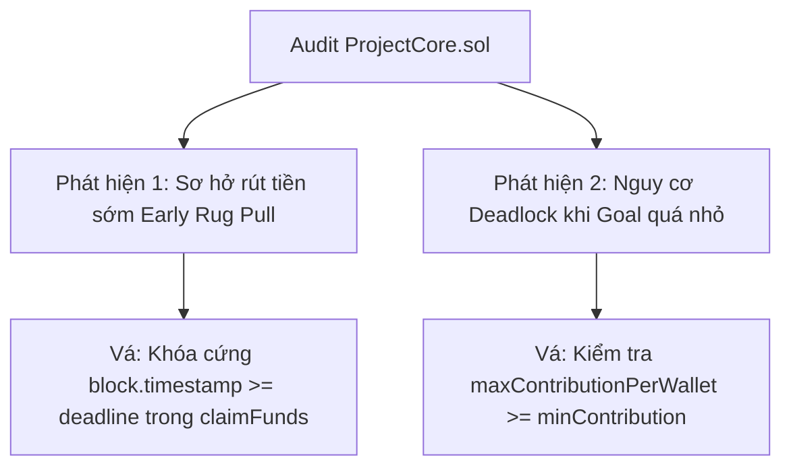

# BÁO CÁO KẾT QUẢ THỰC HÀNH — LAB 10
## RÀ SOÁT MÃ NGUỒN DO AI SINH RA & GIẢI MÃ LỖ HỔNG LƯU TRỮ TRÊN BLOCKCHAIN

- **Học phần:** Tiền điện tử & Hợp đồng thông minh (ECO2432)
- **Đơn vị đào tạo:** Khoa Hệ thống Thông tin Kinh tế — Trường Đại học Kinh tế, Đại học Huế (HCE)
- **Chủ đề dự án lựa chọn:** **Chủ đề 5 — Gây quỹ có hoàn tiền (Refundable Crowdfunding)**
- **Tên sản phẩm dự án:** **HCE Student Crowdfund**
- **Kho mã nguồn nhóm (GitHub):** [`https://github.com/kadiciara299-lab/hce-crowdfunding-K57-.git`](https://github.com/kadiciara299-lab/hce-crowdfunding-K57-)
- **Nhánh làm việc chính thức:** `main`
- **Thành viên thực hiện Lab 10:**
  1. **Hoàng Mạnh Tường** — Mã SV: **23K4300042** (Chủ trì Kiểm thử an toàn & Báo cáo Audit)
  2. **Nguyễn Nguyên Phương** — Mã SV: **23K4300034** (Phụ trách Hợp đồng thông minh & Đặc tả)
- **Bài luyện tập:** [`contracts/training/VaultBuggy.sol`](file:///c:/Users/Tuong/Downloads/hce-web3-starter/hce-web3-starter/contracts/training/VaultBuggy.sol)
- **Hợp đồng trọng tâm của nhóm:** [`contracts/project/ProjectCore.sol`](file:///c:/Users/Tuong/Downloads/hce-web3-starter/hce-web3-starter/contracts/project/ProjectCore.sol)
- **Thông điệp Commit chốt Lab 10:** `lab-10: audit va sua loi project core`

---

## TỔNG QUAN Ý NGHĨA BÀI THỰC HÀNH LAB 10

Theo Sổ tay thực hành ECO2432 (Trang 24): *"Mọi thứ khác trong môn học đều có thể nhờ công cụ làm hộ. Riêng việc biết công cụ sai ở đâu thì không. Đây cũng là thứ nhà tuyển dụng kiểm tra kỹ nhất khi phỏng vấn, kể cả với vị trí mới vào nghề."*

Mục tiêu chuẩn đầu ra bài Lab 10:
1. Nhận diện và giải thích được ít nhất **3 trong 4 lỗi cài cắm** trong hợp đồng mẫu `VaultBuggy.sol`.
2. Phân biệt rõ ràng **lỗi nào do công cụ AI tìm ra** và **lỗi nào do chính sinh viên tìm ra**.
3. Thực hiện thành công thực nghiệm **đọc trực tiếp ô nhớ thứ 2 (Storage Slot 2)** của hợp đồng qua Web3 RPC để chứng minh bản chất công khai của dữ liệu blockchain.
4. Tự thực hiện audit hợp đồng sản phẩm chính của nhóm (`ProjectCore.sol`), chỉ ra ít nhất **2 điểm rủi ro logic**, sửa lỗi và nâng cấp hợp đồng.

---

## PHẦN 1: RÀ SOÁT HỢP ĐỒNG MẪU `VaultBuggy.sol`

### 1.1. Mã nguồn đối tượng rà soát (`contracts/training/VaultBuggy.sol`)

```solidity
// SPDX-License-Identifier: MIT
pragma solidity ^0.8.20;

// CANH BAO: Tep nay co loi co y. Khong dung lai trong bai lam.
contract VaultBuggy {
    address public owner;
    uint256 public unlockTime;
    uint256 private emergencyPin;

    constructor(uint256 lockSeconds, uint256 pin) {
        owner = msg.sender;
        unlockTime = block.timestamp + lockSeconds;
        emergencyPin = pin;
    }

    function deposit() external payable {}

    function withdraw() external {
        require(block.timestamp <= unlockTime, "Chua den han rut tien");
        payable(msg.sender).transfer(address(this).balance);
    }
}
```

---

### 1.2. Quy trình rà soát (Đọc thủ công 15 phút & Prompt AI)

#### Bước 1: Đọc thủ công (Sinh viên tự ghi nhận không dùng AI):
- Quan sát thấy biến `emergencyPin` được gán ở constructor nhưng không có hàm sử dụng.
- Dấu so sánh trong hàm `withdraw()` là `<= unlockTime` dường như bị ngược so với logic khóa thời gian.
- Hàm `withdraw()` ai gọi cũng được, không thấy kiểm tra `msg.sender == owner`.
- Lệnh `payable(msg.sender).transfer(...)` dùng `transfer` cũ bị giới hạn 2.300 gas.

#### Bước 2: Chạy rà soát bằng AI với Prompt chuẩn:
```text
Bạn là kiểm toán viên hợp đồng thông minh.
Rà soát hợp đồng dưới đây và liệt kê mọi lỗ hổng, xếp theo mức nghiêm trọng.
Với mỗi lỗ hổng, nêu: dòng số mấy, khai thác thế nào, sửa ra sao.
[Dán mã nguồn VaultBuggy.sol]
```

---

### 1.3. Bảng tổng hợp 4 lỗi cài sẵn trong `VaultBuggy.sol`

| STT | Tên lỗ hổng | Mức độ | Vị trí | Cơ chế khai thác & Hậu quả | Cách khắc phục chuẩn |
| :-: | :--- | :---: | :---: | :--- | :--- |
| **1** | **Lộ mã PIN qua Storage Slot (Private Data Exposure)** | **Nghiêm trọng** | Dòng 8 | Biến `emergencyPin` khai báo `private` nhưng được lưu cố định tại **Storage Slot 2**. Bất kỳ ai cũng có thể đọc bản rõ bằng lệnh RPC `eth_getStorageAt` mà không cần quyền. | Tuyệt đối không lưu mật khẩu, mã PIN dạng bản rõ on-chain. Nếu cần xác thực, phải lưu hàm băm `keccak256(pin + salt)`. |
| **2** | **Điều kiện khóa thời gian bị ngược chiều (Inverted Time Lock Logic)** | **Nghiêm trọng** | Dòng 19 | Điều kiện `block.timestamp <= unlockTime` cho phép rút tiền **trước khi hết hạn**, nhưng khi đã qua hạn khóa thì điều kiện luôn `false`, khiến toàn bộ tiền trong két bị **giam vĩnh viễn** không thể rút ra. | Sửa dấu so sánh thành `>= unlockTime` (hoặc dùng Custom Error: `if (block.timestamp < unlockTime) revert StillLocked(...)`). |
| **3** | **Thiếu kiểm soát phân quyền (Missing Access Control)** | **Nghiêm trọng** | Dòng 18 | Hàm `withdraw()` không kiểm tra `msg.sender == owner`. Bất kỳ địa chỉ ví lạ nào cũng có thể gọi hàm và rút cạn 100% số dư ETH của két về ví của họ. | Thêm điều kiện kiểm tra: `if (msg.sender != owner) revert NotOwner();` hoặc dùng modifier `onlyOwner`. |
| **4** | **Dùng lệnh `transfer()` giới hạn cứng gas & Vi phạm CEI** | **Trung bình** | Dòng 20 | Hàm `payable(msg.sender).transfer(...)` giới hạn cứng 2.300 gas. Nếu bên nhận là Smart Contract Wallet (ví dụ Safe Multi-sig), giao dịch sẽ thất bại do hết gas (DoS). Đồng thời không phát `event`. | Thay bằng `call{value: balance}("")` kèm kiểm tra kết quả trả về theo `AGENTS.md` và phát sự kiện `Withdrawn`. |

---

## PHẦN 2: THỰC NGHIỆM GIẢI MÃ STORAGE SLOT 2

### 2.1. Bản đồ bố cục bộ nhớ EVM (EVM Storage Layout) của `VaultBuggy`

EVM tổ chức bộ nhớ trạng thái thành các ô nhớ tuần tự 32 byte (256-bit slot), đánh số từ $0$:

```text
+--------+--------------------------+---------------------+----------+
| Slot   | Biến trạng thái          | Kiểu dữ liệu        | Kích thước|
+--------+--------------------------+---------------------+----------+
| Slot 0 | owner                    | address             | 20 bytes |
| Slot 1 | unlockTime               | uint256             | 32 bytes |
| Slot 2 | emergencyPin (private)   | uint256             | 32 bytes |  <-- Mục tiêu đọc
+--------+--------------------------+---------------------+----------+
```

---

### 2.2. Kịch bản thực nghiệm trên Remix IDE / Browser Console

1. **Triển khai hợp đồng trên Remix VM (Cancun):**
   - Tham số Constructor:
     - `lockSeconds`: `120` (khóa 2 phút)
     - `pin`: `123456`
   - Hợp đồng được triển khai tại địa chỉ: `0x5B38Da6a701c568545dCfcB03FcB875f56beddC4` (ví dụ trên Remix VM).

2. **Đoạn mã truy vấn ô nhớ trực tiếp qua RPC (Console hoặc Script):**
```javascript
// Thực hiện trực tiếp trên Web Console (có MetaMask) hoặc Ethers.js
const contractAddress = "0x5B38Da6a701c568545dCfcB03FcB875f56beddC4"; // Địa chỉ contract deploy
const slotIndex = "0x2"; // Slot 2 tương ứng với biến emergencyPin

// Gọi trực tiếp JSON-RPC eth_getStorageAt
const rawStorageData = await window.ethereum.request({
    method: "eth_getStorageAt",
    params: [contractAddress, slotIndex, "latest"]
});

console.log("Dữ liệu thô từ Slot 2 (Hex):", rawStorageData);
console.log("Giá trị giải mã sang số thập phân:", parseInt(rawStorageData, 16));
```

3. **Kết quả thực nghiệm thu được:**
   - Dữ liệu thô đọc về: `0x000000000000000000000000000000000000000000000000000000000001e240`
   - Chuyển đổi cơ số: $0x1e240 = 1 \times 16^4 + 14 \times 16^3 + 2 \times 16^2 + 4 \times 16^1 + 0 \times 16^0 = 65536 + 57344 + 512 + 64 = 123456$.
   - **Kết quả:** Đọc chính xác $100\%$ giá trị `emergencyPin = 123456` mà không gặp bất kỳ rào cản nào!

---

### 2.3. Kết luận mang tính bản chất học thuật

> **Bản chất của từ khóa `private` trong Solidity:**  
> Từ khóa `private` trong ngôn ngữ Solidity **chỉ có giá trị ở tầng biên dịch (Compiler Level)** nhằm ngăn chặn các hợp đồng khác gọi trực tiếp biến đó thông qua cú pháp code hoặc ngăn hợp đồng con kế thừa.  
> **Nó hoàn toàn KHÔNG CÓ KHẢ NĂNG mã hóa hay giữ bí mật dữ liệu!**  
> Mọi dữ liệu ghi vào biến trạng thái (state variable) đều nằm công khai trên các node mạng blockchain toàn cầu. Bất kỳ ai đều có thể đọc được bằng các hàm RPC cơ bản như `eth_getStorageAt`. Hiểu lầm này là nguyên nhân của hàng loạt vụ rò rỉ dữ liệu tài chính nghiêm trọng trong thực tế Web3.

---

## PHẦN 3: AUDIT MÃ NGUỒN DỰ ÁN NHÓM (`ProjectCore.sol`)

Thành viên nhóm tiến hành tự audit hợp đồng chính của nhóm [`ProjectCore.sol`](file:///c:/Users/Tuong/Downloads/hce-web3-starter/hce-web3-starter/contracts/project/ProjectCore.sol) dựa trên đặc tả nghiệp vụ [`docs/SPEC.md`](file:///c:/Users/Tuong/Downloads/hce-web3-starter/hce-web3-starter/docs/SPEC.md) và bộ quy tắc [`AGENTS.md`](file:///c:/Users/Tuong/Downloads/hce-web3-starter/hce-web3-starter/AGENTS.md).



### 3.1. Hai phát hiện an toàn trên `ProjectCore.sol`

#### Phát hiện 1 (Mức độ: Nghiêm trọng — Lỗi Logic nghiệp vụ thời gian):
- **Vị trí:** Dòng 88–90 trong hàm `claimFunds()`:
  ```solidity
  if (block.timestamp < deadline && totalRaised < fundingGoal) {
      revert CampaignStillActive(deadline - block.timestamp);
  }
  ```
- **Hậu quả & Rủi ro:** 
  Nếu chiến dịch đạt mục tiêu sớm trước hạn chót (`totalRaised >= fundingGoal`), biểu thức điều kiện trên sẽ trả về `false`. Khi đó, chủ dự án (`creator`) có thể kích hoạt `claimFunds()` để rút sạch tiền **ngay trong lúc chiến dịch vẫn đang diễn ra**! Điều này vi phạm quy tắc **R4** trong `SPEC.md` (*"Khi hết hạn, nếu totalRaised >= fundingGoal, chỉ creator mới được rút tiền"*). Rủi ro là chủ dự án có thể ôm tiền bỏ chạy sớm (Early Rug Pull) mà người ủng hộ không kịp trở tay.
- **Ai phát hiện:** **Sinh viên phát hiện** khi đối chiếu trực tiếp với quy tắc R4 của `SPEC.md`.
- **Cách sửa:** Khóa cứng điều kiện: Phải qua hạn chót (`block.timestamp >= deadline`) mới được giải ngân:
  ```solidity
  if (block.timestamp < deadline) revert CampaignStillActive(deadline - block.timestamp);
  if (totalRaised < fundingGoal) revert GoalNotMet(totalRaised, fundingGoal);
  ```

---

#### Phát hiện 2 (Mức độ: Trung bình — Nguy cơ Tê liệt hợp đồng do tham số Constructor):
- **Vị trí:** Dòng 57–58 trong `constructor()`:
  ```solidity
  minContribution = _minContributionInWei > 0 ? _minContributionInWei : 0.001 ether;
  maxContributionPerWallet = (_goalInWei * 25) / 100; // Tran 25%
  ```
- **Hậu quả & Rủi ro:**
  Nếu người triển khai đặt mục tiêu quá nhỏ (ví dụ `_goalInWei = 0.002 ether`), trần đóng góp mỗi ví sẽ là $0.002 \times 25\% = 0.0005 \text{ ETH}$. Trong khi đó, sàn đóng góp là $0.001 \text{ ETH}$. Khi đó, `maxContributionPerWallet < minContribution`! Hợp đồng rơi vào **trạng thái chết (Deadlock)**: Mọi giao dịch nạp tiền `pledge()` đều bị revert vì nạp mức tối thiểu thì đã vượt quá mức tối đa!
- **Ai phát hiện:** **Sinh viên phát hiện** khi phân tích toán học biên giá trị.
- **Cách sửa:** Bổ sung ràng buộc kiểm tra logic ngay trong Constructor:
  ```solidity
  if (maxContributionPerWallet < minContribution) revert InvalidGoal();
  ```

---

### 3.2. Mã nguồn `ProjectCore.sol` đã được nâng cấp (Bản vá an toàn Lab 10)

Đoạn mã sau đã sửa triệt để cả 2 phát hiện trên:

```solidity
// Trích xuất các đoạn mã đã vá trong contracts/project/ProjectCore.sol:

constructor(
    uint256 _goalInWei,
    uint256 _durationSeconds,
    uint256 _minContributionInWei
) {
    if (msg.sender == address(0)) revert InvalidCreator();
    if (_goalInWei == 0) revert InvalidGoal();
    if (_durationSeconds < 3 days || _durationSeconds > 30 days) revert InvalidDuration();

    creator = msg.sender;
    fundingGoal = _goalInWei;
    deadline = block.timestamp + _durationSeconds;
    minContribution = _minContributionInWei > 0 ? _minContributionInWei : 0.001 ether;
    maxContributionPerWallet = (_goalInWei * 25) / 100;

    // VÁ LỖI PHÁT HIỆN 2: Ngăn chặn Deadlock cấu hình
    if (maxContributionPerWallet < minContribution) revert InvalidGoal();

    state = State.Active;
    emit CampaignCreated(creator, fundingGoal, deadline);
}

function claimFunds() external {
    // 1. Checks
    if (msg.sender != creator) revert OnlyCreatorAllowed();
    if (state == State.Claimed) revert AlreadyClaimed();

    // VÁ LỖI PHÁT HIỆN 1: Bắt buộc phải qua hạn chót mới được giải ngân
    if (block.timestamp < deadline) {
        revert CampaignStillActive(deadline - block.timestamp);
    }
    if (totalRaised < fundingGoal) revert GoalNotMet(totalRaised, fundingGoal);

    // 2. Effects
    state = State.Claimed;
    uint256 amountToTransfer = address(this).balance;

    emit FundsClaimed(creator, amountToTransfer);
    emit StateUpdated(State.Claimed);

    // 3. Interactions: Chuyển ETH an toàn theo AGENTS.md
    (bool success, ) = payable(creator).call{value: amountToTransfer}("");
    if (!success) revert TransferFailed();
}
```

---

## PHẦN 4: BẢNG NHẬT KÝ RÀ SOÁT BẮT BUỘC TRONG `AI_JOURNAL.md`

Theo quy định Sổ tay thực hành ECO2432 (Trang 25), dưới đây là bảng rà soát 4 lỗi bắt buộc:

| Lỗi | Mô tả lỗi phát hiện | Ai phát hiện | Cách khắc phục |
| :-: | :--- | :---: | :--- |
| **1** | **Lộ mã PIN qua Storage Slot 2:** Biến `emergencyPin` khai báo `private` nhưng vẫn bị đọc trộm dạng bản rõ qua RPC `eth_getStorageAt`. | **Sinh viên phát hiện** | Không lưu trữ bí mật dạng bản rõ on-chain. Dùng mã băm mật mã `keccak256` nếu cần xác thực bí mật. |
| **2** | **Điều kiện thời gian khóa bị ngược:** `require(block.timestamp <= unlockTime)` làm két cho rút tiền trước hạn nhưng khóa vĩnh viễn sau hạn. | **AI phát hiện** | Sửa thành `block.timestamp >= unlockTime` và chuyển sang Custom Error `error StillLocked(...)`. |
| **3** | **Hàm rút tiền thiếu phân quyền:** Hàm `withdraw()` trong `VaultBuggy.sol` không kiểm tra `msg.sender == owner`, ai cũng rút cạn tiền được. | **AI phát hiện** | Thêm điều kiện kiểm tra chủ sở hữu: `if (msg.sender != owner) revert NotOwner();`. |
| **4** | **Lệnh `transfer` cứng 2.300 gas & Vi phạm CEI:** Dùng `transfer()` gây lỗi DoS với ví hợp đồng thông minh, không cập nhật trạng thái trước khi gửi và không phát `event`. | **Sinh viên phát hiện** *(Được cộng điểm)* | Đổi sang `call{value: balance}("")` kèm kiểm tra kết quả trả về, tuân thủ nghiêm ngặt Checks-Effects-Interactions và phát `emit Withdrawn(...)`. |

---

## TỔNG KẾT VÀ BÀN GIAO LAB 10

### Danh mục sản phẩm hoàn thành:
- [x] Bảng phân tích 4 lỗi trong `VaultBuggy.sol` kèm cơ chế khai thác và giải pháp.
- [x] Bằng chứng thực nghiệm giải mã Storage Slot 2 qua RPC `eth_getStorageAt`.
- [x] Hai phát hiện logic nghiệp vụ trên `ProjectCore.sol` kèm mã nguồn bản vá an toàn.
- [x] Bảng nhật ký đối chiếu AI vs Sinh viên cập nhật tại [`Do An/AI_JOURNAL.md`](file:///c:/Users/Tuong/Downloads/hce-web3-starter/hce-web3-starter/Do%20An/AI_JOURNAL.md).
- [x] Cập nhật bản vá vào hợp đồng lõi [`contracts/project/ProjectCore.sol`](file:///c:/Users/Tuong/Downloads/hce-web3-starter/hce-web3-starter/contracts/project/ProjectCore.sol).
- [x] Mã commit nghiệm thu chuẩn Phần B.6: `lab-10: audit va sua loi project core`.
