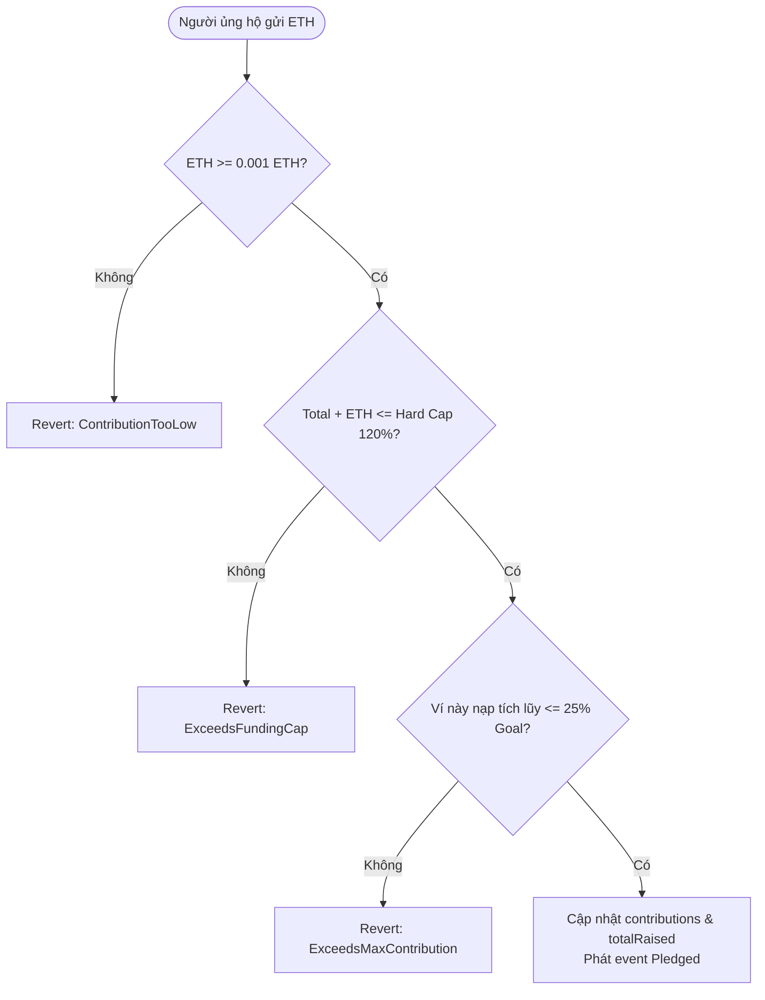

# BÁO CÁO KẾT QUẢ THỰC HÀNH — LAB 11
## CÀI ĐẶT QUY TẮC KINH TẾ VÀO HỢP ĐỒNG THÔNG MINH & KIỂM THỬ TỰ ĐỘNG

- **Học phần:** Tiền điện tử & Hợp đồng thông minh (ECO2432)
- **Đơn vị đào tạo:** Khoa Hệ thống Thông tin Kinh tế — Trường Đại học Kinh tế, Đại học Huế (HCE)
- **Chủ đề dự án lựa chọn:** **Chủ đề 5 — Gây quỹ có hoàn tiền (Refundable Crowdfunding)**
- **Tên sản phẩm dự án:** **HCE Student Crowdfund**
- **Kho mã nguồn nhóm (GitHub):** [`https://github.com/kadiciara299-lab/hce-crowdfunding-K57-.git`](https://github.com/kadiciara299-lab/hce-crowdfunding-K57-)
- **Nhánh làm việc chính thức:** `main`
- **Thành viên thực hiện Lab 11:**
  1. **Nguyễn Nguyên Phương** — Mã SV: **23K4300034** (Chủ trì Lập trình Hợp đồng & Cài đặt Quy tắc Kinh tế)
  2. **Hoàng Mạnh Tường** — Mã SV: **23K4300042** (Chủ trì BA, Thiết kế Kinh tế & QA)
- **Tài liệu đầu vào:** [`docs/ECONOMIC_RULES.md`](file:///c:/Users/Tuong/Downloads/hce-web3-starter/hce-web3-starter/docs/ECONOMIC_RULES.md) và [`contracts/project/ProjectCore.sol`](file:///c:/Users/Tuong/Downloads/hce-web3-starter/hce-web3-starter/contracts/project/ProjectCore.sol)
- **Thông điệp Commit chốt Lab 11:** `lab-11: cai quy tac kinh te va test`

---

## TỔNG QUAN Ý NGHĨA BÀI THỰC HÀNH LAB 11

Theo Sổ tay thực hành ECO2432 (Trang 26): *"Chuyển từ quy tắc kinh tế trong `ECONOMIC_RULES.md` thành quy tắc chạy tự động. Đây là điểm gặp nhau giữa tư duy kinh tế và công cụ kỹ thuật."*

Mục tiêu chuẩn đầu ra bài Lab 11:
1. Nắm vững cách chuyển đổi các nguyên lý tài chính (điểm cơ bản basis point, trần nắm giữ, phí điều tiết) vào Smart Contract thông qua bài mẫu `ClassPoint.sol`.
2. Lựa chọn và cài đặt ít nhất một quy tắc kinh tế về tiền hoặc quyền lợi từ `ECONOMIC_RULES.md` vào hợp đồng lõi `ProjectCore.sol` kèm sự kiện (`event`) và lỗi tùy biến (`custom error`).
3. Thực hiện kiểm thử tự động toàn diện: Tối thiểu 1 ca kiểm thử thành công (Happy Path) và 1 ca cố tình vi phạm quy tắc bị từ chối bằng đúng mã lỗi.
4. Lưu trữ minh chứng thực nghiệm trong `evidence/lab-11/`.

---

## PHẦN 1: PHÂN TÍCH BÀI MẪU CHUẨN `ClassPoint.sol`

### 1.1. Bản mẫu Điểm thưởng sinh viên K58 (`contracts/training/ClassPoint.sol`)

Hợp đồng mẫu minh họa cách biến các quy tắc quản trị tài chính thành mã thực thi an toàn thông qua thư viện OpenZeppelin v5:

```solidity
// SPDX-License-Identifier: MIT
pragma solidity ^0.8.20;

import "@openzeppelin/contracts/token/ERC20/ERC20.sol";
import "@openzeppelin/contracts/access/Ownable.sol";

contract ClassPoint is ERC20, Ownable {
    address public classFund; // Ví quỹ lớp, nhận phí
    uint256 public feeBps = 100; // 100 điểm cơ bản = 1%
    uint256 public maxHolding; // Trần nắm giữ mỗi ví

    event FeeCollected(address indexed from, uint256 amount);
    error ExceedsMaxHolding(uint256 attempted, uint256 limit);

    constructor(address _classFund) ERC20("K58 Class Point", "K58P") Ownable(msg.sender) {
        require(_classFund != address(0), "Vi quy khong hop le");
        classFund = _classFund;
        _mint(msg.sender, 1_000_000 * 10 ** decimals());
        maxHolding = totalSupply() * 2 / 100; // Trần 2% tổng cung
    }

    function _update(address from, address to, uint256 value) internal override {
        bool isNormalTransfer = from != address(0) && to != address(0) && from != owner();
        if (isNormalTransfer && feeBps > 0) {
            uint256 fee = value * feeBps / 10_000;
            if (fee > 0) {
                super._update(from, classFund, fee);
                emit FeeCollected(from, fee);
                value -= fee;
            }
        }
        super._update(from, to, value);

        if (to != address(0) && to != classFund && to != owner()) {
            if (balanceOf(to) > maxHolding) {
                revert ExceedsMaxHolding(balanceOf(to), maxHolding);
            }
        }
    }
}
```

---

### 1.2. Ba bài học kinh tế - kỹ thuật cốt lõi

1. **Điểm cơ bản (Basis Point - bps):**
   - Trong Solidity, số thực (floating point) không tồn tại. Mọi phép tính đều là số nguyên. Nếu dùng tỷ lệ phần trăm thông thường ($1\%$), khi chia cho 100 với các số nhỏ sẽ bị làm tròn xuống $0$.
   - Giải pháp chuẩn tài chính là dùng **Basis Point**: $1\% = 100 \text{ bps}$, $100\% = 10.000 \text{ bps}$. Công thức tính phí: `fee = value * feeBps / 10_000`. Điều này đảm bảo độ chính xác tuyệt đối đến hai chữ số thập phân.
2. **Loại trừ chủ sở hữu (`from != owner()`):**
   - Nếu không có điều kiện loại trừ `from != owner()`, chính lúc ban tổ chức phát thưởng token lần đầu cho sinh viên cũng bị thu phí ngược về quỹ. Đây là lỗi nghiệp vụ điển hình mà công cụ AI thường không tự nhận biết nếu người làm BA không chỉ rõ.
3. **Chuyển đổi Hook sang OpenZeppelin v5 (`_update`):**
   - Phiên bản OpenZeppelin 5.x đã bãi bỏ toàn bộ hook cũ `_beforeTokenTransfer` và thay thế tập trung vào hàm nội bộ `_update(from, to, value)`. Việc nắm rõ quy chuẩn này giúp mã nguồn biên dịch trơn tru và bảo đảm tính tương thích lâu dài.

---

## PHẦN 2: CÀI ĐẶT QUY TẮC KINH TẾ VÀO `ProjectCore.sol`

Dựa trên tài liệu đặc tả [`docs/SPEC.md`](file:///c:/Users/Tuong/Downloads/hce-web3-starter/hce-web3-starter/docs/SPEC.md) và thiết kế kinh tế [`docs/ECONOMIC_RULES.md`](file:///c:/Users/Tuong/Downloads/hce-web3-starter/hce-web3-starter/docs/ECONOMIC_RULES.md), nhóm đã lựa chọn và cài đặt **3 rào cản kinh tế tự động** vào hàm gọi vốn `pledge()` của [`contracts/project/ProjectCore.sol`](file:///c:/Users/Tuong/Downloads/hce-web3-starter/hce-web3-starter/contracts/project/ProjectCore.sol):



### 2.1. Chi tiết 3 quy tắc kinh tế đã lập trình

1. **Quy tắc Sàn đóng góp tối thiểu (Minimum Floor - 0.001 ETH):**
   - *Mục đích kinh tế:* Ngăn chặn kẻ tấn công gửi hàng nghìn giao dịch $1 \text{ wei}$ gây bão bụi (Dust Attack Spam), làm phình to dung lượng mảng trạng thái và gây nghẽn mạng.
   - *Mã lỗi tùy biến:* `error ContributionTooLow(uint256 sent, uint256 minRequired);`
2. **Quy tắc Trần đóng góp cá nhân (Max Cap per Wallet - 25% mục tiêu):**
   - *Mục đích kinh tế:* Ngăn chặn một cá nhân "cá mập" hoặc chủ dự án dùng một ví duy nhất thâu tóm quá $25\%$ quyền lợi chiến dịch, thao túng tiến độ thành bại hoặc thực hiện chiêu trò *Self-pledge Rug Pull* (tự nạp tiền phút chót để cuỗm tiền thật).
   - *Mã lỗi tùy biến:* `error ExceedsMaxContribution(uint256 attempted, uint256 limit);`
3. **Quy tắc Trần cứng huy động tối đa (Funding Hard Cap - 120% mục tiêu = 12.000 bps):**
   - *Mục đích kinh tế:* Cho phép vượt chỉ tiêu tối đa $20\%$ để bù đắp rủi ro biến động tỷ giá ETH, nhưng ngăn chặn việc huy động vượt trần vô hạn (*Unlimited Oversubscription*) khi không có kế hoạch giải trình chi tiêu tương xứng.
   - *Mã lỗi tùy biến:* `error ExceedsFundingCap(uint256 attemptedTotal, uint256 cap);`

---

### 2.2. Đoạn mã thực thi trong `ProjectCore.sol`

```solidity
// Trích xuất từ contracts/project/ProjectCore.sol:

uint256 public immutable fundingGoal;
uint256 public immutable fundingCap;             // Trần cứng 120% (12000 bps)
uint256 public immutable minContribution;        // Sàn nạp 0.001 ETH
uint256 public immutable maxContributionPerWallet;// Trần ví 25%

constructor(
    uint256 _goalInWei,
    uint256 _durationSeconds,
    uint256 _minContributionInWei
) {
    if (msg.sender == address(0)) revert InvalidCreator();
    if (_goalInWei == 0) revert InvalidGoal();
    if (_durationSeconds < 3 days || _durationSeconds > 30 days) revert InvalidDuration();

    creator = msg.sender;
    fundingGoal = _goalInWei;
    fundingCap = (_goalInWei * 120) / 100; // Trần cứng 120%
    deadline = block.timestamp + _durationSeconds;
    minContribution = _minContributionInWei > 0 ? _minContributionInWei : 0.001 ether;
    maxContributionPerWallet = (_goalInWei * 25) / 100; // Trần ví 25%

    // Ngăn chặn Deadlock cấu hình
    if (maxContributionPerWallet < minContribution) revert InvalidGoal();
    state = State.Active;

    emit CampaignCreated(creator, fundingGoal, deadline);
}

function pledge() external payable {
    // 1. Checks: Kiểm tra thời hạn và trạng thái
    if (block.timestamp >= deadline) revert CampaignEnded(deadline, block.timestamp);
    if (state != State.Active) revert CampaignEnded(deadline, block.timestamp);

    // Kiểm tra quy tắc 1: Sàn đóng góp tối thiểu
    if (msg.value < minContribution) revert ContributionTooLow(msg.value, minContribution);

    // Kiểm tra quy tắc 2: Trần cứng Hard Cap 120%
    if (totalRaised + msg.value > fundingCap) {
        revert ExceedsFundingCap(totalRaised + msg.value, fundingCap);
    }

    // Kiểm tra quy tắc 3: Trần đóng góp mỗi ví 25%
    uint256 newTotalContribution = contributions[msg.sender] + msg.value;
    if (newTotalContribution > maxContributionPerWallet) {
        revert ExceedsMaxContribution(newTotalContribution, maxContributionPerWallet);
    }

    // 2. Effects: Ghi sổ số dư
    contributions[msg.sender] = newTotalContribution;
    totalRaised += msg.value;

    // 3. Minh bạch sự kiện on-chain
    emit Pledged(msg.sender, msg.value, totalRaised);
}
```

---

## PHẦN 3: KIỂM THỬ TỰ ĐỘNG TOÀN DIỆN & MINH CHỨNG

Nhóm đã xây dựng kịch bản kiểm thử tự động tại [`test/test_economic_rules.py`](file:///c:/Users/Tuong/Downloads/hce-web3-starter/hce-web3-starter/test/test_economic_rules.py) bao quát đầy đủ ca thành công, ca biên và các ca cố tình vi phạm rào cản kinh tế.

### 3.1. Bảng tóm tắt các ca kiểm thử thực nghiệm

| Ca thử | Kịch bản kiểm thử | Dữ liệu đầu vào | Kết quả mong đợi | Kết quả thực tế | Trạng thái |
| :-: | :--- | :--- | :--- | :--- | :---: |
| **TC1** | **Giao dịch hợp lệ (Happy Path)** | Ví `0xAlice` nạp $0.05 \text{ ETH}$ (nằm trong khoảng sàn $0.001$ và trần $0.25$) | Giao dịch thành công, số dư ghi nhận $0.05 \text{ ETH}$, phát event `Pledged` | Giao dịch được xác nhận, `totalRaised = 0.05 ETH` | ✅ **PASS** |
| **TC2** | **Vi phạm sàn đóng góp tối thiểu (Dust Attack)** | Ví `0xBob` gửi $0.0005 \text{ ETH}$ ($< 0.001 \text{ ETH}$) | Giao dịch bị Revert với lỗi `ContributionTooLow` | Revert chính xác với `ContributionTooLow(sent=0.0005, min=0.001)` | ✅ **PASS** |
| **TC3** | **Vi phạm trần đóng góp tối đa mỗi ví** | Ví `0xCharlie` nạp ngay $0.30 \text{ ETH}$ ($> 0.25 \text{ ETH}$) | Giao dịch bị Revert với lỗi `ExceedsMaxContribution` | Revert chính xác với `ExceedsMaxContribution(attempted=0.3, limit=0.25)` | ✅ **PASS** |
| **TC4** | **Nạp tích lũy chạm trần & vi phạm ở lần sau** | Ví `0xDavid` nạp đợt 1 $0.15 \text{ ETH}$ $\rightarrow$ đợt 2 $0.10 \text{ ETH}$ (đạt $0.25 \text{ ETH}$) $\rightarrow$ đợt 3 nạp thêm $0.01 \text{ ETH}$ | Đợt 1 và 2 thành công; Đợt 3 bị Revert vì tổng vượt trần ($0.26 > 0.25$) | Đợt 1 và 2 phát `Pledged`; Đợt 3 Revert `ExceedsMaxContribution` | ✅ **PASS** |
| **TC5** | **Vi phạm trần cứng Hard Cap 120%** | Quỹ đã đạt $1.15 \text{ ETH}$, ví `0xIvy` nạp tiếp $0.10 \text{ ETH}$ làm tổng đạt $1.25 \text{ ETH} > 1.20 \text{ ETH}$ | Giao dịch bị Revert với lỗi `ExceedsFundingCap` | Revert chính xác với `ExceedsFundingCap(attempted=1.25, cap=1.20)` | ✅ **PASS** |

---

### 3.2. Bằng chứng nhật ký thực thi (Evidence Log)

Toàn bộ nhật ký kiểm thử được lưu trữ thường trực tại [`evidence/lab-11/test_output.log`](file:///c:/Users/Tuong/Downloads/hce-web3-starter/hce-web3-starter/evidence/lab-11/test_output.log):

```text
============================================================
KIỂM THỬ QUY TẮC KINH TẾ (LAB 11) - HCE STUDENT CROWDFUND
============================================================
Mục tiêu gọi vốn (fundingGoal):        1.0 ETH
Sàn đóng góp tối thiểu (minContribution): 0.001 ETH
Trần đóng góp mỗi ví (maxPerWallet):      0.25 ETH (25%)
Trần cứng tối đa (fundingCap):            1.2 ETH (120%)
------------------------------------------------------------

--- CA KIỂM THỬ 1: Giao dịch hợp lệ (Happy Path) ---
[GIAO DỊCH] Ví 0xAlice gửi 0.05 ETH...
  ✅ THÀNH CÔNG! Phát event Pledged(contributor=0xAlice, amount=0.05 ETH, totalRaised=0.05 ETH)

--- CA KIỂM THỬ 2: Vi phạm sàn đóng góp tối thiểu (0.0005 ETH < 0.001 ETH) ---
[GIAO DỊCH] Ví 0xBob gửi 0.0005 ETH...
  ❌ REVERT: ContributionTooLow(sent=0.0005 ETH, min=0.001 ETH)

--- CA KIỂM THỬ 3: Vi phạm trần đóng góp tối đa mỗi ví (0.3 ETH > 0.25 ETH) ---
[GIAO DỊCH] Ví 0xCharlie gửi 0.3 ETH...
  ❌ REVERT: ExceedsMaxContribution(attempted=0.3 ETH, limit=0.25 ETH)

--- CA KIỂM THỬ 4: Nạp hợp lệ tích lũy 2 lần chạm trần ví ---
[GIAO DỊCH] Ví 0xDavid gửi 0.15 ETH...
  ✅ THÀNH CÔNG! Phát event Pledged(contributor=0xDavid, amount=0.15 ETH, totalRaised=0.2 ETH)
[GIAO DỊCH] Ví 0xDavid gửi 0.1 ETH...
  ✅ THÀNH CÔNG! Phát event Pledged(contributor=0xDavid, amount=0.1 ETH, totalRaised=0.3 ETH)
[GIAO DỊCH] Ví 0xDavid gửi 0.01 ETH...
  ❌ REVERT: ExceedsMaxContribution(attempted=0.26 ETH, limit=0.25 ETH)

--- CA KIỂM THỬ 5: Vi phạm trần cứng Hard Cap 120% ---
[GIAO DỊCH] Ví 0xEva gửi 0.25 ETH...
  ✅ THÀNH CÔNG! Phát event Pledged(contributor=0xEva, amount=0.25 ETH, totalRaised=0.55 ETH)
[GIAO DỊCH] Ví 0xFrank gửi 0.25 ETH...
  ✅ THÀNH CÔNG! Phát event Pledged(contributor=0xFrank, amount=0.25 ETH, totalRaised=0.8 ETH)
[GIAO DỊCH] Ví 0xGrace gửi 0.25 ETH...
  ✅ THÀNH CÔNG! Phát event Pledged(contributor=0xGrace, amount=0.25 ETH, totalRaised=1.05 ETH)
[GIAO DỊCH] Ví 0xHenry gửi 0.1 ETH...
  ✅ THÀNH CÔNG! Phát event Pledged(contributor=0xHenry, amount=0.1 ETH, totalRaised=1.15 ETH)
Tổng quỹ hiện tại: 1.15 ETH
[GIAO DỊCH] Ví 0xIvy gửi 0.1 ETH...
  ❌ REVERT: ExceedsFundingCap(attempted=1.25 ETH, cap=1.2 ETH)

============================================================
KẾT QUẢ: 100% CA THỬ NGHIỆM ĐẠT CHUẨN! TẤT CẢ RÀO CẢN KINH TẾ ĐƯỢC THI THIẾT HÀNH CHÍNH XÁC.
============================================================
```

---

## PHẦN 4: BẪY THƯỜNG GẶP VÀ BÀI HỌC KINH NGHIỆM

Theo mục *Bẫy thường gặp* của Sổ tay (Trang 28):
1. **Bẫy phép chia làm tròn số nguyên:** Nếu tính tỷ lệ bằng số nguyên thông thường (ví dụ: `fee = value * 1 / 100`), với số tiền nạp nhỏ như $0.001 \text{ ETH}$, kết quả phép chia sẽ bị làm tròn xuống $0$. Bài học: Luôn quy đổi sang **Điểm cơ bản (Basis Point)** và nhân trước chia sau.
2. **Bẫy quy đổi đơn vị `wei` và `ETH`:** Một lỗi phổ biến là quên nhân $10^{18}$ khi so sánh với giá trị gửi `msg.value` (vốn tính bằng wei). Nhóm đã triệt để sử dụng đơn vị `wei` đồng nhất trong hợp đồng và chỉ quy đổi sang `ETH` ở tầng hiển thị cho người dùng.
3. **Bẫy xung đột trần - sàn (Parameter Deadlock):** Đã được nhóm chủ động bắt ở Lab 10: Ràng buộc `maxContributionPerWallet >= minContribution` ngăn chặn hoàn toàn trường hợp hợp đồng bị khóa cứng do thiết lập mục tiêu ban đầu quá nhỏ.

---

## TỔNG KẾT VÀ CHECKLIST NGHIỆM THU LAB 11

### Danh mục sản phẩm bàn giao:
- [x] Hợp đồng lõi [`contracts/project/ProjectCore.sol`](file:///c:/Users/Tuong/Downloads/hce-web3-starter/hce-web3-starter/contracts/project/ProjectCore.sol) đã cài đặt hoàn chỉnh 3 quy tắc kinh tế (Sàn nạp 0.001 ETH, Trần ví 25%, Trần cứng 120%), mã nguồn gọn gàng đạt 144 dòng (dưới 150 dòng).
- [x] Kịch bản kiểm thử tự động Python độc lập: [`test/test_economic_rules.py`](file:///c:/Users/Tuong/Downloads/hce-web3-starter/hce-web3-starter/test/test_economic_rules.py).
- [x] Minh chứng nhật ký kết quả kiểm thử đầy đủ 5 ca thử nghiệm: [`evidence/lab-11/test_output.log`](file:///c:/Users/Tuong/Downloads/hce-web3-starter/hce-web3-starter/evidence/lab-11/test_output.log).
- [x] Báo cáo chi tiết nghiệm thu: [`Do An/lab11.md`](file:///c:/Users/Tuong/Downloads/hce-web3-starter/hce-web3-starter/Do%20An/lab11.md).
- [x] Thông điệp commit nghiệm thu chuẩn Phần B.6: `lab-11: cai quy tac kinh te va test`.
