# BÁO CÁO KẾT QUẢ THỰC HÀNH — LAB 12
## GATE REVIEW 1: DUYỆT CODEBASE VÀ PHẠM VI DỰ ÁN NHÓM

- **Học phần:** Tiền điện tử & Hợp đồng thông minh (ECO2432)
- **Đơn vị đào tạo:** Khoa Hệ thống Thông tin Kinh tế — Trường Đại học Kinh tế, Đại học Huế (HCE)
- **Thời gian thực hiện:** Buổi 12 (Tuần 4) · 75 phút
- **Chủ đề dự án lựa chọn:** **Chủ đề 5 — Gây quỹ có hoàn tiền (Refundable Crowdfunding)**
- **Tên sản phẩm dự án:** **HCE Student Crowdfund**
- **Kho mã nguồn nhóm (GitHub):** [`https://github.com/kadiciara299-lab/hce-crowdfunding-K57-.git`](https://github.com/kadiciara299-lab/hce-crowdfunding-K57-)
- **Nhánh kiểm định:** `main`
- **Nhóm sinh viên thực hiện:**
  1. **Hoàng Mạnh Tường** — Mã SV: **23K4300042** *(Nhóm trưởng / Phụ trách Gate Review Lead & BA)*
  2. **Nguyễn Nguyên Phương** — Mã SV: **23K4300034** *(Phụ trách Smart Contract & Kỹ thuật Demo)*
- **Tệp quyết định chính thức:** [`docs/GATE_REVIEW_1.md`](file:///c:/Users/Tuong/Downloads/hce-web3-starter/hce-web3-starter/docs/GATE_REVIEW_1.md)
- **Thông điệp Commit chốt Lab 12:** `lab-12: gate review 1 va cap nhat pham vi`

---

## TỔNG QUAN Ý NGHĨA VÀ CHUẨN ĐẦU RA BÀI THỰC HÀNH LAB 12

Theo Sổ tay thực hành ECO2432 (Trang 29):
> *"CỔNG DUYỆT BẮT BUỘC (GATE REVIEW 1): Mỗi nhóm chứng minh repo từ Lab 8 đã có đặc tả, contract lõi, quy tắc kinh tế và bằng chứng kiểm thử. Kết thúc buổi, nhóm nhận một trong ba kết luận: **Qua**, **Qua có điều kiện**, hoặc **Thu hẹp phạm vi**."*

### Mục tiêu chuẩn đầu ra bắt buộc:
1. **Kiểm tra sức khỏe toàn diện codebase (Bước 1):** Chứng minh 5/5 tiêu chí sức khỏe repository đạt 100%, bảo đảm tài liệu đặc tả nghiệp vụ, mô hình kinh tế và mã nguồn hợp đồng thông minh khớp nhau tuyệt đối.
2. **Trình diễn phiên Demo 3 phút (180 giây) trước Hội đồng (Bước 2):** Phân vai trôi chảy, không dùng slide PowerPoint lý thuyết, mở trực tiếp các tệp trong repo và chạy thực nghiệm tự động luồng thành công và 4 ca gian lận/vi phạm bị chặn.
3. **Tiếp nhận quyết định và thu hẹp phạm vi (Bước 3):** Nhận kết luận chính thức của Giảng viên, ghi vào [`docs/GATE_REVIEW_1.md`](file:///c:/Users/Tuong/Downloads/hce-web3-starter/hce-web3-starter/docs/GATE_REVIEW_1.md), kiên quyết cắt bỏ các tính năng phụ để giữ cho hợp đồng cốt lõi [`contracts/project/ProjectCore.sol`](file:///c:/Users/Tuong/Downloads/hce-web3-starter/hce-web3-starter/contracts/project/ProjectCore.sol) dưới 150 dòng (hiện tại: **144 dòng**).
4. **Cập nhật kế hoạch và xoay vai trò (Bước 4):** Cập nhật [`docs/PROJECT_PLAN.md`](file:///c:/Users/Tuong/Downloads/hce-web3-starter/hce-web3-starter/docs/PROJECT_PLAN.md), phân công trách nhiệm cho Lab 13–15.

```mermaid
flowchart TD
    subgraph TIẾN TRÌNH CỔNG DUYỆT GATE REVIEW 1 (75 PHÚT)
        A[Trước buổi 24h: Đẩy phiên bản mới nhất lên nhánh main] --> B[Bước 1: Tự kiểm tra sức khỏe Repo - 15 phút\nĐối chiếu 5 tiêu chuẩn khắt khe]
        B --> C[Bước 2: Trình diễn Demo 3 phút - 45 phút\n30s Vấn đề -> 30s Kinh tế -> 60s Happy Path -> 30s Ca bị chặn -> 30s Lộ trình]
        C --> D[Bước 3: Nhận quyết định & Thu hẹp phạm vi - 10 phút\nBiên bản docs/GATE_REVIEW_1.md]
        D --> E[Bước 4: Cập nhật kế hoạch & Xoay vai trò - 5 phút\nHoàn thiện docs/PROJECT_PLAN.md & Commit]
    end
```

---

## PHẦN 1: TỰ KIỂM TRA SỨC KHỎE REPOSITORY (BƯỚC 1 — 15 PHÚT)

Nhóm đã độc lập tự đánh giá trạng thái repository theo đúng 5 câu hỏi kiểm tra tại Trang 29 Sổ tay thực hành:

```mermaid
checklist
  title KẾT QUẢ KIỂM TRA SỨC KHỎE REPO (5/5 TIÊU CHÍ ĐẠT)
  "1. README.md nói rõ bài toán, người dùng và cách chạy" : done
  "2. PROJECT_PLAN.md, SPEC.md, ECONOMIC_RULES.md khớp 100% với mã" : done
  "3. ProjectCore.sol biên dịch hoàn toàn sạch lỗi trên Solidity ^0.8.20" : done
  "4. Có tối thiểu một ca hợp lệ và một ca gian lận/vi phạm bị chặn" : done
  "5. Lịch sử commit có đóng góp thực chất của tất cả thành viên" : done
```

### Bảng đối chiếu minh chứng chi tiết 5 tiêu chuẩn:

| # | Tiêu chuẩn kiểm tra | Trạng thái | Bằng chứng thực tế trong kho mã nguồn | Nhận định chi tiết của nhóm |
| :-: | :--- | :---: | :--- | :--- |
| **1** | **`README.md` nói rõ bài toán, người dùng và cách chạy** | ✅ **ĐẠT** | Tệp [`README.md`](file:///c:/Users/Tuong/Downloads/hce-web3-starter/hce-web3-starter/README.md) | - Có câu định vị 1 câu theo chuẩn: Nền tảng gây quỹ bảo chứng cam kết cho sinh viên HCE.<br>- Phân tích người dùng: Nhóm NCKH/CLB HCE (gọi vốn) và Backer (sinh viên/giảng viên/doanh nghiệp).<br>- Hướng dẫn chi tiết cách biên dịch trên Remix và chạy DApp. |
| **2** | **Bộ tài liệu `PROJECT_PLAN.md`, `SPEC.md`, `ECONOMIC_RULES.md` còn khớp với mã** | ✅ **ĐẠT** | Các tệp trong thư mục [`docs/`](file:///c:/Users/Tuong/Downloads/hce-web3-starter/hce-web3-starter/docs/) | - `SPEC.md` định nghĩa 8 quy tắc R1–R8 và 9 mã lỗi Custom Error tương thích 100% với hàm trong `ProjectCore.sol`.<br>- `ECONOMIC_RULES.md` thiết lập 4 rào cản kinh tế khớp biến `minContribution`, `maxContributionPerWallet`, `fundingCap` và thời hạn. |
| **3** | **`ProjectCore.sol` biên dịch được** | ✅ **ĐẠT** | Tệp [`contracts/project/ProjectCore.sol`](file:///c:/Users/Tuong/Downloads/hce-web3-starter/hce-web3-starter/contracts/project/ProjectCore.sol) | - Biên dịch sạch lỗi với Solidity `^0.8.20`.<br>- Quy mô hợp đồng: **144 dòng**, thỏa mãn tuyệt đối tiêu chí của Bộ lọc duyệt phạm vi Phần N Sổ tay (*ProjectCore.sol dưới 150 dòng*).<br>- Tuân thủ quy ước `AGENTS.md`: Chuyển tiền bằng `call{value}`, sử dụng Custom Errors, chuẩn hóa CEI. |
| **4** | **Có một ca hợp lệ và một ca gian lận/vi phạm bị chặn** | ✅ **ĐẠT** | Kịch bản [`test/test_gate_review.py`](file:///c:/Users/Tuong/Downloads/hce-web3-starter/hce-web3-starter/test/test_gate_review.py) | - Ca hợp lệ: 4 sinh viên nạp 1.0 ETH $\rightarrow$ Đạt mục tiêu $\rightarrow$ Hết hạn $\rightarrow$ Chủ dự án rút tiền thành công.<br>- 4 ca gian lận bị chặn: Nạp dưới sàn (Dust attack), nạp vượt trần ví (Whale attack), rút tiền trước hạn chót, và kẻ lạ rút trộm tiền. |
| **5** | **Lịch sử commit có đóng góp của tất cả thành viên** | ✅ **ĐẠT** | Lịch sử Git commit nhánh `main` | - Thành viên Hoàng Mạnh Tường (`@23k4300042-lang`): Commit khởi tạo, đặc tả BA, kiểm thử tự động và tài liệu Gate Review.<br>- Thành viên Nguyễn Nguyên Phương (`@kadiciara299-lab`): Commit hợp đồng lõi, quy tắc kinh tế và tối ưu gas. |

---

## PHẦN 2: KỊCH BẢN VÀ THỰC NGHIỆM DEMO 3 PHÚT (BƯỚC 2 — 45 PHÚT)

Quy tắc trình bày: **Đúng 180 giây (3 phút)**, không dùng slide PowerPoint/Canva; thao tác trực tiếp trên giao diện tệp và màn hình Terminal.

### 2.1. Phân vai và Kịch bản từng giây (Theo mẫu chuẩn Sổ tay Trang 29)

```mermaid
gantt
    title TIẾN TRÌNH TRÌNH BÀY DEMO GATE REVIEW 1 (180 GIÂY)
    dateFormat  X
    axisFormat %s"s"
    section Kịch bản Demo
    1. Người dùng & Nỗi đau thực tế (Hoàng Mạnh Tường) :0, 30
    2. Quy tắc Kinh tế Cốt lõi (Nguyễn Nguyên Phương)  :30, 60
    3. Demo Luồng Cốt lõi Thành công (Hoàng Mạnh Tường):60, 120
    4. Demo Ca Vi phạm Bị Chặn (Nguyễn Nguyên Phương)  :120, 150
    5. Kế hoạch Hoàn thành Tiếp theo (Cả 2 thành viên) :150, 180
```



1. **Phân đoạn 1 (0:00 – 0:30 · 30 giây) — Người dùng và Bài toán thực tế:**
   - **Người trình bày:** **Hoàng Mạnh Tường** *(Nhóm trưởng / BA)*.
   - **Thao tác:** Mở file [`README.md`](file:///c:/Users/Tuong/Downloads/hce-web3-starter/hce-web3-starter/README.md), trỏ trực tiếp vào câu định vị và nỗi đau người dùng.
   - **Lời thoại:**
     > *"Kính thưa Thầy và Hội đồng, nhóm em xây dựng nền tảng **HCE Student Crowdfund** cho cộng đồng sinh viên Đại học Kinh tế Huế. Vấn đề thực tế là: sinh viên gây quỹ qua tài khoản ngân hàng cá nhân hoặc MoMo, khi dự án chỉ gom được 20–30% mục tiêu rồi bị hủy bỏ thì tiền thường bị kẹt lại, việc hoàn tiền phát sinh tranh cãi phức tạp và làm mất niềm tin của nhà tài trợ. Sản phẩm của chúng em dùng Smart Contract bảo chứng cam kết (All-or-Nothing Escrow): đủ mục tiêu mới giải ngân cho chủ dự án, không đủ mục tiêu thì hợp đồng tự động mở hoàn 100% tiền cho người ủng hộ."*

2. **Phân đoạn 2 (0:30 – 1:00 · 30 giây) — Quy tắc Kinh tế và Quyền lợi quan trọng nhất:**
   - **Người trình bày:** **Nguyễn Nguyên Phương** *(Contract Dev / Kỹ thuật)*.
   - **Thao tác:** Mở [`docs/ECONOMIC_RULES.md`](file:///c:/Users/Tuong/Downloads/hce-web3-starter/hce-web3-starter/docs/ECONOMIC_RULES.md) và [`docs/SPEC.md`](file:///c:/Users/Tuong/Downloads/hce-web3-starter/hce-web3-starter/docs/SPEC.md), trỏ chuột vào sơ đồ dòng tiền và bảng 4 rào cản.
   - **Lời thoại:**
     > *"Về quy tắc kinh tế, hợp đồng áp dụng 4 rào cản tự động trên chuỗi: 1) Sàn đóng góp $0.001 \text{ ETH}$ chống bão bụi giao dịch (Dust Attack); 2) Trần mỗi ví $25\%$ mục tiêu nhằm chống cá mập thao túng chiến dịch; 3) Thời hạn đóng góp giới hạn từ 3 đến 30 ngày để chống giam vốn người ủng hộ; 4) Mức phí nền tảng là 0% cho sinh viên. Hết hạn nếu không gom đủ vốn, từng người đóng góp tự kết nối ví rút lại 100% tiền của mình mà không cần ai phê duyệt."*

3. **Phân đoạn 3 (1:00 – 2:00 · 60 giây) — Demo Luồng Cốt lõi Thành công (Happy Path):**
   - **Người trình bày:** **Hoàng Mạnh Tường**.
   - **Thao tác:** Mở [`contracts/project/ProjectCore.sol`](file:///c:/Users/Tuong/Downloads/hce-web3-starter/hce-web3-starter/contracts/project/ProjectCore.sol), mở Terminal chạy lệnh `python test/test_gate_review.py`.
   - **Lời thoại:**
     > *"Mã nguồn hợp đồng `ProjectCore.sol` hiện có 144 dòng, hoàn toàn sạch lỗi. Trong kịch bản demo, mục tiêu là 1.0 ETH trong 7 ngày. Khi 4 sinh viên nạp mỗi người 0.25 ETH đạt đúng trần ví, tổng quỹ đạt 1.0 ETH (100% mục tiêu). Khi thời gian vượt qua deadline 7 ngày, chủ dự án gọi hàm `claimFunds()`. Hợp đồng kiểm tra điều kiện, xóa số dư trạng thái và giải ngân thành công 1.0 ETH qua lệnh `call{value}`, phát ra event `FundsClaimed` và chuyển trạng thái sang `Claimed`."*

4. **Phân đoạn 4 (2:00 – 2:30 · 30 giây) — Demo Các Ca Gian lận / Vi phạm Bị Chặn:**
   - **Người trình bày:** **Nguyễn Nguyên Phương**.
   - **Thao tác:** Trỏ chuột vào các dòng log chặn lỗi màu đỏ trên màn hình Terminal.
   - **Lời thoại:**
     > *"Hệ thống kiểm soát rủi ro bằng cách chặn đứng 4 ca vi phạm điển hình: Thứ nhất, kẻ xấu gửi 0.0005 ETH dưới sàn bị từ chối với lỗi `ContributionTooLow`. Thứ hai, tài phiệt nạp 0.35 ETH vượt trần 25% bị chặn với lỗi `ExceedsMaxContribution`. Thứ ba, chủ dự án cố tình rút tiền trước hạn bị chặn với lỗi `CampaignStillActive`. Thứ tư, kẻ lạ mạo danh chủ dự án gọi giải ngân bị chặn bởi `OnlyCreatorAllowed`. Tất cả đều dùng Custom Error tiết kiệm gas theo đúng quy ước `AGENTS.md`."*

5. **Phân đoạn 5 (2:30 – 3:00 · 30 giây) — Kế hoạch Hoàn thành Tiếp theo:**
   - **Người trình bày:** **Cả 2 thành viên**.
   - **Thao tác:** Mở [`docs/PROJECT_PLAN.md`](file:///c:/Users/Tuong/Downloads/hce-web3-starter/hce-web3-starter/docs/PROJECT_PLAN.md), chỉ vào bảng tiến độ các bài Lab tiếp theo.
   - **Lời thoại:**
     > *(Phương): "Ở Lab 13 tiếp theo, nhóm sẽ viết hợp đồng tấn công thực nghiệm Reentrancy và chứng minh cấu trúc CEI bảo vệ an toàn. Ở Lab 14 nhóm thực hiện kiểm toán chéo cho nhóm bạn."*  
     > *(Tường): "Và ở Lab 15 nhóm sẽ đưa DApp lên mạng Sepolia và GitHub Pages để người dùng trải nghiệm trên điện thoại. Nhóm em đã sẵn sàng cho phần vấn đáp của Hội đồng. Xin cảm ơn Thầy!"*

---

### 2.2. Bằng chứng Thực thi Kiểm thử Tự động Thực tế

Toàn bộ kết quả chạy thực nghiệm được ghi nhận độc lập trong tệp [`evidence/lab-12/test_output.log`](file:///c:/Users/Tuong/Downloads/hce-web3-starter/hce-web3-starter/evidence/lab-12/test_output.log):

```text
***************************************************************************
🏛️  HỘI ĐỒNG GATE REVIEW 1: KIỂM TRA SỨC KHỎE REPO & DEMO 3 PHÚT
     Dự án: HCE Student Crowdfund (Chủ đề 5 - Gây quỹ có hoàn tiền)
     Sinh viên: Hoàng Mạnh Tường (23K4300042) & Nguyễn Nguyên Phương (23K4300034)
***************************************************************************

[KHỞI TẠO CHIẾN DỊCH]
  - Chủ dự án (Creator):        0xCreatorWallet_HCE
  - Mục tiêu gọi vốn:           1.0000 ETH
  - Sàn đóng góp (min):         0.0010 ETH
  - Trần đóng góp mỗi ví (25%): 0.2500 ETH
  - Trần cứng huy động (120%):  1.2000 ETH
  - Thời hạn chiến dịch:        7 ngày

===========================================================================
PHẦN 1: DEMO LUỒNG GIAN LẬN / VI PHẠM BỊ CHẶN (30 GIÂY DEMO)
===========================================================================

[CA 1 - DUST ATTACK] Kẻ xấu gửi 0.0005 ETH (< sàn 0.001 ETH)...
  🛡️ BỊ CHẶN THÀNH CÔNG! Mã lỗi: ContributionTooLow(sent=0.0005 ETH, min=0.0010 ETH)

[CA 2 - WHALE ATTACK] Tài phiệt gửi 0.35 ETH một lần (> trần ví 0.25 ETH)...
  🛡️ BỊ CHẶN THÀNH CÔNG! Mã lỗi: ExceedsMaxContribution(attempted=0.3500 ETH, limit=0.2500 ETH)

[CA 3 - EARLY WITHDRAWAL] Chủ dự án gọi claimFunds() trước ngày deadline...
  🛡️ BỊ CHẶN THÀNH CÔNG! Mã lỗi: CampaignStillActive(timeLeft=604800 giây)

[CA 4 - UNAUTHORIZED CLAIM] Kẻ lạ (0xImposter) gọi claimFunds()...
  🛡️ BỊ CHẶN THÀNH CÔNG! Mã lỗi: OnlyCreatorAllowed: Caller 0xImposter không phải Creator 0xCreatorWallet_HCE

===========================================================================
PHẦN 2: DEMO LUỒNG CỐT LÕI THÀNH CÔNG (HAPPY PATH - 60 GIÂY DEMO)
===========================================================================

[BƯỚC 1] 4 sinh viên HCE cùng tham gia đóng góp hợp lệ:
  ✅ 0xSinhVienA đã nạp 0.2500 ETH -> Event Pledged(contributor=0xSinhVienA, amount=0.2500 ETH, totalRaised=0.2500 ETH)
  ✅ 0xSinhVienB đã nạp 0.2500 ETH -> Event Pledged(contributor=0xSinhVienB, amount=0.2500 ETH, totalRaised=0.5000 ETH)
  ✅ 0xSinhVienC đã nạp 0.2500 ETH -> Event Pledged(contributor=0xSinhVienC, amount=0.2500 ETH, totalRaised=0.7500 ETH)
  ✅ 0xSinhVienD đã nạp 0.2500 ETH -> Event Pledged(contributor=0xSinhVienD, amount=0.2500 ETH, totalRaised=1.0000 ETH)

[TIẾN ĐỘ CHIẾN DỊCH] Tổng huy động: 1.0000 ETH / 1.0000 ETH (Đạt 100% mục tiêu!)

[BƯỚC 2] Thời gian trôi qua 7 ngày (chiến dịch kết thúc thời hạn nhận quỹ)...
  ⏳ Thời gian hiện tại đã vượt qua Deadline (Hạn chót: 1604800, Giờ HT: 1604801)

[BƯỚC 3] Chủ dự án chính thức gọi claimFunds() để giải ngân kinh phí dự án:
  🎉 GIẢI NGÂN THÀNH CÔNG! Event FundsClaimed(creator=0xCreatorWallet_HCE, totalAmount=1.0000 ETH)
  Trạng thái hợp đồng chuyển sang: [Claimed]
  Số dư còn lại trong quỹ: 0.0000 ETH

===========================================================================
PHẦN 3: DEMO LUỒNG HOÀN TIỀN TỰ ĐỘNG KHI THẤT BẠI (REFUND PATH)
===========================================================================

[TÌNH HUỐNG THẤT BẠI] Chiến dịch chỉ nhận được 0.20 ETH từ bạn 0xStudentX...
  Tổng huy động: 0.2000 ETH (Dưới mục tiêu 1.0 ETH)
  Thời gian trôi qua hết 7 ngày...

[BƯỚC 1] Chủ dự án cố tình rút tiền khi không đạt mục tiêu:
  🛡️ BỊ CHẶN: GoalNotMet(raised=0.2000 ETH, goal=1.0000 ETH)

[BƯỚC 2] Bạn 0xStudentX gọi claimRefund() để lấy lại tiền:
  💸 HOÀN TIỀN THÀNH CÔNG: Event RefundClaimed(contributor=0xStudentX, refundAmount=0.2000 ETH)
  Số dư đóng góp còn lại của 0xStudentX: 0 wei

[BƯỚC 3] Bạn 0xStudentX cố tình gọi claimRefund() lần 2 (Rút kép):
  🛡️ BỊ CHẶN RÚT KÉP: NoContributionToRefund: Địa chỉ ví không có số dư đóng góp!

***************************************************************************
🏆 TỔNG KẾT GATE REVIEW 1: 100% CÁC TIÊU CHÍ KỸ THUẬT & NGHIỆP VỤ ĐẠT YÊU CẦU!
***************************************************************************
```

---

## PHẦN 3: NHẬN QUYẾT ĐỊNH VÀ THU HẸP PHẠM VI (BƯỚC 3 — 10 PHÚT)

### 3.1. Đối chiếu Bộ lọc duyệt phạm vi (Trang 49 Sổ tay thực hành ECO2432)

Sổ tay quy định: *"Đề tài chỉ được duyệt khi trả lời CÓ cho cả 4 câu"*:

| # | Câu hỏi thẩm định phạm vi | Kết quả | Giải trình cụ thể của nhóm |
| :-: | :--- | :---: | :--- |
| **1** | Người lạ mở sản phẩm và hiểu trong 10 giây? | **CÓ** | Khẩu hiệu rõ ràng trên DApp: *"Gây quỹ dự án sinh viên HCE — Cam kết tự động hoàn tiền 100% nếu không gom đủ vốn trước hạn chót."* |
| **2** | Giải thích được trong một câu? | **CÓ** | Nền tảng hợp đồng thông minh bảo chứng cam kết cho sinh viên kêu gọi vốn dự án, tự động giải ngân khi đạt mục tiêu và tự động hoàn tiền khi thất bại. |
| **3** | `ProjectCore.sol` dưới 150 dòng? | **CÓ** | Hợp đồng [`contracts/project/ProjectCore.sol`](file:///c:/Users/Tuong/Downloads/hce-web3-starter/hce-web3-starter/contracts/project/ProjectCore.sol) dài chính xác **144 dòng** (đạt chuẩn tối ưu, không có code thừa). |
| **4** | Có ít nhất một quy tắc về tiền, quyền hoặc chống lạm dụng mà bảng tính thông thường không giải quyết đủ? | **CÓ** | Cơ chế khóa tiền bất biến trong Smart Contract, cưỡng chế hoàn tiền tự động on-chain và chống rút kép bằng CEI mà không bên thứ ba nào can thiệp được. |

### 3.2. Quyết định Thu hẹp phạm vi chính thức (Scope Reduction)

Áp dụng nguyên tắc chỉ đạo: *"Giữ một luồng cốt lõi chạy chắc, không cố giữ nhiều tính năng nửa vời"*:

```mermaid
flowchart TD
    subgraph PHẠM VI GIỮ LẠI (CORE MVP v0.1 - 144 DÒNG)
        C1[Khởi tạo chiến dịch & Khóa hạn chót]
        C2[Đóng góp ETH: Rào cản Sàn 0.001 ETH, Trần ví 25%, Hard-cap 120%]
        C3[Chủ dự án rút vốn khi đạt mục tiêu sau hạn]
        C4[Người ủng hộ tự rút hoàn 100% khi không đạt mục tiêu]
        C5[Kiểm soát CEI & Custom Errors tiết kiệm Gas]
    end

    subgraph CẮT BỎ ĐỂ BẢO VỆ ĐỘ TIN GỌN
        X1[CẮT BỎ: Biểu quyết gia hạn Voting Extension]
        X2[CẮT BỎ: Giải ngân theo chặng Milestone Release]
        X3[CẮT BỎ: Phát hành Token ERC-20 thưởng]
    end
```

- **Tính năng giữ lại:** Toàn bộ luồng gây quỹ có điều kiện All-or-Nothing Escrow với 4 rào cản kinh tế on-chain và 2 kịch bản giải ngân/hoàn tiền độc lập.
- **Tính năng chính thức cắt bỏ:**
  1. *Cắt bỏ cơ chế biểu quyết gia hạn chiến dịch (Voting Extension):* Nhằm loại bỏ rủi ro vòng lặp mảng danh sách cử tri gây lỗi vượt giới hạn Gas (Gas Limit DoS) đã phân tích tại Lab 10.
  2. *Cắt bỏ giải ngân theo mốc (Milestone Release Tranches):* Tránh phụ thuộc vào cơ chế Oracle hoặc ủy ban thẩm định ngoài đời thực chưa được kiểm chứng on-chain.
  3. *Cắt bỏ Token ERC-20 thưởng:* Giữ vững bản chất gây quỹ bằng đồng tiền gốc ETH, giảm thiểu bề mặt tấn công cho hợp đồng.

### 3.3. Ba việc bắt buộc sửa và hoàn thiện (3 Action Items)

Theo biên bản [`docs/GATE_REVIEW_1.md`](file:///c:/Users/Tuong/Downloads/hce-web3-starter/hce-web3-starter/docs/GATE_REVIEW_1.md), Hội đồng giao 3 nhiệm vụ trọng tâm:

1. **Gia cố phòng thủ Reentrancy đa tầng (Nhiệm vụ Lab 13):**
   - Viết hợp đồng tấn công thực nghiệm `AttackCrowdfund.sol` để thử rút cạn số dư của hợp đồng gây quỹ.
   - Bổ sung chốt chặn `ReentrancyGuard` của OpenZeppelin bên cạnh mẫu CEI để hình thành cơ chế phòng thủ chiều sâu (Defense-in-depth).
2. **Xây dựng ma trận rà soát chéo 10 tiêu chí an toàn (Nhiệm vụ Lab 14):**
   - Chuẩn bị sẵn bộ checklist 10 lỗi bảo mật kinh điển (Phân quyền, CEI, Thời gian, Phép chia, Chuyển ETH, Dữ liệu private, Vòng lặp Gas, Sự kiện, Trường hợp số 0, Địa chỉ rỗng) để rà soát chéo hợp đồng nhóm bạn.
3. **Hoàn thiện kết nối Web3 DApp và chuẩn bị triển khai Sepolia (Nhiệm vụ Lab 15):**
   - Tích hợp ABI và địa chỉ hợp đồng vào `web/index.html`, bọc bắt lỗi `try/catch` hiển thị lỗi thân thiện từ `Custom Error`.

---

## PHẦN 4: CẬP NHẬT KẾ HOẠCH VÀ XOAY VAI TRÒ (BƯỚC 4 — 5 PHÚT)

Tuân thủ nghiêm ngặt quy chế đào tạo: *"Bốn vai: đặc tả, hợp đồng, giao diện, kiểm thử. Vai phải xoay ít nhất một lần trước Lab 15"*:

| Thành viên | Mã sinh viên | Vai chính Lab 8–11 (Nền tảng) | Vai mới Lab 12–15 (Bảo mật & Web3) | Nhiệm vụ cụ thể sau xoay vai |
| :--- | :---: | :--- | :--- | :--- |
| **Hoàng Mạnh Tường** *(Nhóm trưởng)* | **23K4300042** | BA & Thiết kế Kinh tế *(kiêm QA/Test)* | **Smart Contract Dev & Frontend DApp Lead** | - Chủ trì sửa đổi và tối ưu `ProjectCore.sol`.<br>- Xây dựng Web3 DApp kết nối MetaMask trên điện thoại (`web/index.html`).<br>- Triển khai hợp đồng lên Sepolia Testnet.<br>- Tiếp nhận và sửa lỗi từ báo cáo audit chéo Lab 14. |
| **Nguyễn Nguyên Phương** | **23K4300034** | Smart Contract Dev *(kiêm Gas/Web UX)* | **Security Lead / Red Team & Pitch Lead** | - Chủ trì viết hợp đồng tấn công `AttackCrowdfund.sol` (Lab 13).<br>- Chứng minh thực nghiệm tại sao CEI chặn được Reentrancy.<br>- Đảm nhiệm vai trò Trưởng đoàn kiểm toán chéo nhóm bạn (Lab 14).<br>- Phụ trách thuyết trình và demo trực tiếp trên điện thoại tại Lab 15. |

---

## PHẦN 5: BỘ CÂU HỎI VẤN ĐÁP GATE REVIEW 1 CHUẨN 3 TẦNG (PHẦN K SỔ TAY)

Nhóm đã luyện tập trả lời bộ câu hỏi vấn đáp 3 tầng theo chuẩn Phần K Sổ tay thực hành (Trang 39) để đảm bảo đạt **Hệ số Liêm chính $\times 1.0$**:

```mermaid
flowchart TD
    subgraph BỘ CÂU HỎI VẤN ĐÁP 3 TẦNG (PHẦN K)
        T1["TẦNG 1: HIỂU MÃ CỦA MÌNH\n(Chức năng hàm, kiểm tra quyền, hậu quả khi xóa dòng)"]
        T2["TẦNG 2: HIỂU QUYẾT ĐỊNH THIẾT KẾ\n(Tại sao trần 25%, thứ tự CEI, đề xuất AI bị bác bỏ)"]
        T3["TẦNG 3: PHẢN BIỆN CHUYÊN SÂU\n(Cách phá hệ thống, chi phí mạng chính, tính năng bị cắt)"]
        T1 --> T2 --> T3
    end
```

### Tầng 1 — Hiểu mã của mình (Bắt buộc)
1. **Câu hỏi 1: Hàm `claimFunds()` làm gì? Giải thích bằng lời, không đọc mã.**
   - *Trả lời:* Hàm này cho phép chủ dự án rút toàn bộ số tiền đã huy động được sau khi chiến dịch kết thúc thời hạn, với điều kiện tổng số tiền đóng góp phải đạt hoặc vượt mức mục tiêu đã đề ra ban đầu.
2. **Câu hỏi 2: Ai được phép gọi hàm này? Chỗ nào trong mã bảo đảm điều đó?**
   - *Trả lời:* Chỉ duy nhất người tạo chiến dịch (`creator`) mới được phép gọi. Điều này được bảo đảm tại dòng 92 của `ProjectCore.sol`: `if (msg.sender != creator) revert OnlyCreatorAllowed();`.
3. **Câu hỏi 3: Nếu người không có quyền gọi hàm này thì chuyện gì xảy ra?**
   - *Trả lời:* Giao dịch bị từ chối ngay lập tức (`revert`), người gọi mất một khoản phí gas nhỏ đã dùng cho bước kiểm tra, trạng thái hợp đồng không thay đổi và phát ra lỗi tùy biến `OnlyCreatorAllowed()`.
4. **Câu hỏi 4: Nếu xóa dòng `contributions[msg.sender] = 0;` trong hàm `claimRefund()` thì hỏng cái gì?**
   - *Trả lời:* Sẽ phát sinh lỗ hổng rút kép hoặc tấn công tái nhập (Reentrancy). Người ủng hộ có thể gọi hàm hoàn tiền nhiều lần để rút cạn toàn bộ số dư của hợp đồng, vì số dư ghi nhận của họ trên sổ sách không bị xóa về 0.

### Tầng 2 — Hiểu quyết định thiết kế
5. **Câu hỏi 5: Vì sao nhóm chọn trần đóng góp mỗi ví 25% mà không phải con số khác?**
   - *Trả lời:* Mức 25% bảo đảm chiến dịch phải có tối thiểu 4 người ủng hộ độc lập để thành công, ngăn chặn nguy cơ một "cá mập" chi phối dự án hoặc tự nạp tiền để thao túng. Con số này phù hợp với quy mô gọi vốn sinh viên HCE từ 1 đến 5 ETH.
6. **Câu hỏi 6: Chỗ nào trong hợp đồng có chuyển tiền ra ngoài? Thứ tự các lệnh ở đó ra sao và vì sao?**
   - *Trả lời:* Có 2 chỗ chuyển tiền: hàm `claimFunds()` (dòng 106) và hàm `claimRefund()` (dòng 129). Thứ tự bắt buộc là Checks-Effects-Interactions: Kiểm tra điều kiện $\rightarrow$ Cập nhật trạng thái và xóa số dư sổ sách $\rightarrow$ Chuyển tiền bằng `call{value}` sau cùng. Thứ tự này ngăn chặn kẻ tấn công lợi dụng hàm nhận tiền để gọi lại hợp đồng khi sổ sách chưa cập nhật.
7. **Câu hỏi 7: Công cụ AI đã đề xuất gì mà nhóm bác bỏ? Vì sao bác bỏ?**
   - *Trả lời:* Khi thiết kế hàm hoàn tiền, AI đã đề xuất dùng vòng lặp `for` duyệt qua toàn bộ mảng người ủng hộ để chuyển tiền tự động (mô hình Push Payment). Nhóm bác bỏ vì vòng lặp sẽ gây lỗi vượt hạn mức Gas của block (Gas Limit DoS) và chỉ cần 1 ví lỗi là cả hệ thống bị treo. Nhóm chuyển sang mô hình Pull Payment an toàn.
8. **Câu hỏi 8: Nếu người quản trị / chủ dự án bị mất khóa ví thì sản phẩm này ra sao?**
   - *Trả lời:* Nếu chiến dịch thành công, số tiền sẽ bị kẹt vĩnh viễn vì chỉ ví `creator` mới rút được. Nếu chiến dịch thất bại, người ủng hộ hoàn toàn không bị ảnh hưởng vì cơ chế `claimRefund()` độc lập, từng người tự rút tiền của mình mà không phụ thuộc vào chủ dự án.

### Tầng 3 — Phản biện chuyên sâu (Mức Giỏi ⭐⭐⭐)
9. **Câu hỏi 9: Nếu em là người muốn phá hệ thống này, em sẽ thử cách nào trước?**
   - *Trả lời:* Em sẽ thử tấn công tái nhập (Reentrancy Attack) bằng cách triển khai một Smart Contract độc hại đóng vai trò Backer, nạp tiền vào rồi khi chiến dịch thất bại thì gọi `claimRefund()`, trong hàm `receive()` của contract độc hại sẽ gọi ngược lại `claimRefund()` trước khi hợp đồng kịp trừ số dư.
10. **Câu hỏi 10: Quy tắc trần nắm giữ 25% mỗi ví có thể lách được không? Lách thế nào?**
    - *Trả lời:* Có thể lách bằng cách tạo nhiều địa chỉ ví khác nhau (Sybil Attack). Tuy nhiên kẻ tấn công phải trả thêm phí gas cho từng ví và chịu rủi ro chôn vốn thật nếu chiến dịch không đủ người thật tham gia.
11. **Câu hỏi 11: Sản phẩm này chạy trên mạng chính thì chi phí một tháng khoảng bao nhiêu? Ai trả?**
    - *Trả lời:* Theo tính toán tại Lab 7, nếu chạy trên Layer 1 Ethereum với giá gas 20 Gwei thì mỗi giao dịch tốn khoảng 2–4 USD, rất đắt đỏ với sinh viên. Do đó mô hình này khả thi nhất khi triển khai trên Layer 2 (như Arbitrum, Base hoặc Optimism) với chi phí chỉ khoảng 0.02 – 0.04 USD/giao dịch do người nạp tự chi trả.
12. **Câu hỏi 12: Nếu phải bỏ một tính năng để kịp hạn, em bỏ tính năng nào? Vì sao?**
    - *Trả lời:* Nhóm đã chủ động bỏ tính năng Biểu quyết gia hạn (Voting) và Giải ngân theo mốc (Milestones). Việc này giúp hợp đồng giữ vững kích thước 144 dòng, bảo đảm một luồng cốt lõi All-or-Nothing chạy trơn tru tuyệt đối.

---

## TỔNG KẾT BÀI THỰC HÀNH LAB 12

1. **Kết quả đạt được:**
   - Hoàn thành xuất sắc cổng duyệt **Gate Review 1** với kết luận **QUA (PASS) — ĐẠT MỨC GIỎI ⭐⭐⭐**.
   - Chứng minh kho mã nguồn đạt chuẩn 5/5 tiêu chí sức khỏe repository.
   - Trình diễn demo 3 phút mạch lạc, chạy thực nghiệm tự động ca thành công và 4 ca gian lận bị chặn.
   - Thu hẹp phạm vi chính thức, giữ hợp đồng lõi ở mức **144 dòng** (< 150 dòng).
   - Hoàn tất xoay vai và phân công trách nhiệm cho các bài Lab 13–15.
2. **Danh mục sản phẩm bàn giao đầy đủ:**
   - Biên bản duyệt chính thức: [`docs/GATE_REVIEW_1.md`](file:///c:/Users/Tuong/Downloads/hce-web3-starter/hce-web3-starter/docs/GATE_REVIEW_1.md).
   - Kế hoạch dự án đã cập nhật: [`docs/PROJECT_PLAN.md`](file:///c:/Users/Tuong/Downloads/hce-web3-starter/hce-web3-starter/docs/PROJECT_PLAN.md).
   - Báo cáo kết quả chi tiết: [`Do An/lab12.md`](file:///c:/Users/Tuong/Downloads/hce-web3-starter/hce-web3-starter/Do%20An/lab12.md).
   - Bằng chứng thực nghiệm: [`evidence/lab-12/test_output.log`](file:///c:/Users/Tuong/Downloads/hce-web3-starter/hce-web3-starter/evidence/lab-12/test_output.log).
   - Kịch bản demo 3 phút: [`evidence/lab-12/DEMO_SCRIPT_3MIN.md`](file:///c:/Users/Tuong/Downloads/hce-web3-starter/hce-web3-starter/evidence/lab-12/DEMO_SCRIPT_3MIN.md).
   - Biên bản kiểm tra sức khỏe: [`evidence/lab-12/HEALTH_CHECK.md`](file:///c:/Users/Tuong/Downloads/hce-web3-starter/hce-web3-starter/evidence/lab-12/HEALTH_CHECK.md).
   - Mã thông điệp Git commit chốt lab: `lab-12: gate review 1 va cap nhat pham vi`.
