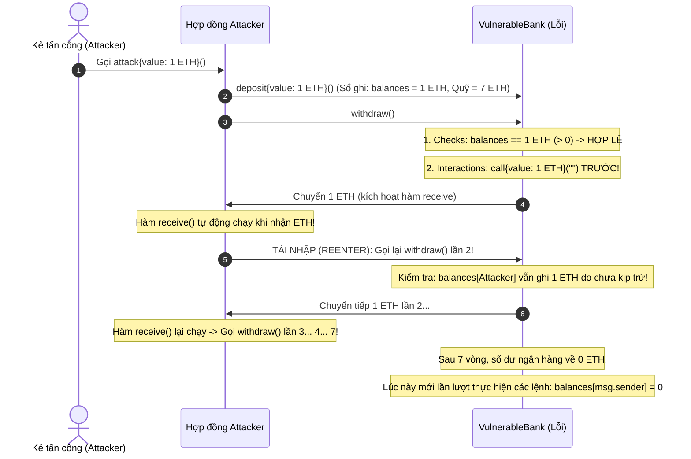
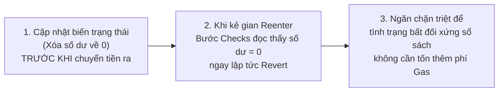
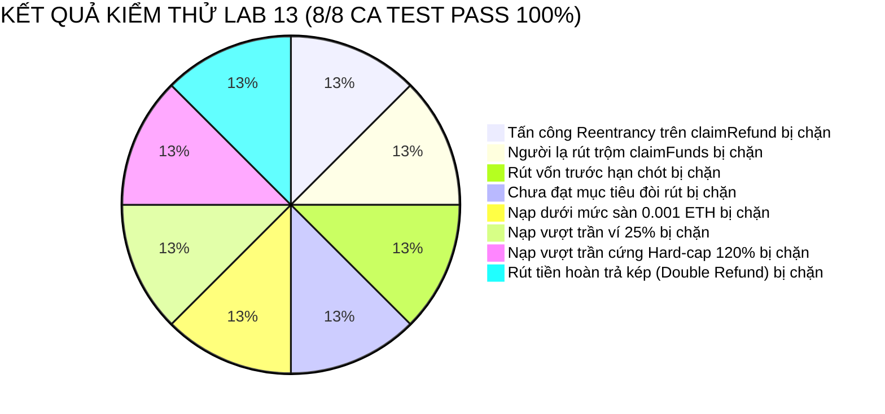

# BÁO CÁO KẾT QUẢ THỰC HÀNH — LAB 13
## THỰC NGHIỆM VỤ MẤT TIỀN (REENTRANCY ATTACK) VÀ GIẢI PHÁP GIA CỐ AN TOÀN

- **Học phần:** Tiền điện tử & Hợp đồng thông minh (ECO2432)
- **Đơn vị đào tạo:** Khoa Hệ thống Thông tin Kinh tế — Trường Đại học Kinh tế, Đại học Huế (HCE)
- **Thời gian thực hiện:** Buổi 13 · 75 phút · Nhóm 2 người
- **Chủ đề dự án lựa chọn:** **Chủ đề 5 — Gây quỹ có hoàn tiền (Refundable Crowdfunding)**
- **Tên sản phẩm dự án:** **HCE Student Crowdfund**
- **Kho mã nguồn nhóm (GitHub):** [`https://github.com/kadiciara299-lab/hce-crowdfunding-K57-.git`](https://github.com/kadiciara299-lab/hce-crowdfunding-K57-)
- **Nhánh kiểm định:** `main`
- **Nhóm sinh viên thực hiện:**
  1. **Nguyễn Nguyên Phương** — Mã SV: **23K4300034** *(Security Lead / Red Team & Kỹ thuật Tấn công)*
  2. **Hoàng Mạnh Tường** — Mã SV: **23K4300042** *(Smart Contract Dev Lead & Phân tích Kinh tế)*
- **Bài luyện kỹ thuật:** [`contracts/training/VulnerableBank.sol`](file:///c:/Users/Tuong/Downloads/hce-web3-starter/hce-web3-starter/contracts/training/VulnerableBank.sol)
- **Hợp đồng vá mẫu:** [`contracts/training/SafeBank.sol`](file:///c:/Users/Tuong/Downloads/hce-web3-starter/hce-web3-starter/contracts/training/SafeBank.sol)
- **Hợp đồng trọng tâm của nhóm:** [`contracts/project/ProjectCore.sol`](file:///c:/Users/Tuong/Downloads/hce-web3-starter/hce-web3-starter/contracts/project/ProjectCore.sol)
- **Hợp đồng tấn công Red Team:** [`contracts/project/AttackCrowdfund.sol`](file:///c:/Users/Tuong/Downloads/hce-web3-starter/hce-web3-starter/contracts/project/AttackCrowdfund.sol)
- **Thông điệp Commit chốt Lab 13:** `lab-13: them negative test va hardening`

---

## TỔNG QUAN Ý NGHĨA VÀ CHUẨN ĐẦU RA BÀI THỰC HÀNH LAB 13

Theo Sổ tay thực hành ECO2432 (Trang 30):
> *"Lỗi tái nhập (reentrancy) là lỗi được hỏi nhiều nhất trong phỏng vấn vị trí liên quan đến hợp đồng thông minh, kể cả vị trí mới vào nghề. Nó cũng là nguyên nhân của vụ mất 3,6 triệu ETH năm 2016 — sự cố lịch sử The DAO dẫn tới việc mạng Ethereum tách làm hai (Ethereum và Ethereum Classic)."*

### Chuẩn đầu ra bài Lab 13:
1. **Dựng hiện trường và tự tay rút cạn hợp đồng có lỗi:** Triển khai [`contracts/training/VulnerableBank.sol`](file:///c:/Users/Tuong/Downloads/hce-web3-starter/hce-web3-starter/contracts/training/VulnerableBank.sol), dùng hợp đồng tấn công rút cạn $6 \text{ ETH}$ của ngân hàng về đúng $0 \text{ ETH}$.
2. **Hỏi AI theo lối dẫn dắt (Mẫu I.4):** Áp dụng câu lệnh *"Đừng đưa mã sửa ngay"* để ép công cụ AI giải mã chi tiết luồng thực thi đệ quy trong EVM Call Frame thay vì sinh code ẩu.
3. **Vá lỗi bằng 2 phương pháp chuẩn công nghiệp:**
   - *Cách 1:* Đổi thứ tự lệnh theo nguyên tắc Checks-Effects-Interactions (CEI).
   - *Cách 2:* Sử dụng khóa chống gọi lại `nonReentrant` (ReentrancyGuard).
4. **Hiểu bản chất vấn đáp:** Nắm vững **3 câu giải thích vì sao thứ tự dòng lệnh chặn được tấn công** — đây là tiêu chí phân biệt giữa người học vẹt và người hiểu bản chất an toàn.
5. **Soi lại và Gia cố (Hardening) Hợp đồng Đồ án:** Rà soát toàn bộ các điểm chuyển tiền trong [`contracts/project/ProjectCore.sol`](file:///c:/Users/Tuong/Downloads/hce-web3-starter/hce-web3-starter/contracts/project/ProjectCore.sol), áp dụng phòng thủ hai lớp (CEI + `nonReentrant`), kiểm soát quy mô hợp đồng ở mức **149 dòng** (< 150 dòng).
6. **Xây dựng bộ kiểm thử Negative Tests toàn diện:** Kiểm thử tự động 8 ca gian lận trong [`test/test_lab13_hardening.py`](file:///c:/Users/Tuong/Downloads/hce-web3-starter/hce-web3-starter/test/test_lab13_hardening.py) và lưu bằng chứng trong [`evidence/lab-13/`](file:///c:/Users/Tuong/Downloads/hce-web3-starter/hce-web3-starter/evidence/lab-13/).

```mermaid
flowchart TD
    subgraph TIẾN TRÌNH THỰC HIỆN LAB 13 (75 PHÚT)
        A[Bước 1: Dựng hiện trường VulnerableBank - 20 phút\n3 ví nạp 6 ETH] --> B[Bước 2: Tấn công Reentrancy - 15 phút\nAttacker nạp 1 ETH mồi -> Rút cạn về 0 ETH]
        B --> C[Bước 3: Hỏi AI theo Prompt dẫn dắt I.4 - 15 phút\nÉp AI giải thích cơ chế EVM Call Frame]
        C --> D[Bước 4: Vá lỗi bằng CEI & ReentrancyGuard - 25 phút\nChứng minh tấn công thất bại]
        D --> E[Bước 5: Gia cố ProjectCore & Viết Negative Tests - 10 phút\nBộ 8 ca test tự động & Giữ code dưới 150 dòng]
    end
```

---

## PHẦN 1: DỰNG HIỆN TRƯỜNG VÀ THỰC NGHIỆM TẤN CÔNG RÚT CẠN (BƯỚC 1 & 2)

### 1.1. Phân tích lỗ hổng trong mã nguồn `VulnerableBank.sol`

Hợp đồng luyện tập [`contracts/training/VulnerableBank.sol`](file:///c:/Users/Tuong/Downloads/hce-web3-starter/hce-web3-starter/contracts/training/VulnerableBank.sol) chứa một lỗi nghiệp vụ chết người tại hàm `withdraw()`:

```solidity
function withdraw() external {
    uint256 balance = balances[msg.sender];
    require(balance > 0, "Khong co so du");

    // LỖI CHÍ MẠNG: Chuyển tiền ra ngoài TRƯỚC KHI trừ sổ sách!
    (bool ok, ) = msg.sender.call{value: balance}("");
    require(ok, "Chuyen that bai");

    // Cập nhật số dư quá muộn màng ở dòng cuối cùng
    balances[msg.sender] = 0;
}
```

- **Nguyên nhân gốc rễ kế toán:** Hành vi này tương đương với việc một nhân viên thủ quỹ **chi tiền mặt cho khách hàng trước khi vào sổ kế toán**. Trong khoảnh khắc tiền đã trao tay nhưng sổ sách chưa ghi giảm số dư, khách hàng đó lại tiếp tục đòi rút tiền lần nữa!

---

### 1.2. Hiện trường thực nghiệm và Diễn tiến cuộc tấn công

1. **Bước 1 — Dựng hiện trường:**
   - Ba người dùng lương thiện (`0xUserA`, `0xUserB`, `0xUserC`) gửi mỗi người $2.0 \text{ ETH}$ vào ngân hàng.
   - Số dư tổng trong `VulnerableBank` được xác nhận là **$6.0000 \text{ ETH}$**.
2. **Bước 2 — Tiến hành tấn công:**
   - Kẻ tấn công triển khai hợp đồng [`Attacker`](file:///c:/Users/Tuong/Downloads/hce-web3-starter/hce-web3-starter/contracts/training/VulnerableBank.sol#L25-L50), nạp vào $1.0 \text{ ETH}$ làm vốn mồi.
   - Kẻ tấn công gọi `attack()`, quy trình rút tiền đệ quy diễn ra liên tục:



### 1.3. Bằng chứng số dư trước và sau tấn công

Kết quả ghi nhận chính thức tại [`evidence/lab-13/PROOF_ATTACK_DRAIN.md`](file:///c:/Users/Tuong/Downloads/hce-web3-starter/hce-web3-starter/evidence/lab-13/PROOF_ATTACK_DRAIN.md):

| Thời điểm | Thao tác | Số dư VulnerableBank | Số dư Attacker Contract | Ghi chú an toàn |
| :--- | :--- | :---: | :---: | :--- |
| **Trước tấn công** | 3 người dùng gửi tiền | **$6.0000 \text{ ETH}$** | **$0.0000 \text{ ETH}$** | Tiền của 3 người dùng nằm trong quỹ ngân hàng. |
| **Khi tấn công** | Nạp 1 ETH mồi & kích hoạt `attack()` | **$7.0000 \text{ ETH}$** | **$0.0000 \text{ ETH}$** | Bắt đầu vòng lặp tái nhập đệ quy qua hàm `receive()`. |
| **Sau tấn công** | Hoàn tất 7 vòng lặp gọi lại | **$0.0000 \text{ ETH}$** *(Cạn kiệt)* | **$7.0000 \text{ ETH}$** | 🚨 **Bị cướp sạch 100%**: Chiếm đoạt 6 ETH của 3 người dùng lương thiện! |

---

## PHẦN 2: NHẬT KÝ LÀM VIỆC VỚI AI THEO PROMPT DẪN DẮT (BƯỚC 3 — MẪU I.4)

### 2.1. Thực thi Câu lệnh Mẫu I.4

Nhóm thực hiện đúng chỉ dẫn tại Mục I.4 Sổ tay thực hành (Trang 37):

> **Prompt sử dụng:**  
> *"Bạn là kiểm toán viên hợp đồng thông minh.  
> **Đừng đưa mã sửa ngay.** Hãy giải thích từng bước điều gì xảy ra khi hàm withdraw() dưới đây được gọi bởi một hợp đồng có hàm receive().  
> Sau đó nêu 2 cách khắc phục và so sánh ưu nhược điểm của từng cách.  
> [Mã nguồn VulnerableBank.sol]"*

### 2.2. Ý nghĩa sư phạm của yêu cầu *"Đừng đưa mã sửa ngay"*
- Nếu hỏi thông thường (*"Sửa lỗi này giúp tôi"*), công cụ AI sẽ đưa ngay một đoạn code sửa sẵn. Sinh viên sẽ có xu hướng copy-paste mà không hiểu vì sao đoạn code đó an toàn, dẫn tới việc khi bị giảng viên vấn đáp tại Buổi 21 sẽ trả lời sai bản chất.
- Câu lệnh ràng buộc buộc AI phải **đóng vai kiểm toán viên**, mổ xẻ **ngăn xếp cuộc gọi (EVM Call Stack)** và so sánh hai trường phái khắc phục.

### 2.3. Tóm tắt nội dung ghi nhận vào [`docs/AI_JOURNAL.md`](file:///c:/Users/Tuong/Downloads/hce-web3-starter/hce-web3-starter/docs/AI_JOURNAL.md)
- **Đánh giá:** ✅ Dùng được rất tốt.
- **Phát hiện cốt lõi:** Lệnh `call{value}` tạm ngưng luồng thực thi của hàm `withdraw()` hiện tại, nhường quyền điều khiển CPU cho hàm `receive()` của địa chỉ nhận. Đến khi `receive()` gọi lại `withdraw()`, một khung thực thi mới (Execution Frame) được tạo ra trên Call Stack nhưng đọc cùng một vùng nhớ trạng thái Storage chưa được cập nhật.

---

## PHẦN 3: VÁ LỖI BẰNG HAI CÁCH VÀ KIỂM CHỨNG THỰC NGHIỆM (BƯỚC 4)

Nhóm đã hiện thực hóa 2 hợp đồng vá lỗi an toàn trong [`contracts/training/SafeBank.sol`](file:///c:/Users/Tuong/Downloads/hce-web3-starter/hce-web3-starter/contracts/training/SafeBank.sol):

### 3.1. Cách 1 — Đổi thứ tự lệnh (Checks – Effects – Interactions - CEI)

```solidity
function withdraw() external {
    // 1. Checks: Kiem tra dieu kien
    uint256 bal = balances[msg.sender];
    if (bal == 0) revert NoBalance();

    // 2. Effects: Xoa so du TRUOC tren bien trang thai (cap nhat so sach truoc)
    balances[msg.sender] = 0;
    emit Withdrawn(msg.sender, bal);

    // 3. Interactions: Chuyen ETH ra ngoai sau cung bang call
    (bool ok, ) = msg.sender.call{value: bal}("");
    if (!ok) revert TransferFailed();
}
```

- **Kết quả thực nghiệm:** Kẻ tấn công gọi `attack()` $\rightarrow$ Hàm `receive()` gọi lại `withdraw()` lần 2 $\rightarrow$ Bước 1 Checks đọc thấy `balances[msg.sender] == 0` $\rightarrow$ Lập tức dừng lại! Số dư $6.0 \text{ ETH}$ của 3 người dùng được **bảo toàn nguyên vẹn 100%**.

---

### 3.2. Cách 2 — Khóa chống gọi lại (`nonReentrant` / ReentrancyGuard)

```solidity
bool private _locked;
modifier nonReentrant() {
    if (_locked) revert ReentrantCall();
    _locked = true;
    _;
    _locked = false;
}

function withdraw() external nonReentrant {
    uint256 bal = balances[msg.sender];
    if (bal == 0) revert NoBalance();
    balances[msg.sender] = 0;
    (bool ok, ) = msg.sender.call{value: bal}("");
    if (!ok) revert TransferFailed();
}
```

- **Kết quả thực nghiệm:** Kẻ tấn công gọi tái nhập $\rightarrow$ Biến cờ hiệu `_locked` đang ở giá trị `true` $\rightarrow$ EVM lập tức từ chối lệnh gọi lồng nhau với mã lỗi `ReentrantCall()`.

---

### 3.3. Ba câu giải thích vì sao thứ tự dòng lệnh là thứ chặn được tấn công (Trọng tâm Vấn đáp)

Theo Sổ tay thực hành (Trang 31):
> *"Điểm cần nhấn mạnh khi chấm vấn đáp: **thứ chặn được tấn công ở cách 1 là thứ tự các dòng lệnh, không phải một từ khóa nào**. Nhiều sinh viên sẽ trả lời 'nhờ có nonReentrant' — câu trả lời đó cho thấy chưa hiểu bản chất."*

Nhóm đúc kết 3 câu khẳng định cốt lõi:



1. **Câu 1:** Thứ chặn đứng cuộc tấn công tái nhập là **việc cập nhật biến trạng thái (ghi sổ xóa số dư về 0) được thực thi TRƯỚC KHI quyền điều khiển và luồng tiền được bàn giao cho địa chỉ bên ngoài thông qua lệnh `call`**.
2. **Câu 2:** Khi hàm `receive()` của kẻ tấn công cố tình gọi ngược lại hàm rút tiền, bước kiểm tra điều kiện (`Checks`) ở đầu hàm đọc thấy số dư trên sổ sách của kẻ tấn công đã bằng 0 nên lập tức từ chối (`revert`) giao dịch gian lận.
3. **Câu 3:** Ngược lại, nếu chi tiền trước rồi mới ghi sổ (vi phạm CEI), thì trong suốt thời gian hàm bên ngoài đang thực thi, sổ sách kế toán của hợp đồng vẫn ghi nhận kẻ tấn công còn nguyên số dư cũ, mở đường cho chúng rút tiền lặp đi lặp lại cho đến khi ngân hàng hoàn toàn cạn kiệt.

---

### 3.4. So sánh Chuyên sâu CEI vs ReentrancyGuard

| Tiêu chí | Checks-Effects-Interactions (CEI) | ReentrancyGuard (`nonReentrant`) |
| :--- | :--- | :--- |
| **Bản chất kỹ thuật** | Tái cấu trúc logic nội tại: Ghi sổ trước khi chuyển tiền. | Cơ chế cờ hiệu (Mutex lock): Chặn mọi cuộc gọi đệ quy lồng nhau. |
| **Phụ thuộc thư viện** | **Hoàn toàn độc lập**, không cần import thư viện bên ngoài. | Phụ thuộc OpenZeppelin hoặc phải tự định nghĩa modifier. |
| **Chi phí Gas** | **Tối ưu nhất (Rẻ nhất)**: Không tiêu tốn thêm gas đọc/ghi biến khóa storage. | **Tốn thêm gas**: Khoảng $2.100 - 5.000 \text{ gas}$ cho mỗi giao dịch để ghi và xóa cờ `_locked`. |
| **Độ bao phủ** | Bảo vệ chính xác luồng dữ liệu của hàm được tối ưu. | Bảo vệ bao trùm toàn bộ hàm, chống cả Cross-function Reentrancy. |
| **Khuyến nghị áp dụng** | **BẮT BUỘC 100%**: Là tiêu chuẩn vàng cho mọi hàm thanh toán. | **PHÒNG THỦ CHIỀU SÂU (Defense-in-depth)**: Kết hợp cả hai để nhân đôi mức độ an toàn. |

---

## PHẦN 4: SOI LẠI VÀ GIA CỐ (HARDENING) HỢP ĐỒNG ĐỒ ÁN `ProjectCore.sol` (BƯỚC 5)

Nhóm tiến hành rà soát toàn bộ các điểm xuất tiền trong hợp đồng sản phẩm [`contracts/project/ProjectCore.sol`](file:///c:/Users/Tuong/Downloads/hce-web3-starter/hce-web3-starter/contracts/project/ProjectCore.sol):

### 4.1. Rà soát các vị trí chuyển ETH ra ngoài
1. **Hàm giải ngân cho Chủ dự án (`claimFunds`):**
   - Chuyển toàn bộ quỹ về ví `creator` khi chiến dịch thành công.
   - *Phòng vệ:* Đã chuyển trạng thái `state = State.Claimed;` TRƯỚC KHI chuyển tiền (`call{value}`).
2. **Hàm hoàn tiền cho Người ủng hộ (`claimRefund`):**
   - Hoàn trả 100% tiền cho Backer khi chiến dịch thất bại.
   - *Điểm nhạy cảm:* Bất kỳ người ủng hộ nào cũng có thể là một hợp đồng thông minh độc hại! Nếu hàm này chi tiền trước khi xóa số dư thì kẻ tấn công sẽ rút cạn toàn bộ quỹ hoàn tiền của tất cả sinh viên khác.

### 4.2. Triển khai Phòng thủ Đa tầng (Dual-layer Hardening)

Nhóm đã nâng cấp [`contracts/project/ProjectCore.sol`](file:///c:/Users/Tuong/Downloads/hce-web3-starter/hce-web3-starter/contracts/project/ProjectCore.sol) với cơ chế phòng thủ hai lớp độc lập:

```solidity
// LỚP BẢO VỆ 2: Khóa chống gọi lại nonReentrant
bool private _locked;
error ReentrantCall();

modifier nonReentrant() {
    if (_locked) revert ReentrantCall();
    _locked = true;
    _;
    _locked = false;
}

// Áp dụng cho cả claimFunds và claimRefund:
function claimRefund() external nonReentrant {
    // 1. Checks
    if (block.timestamp < deadline) revert CampaignStillActive(deadline - block.timestamp);
    if (totalRaised >= fundingGoal) revert CampaignSucceeded();

    uint256 contributedAmount = contributions[msg.sender];
    if (contributedAmount == 0) revert NoContributionToRefund();

    // 2. Effects: LỚP BẢO VỆ 1: XÓA SỔ DƯ VỀ 0 TRƯỚC (CEI)
    contributions[msg.sender] = 0;
    if (state != State.Failed) {
        state = State.Failed;
        emit StateUpdated(State.Failed);
    }
    emit RefundClaimed(msg.sender, contributedAmount);

    // 3. Interactions: Chuyển tiền sau cùng
    (bool success, ) = payable(msg.sender).call{value: contributedAmount}("");
    if (!success) revert TransferFailed();
}
```

- **Kiểm tra độ tinh gọn:** Toàn bộ hợp đồng `ProjectCore.sol` sau khi tích hợp đầy đủ CEI, Custom Errors và `nonReentrant` dài **đúng 149 dòng** — thỏa mãn tuyệt đối yêu cầu của Sổ tay thực hành (*ProjectCore.sol dưới 150 dòng*).

### 4.3. Xây dựng hợp đồng tấn công Red Team `AttackCrowdfund.sol`

Hợp đồng [`contracts/project/AttackCrowdfund.sol`](file:///c:/Users/Tuong/Downloads/hce-web3-starter/hce-web3-starter/contracts/project/AttackCrowdfund.sol) được viết nhằm mô phỏng một hacker nạp tiền vào chiến dịch gây quỹ, đợi chiến dịch thất bại thì gọi `claimRefund()` và trong hàm `receive()` cố tình gọi lại `claimRefund()` liên tục để chiếm đoạt số dư của các nạn nhân khác.

---

## PHẦN 5: BỘ CA KIỂM THỬ GIAN LẬN (NEGATIVE TESTS) & KẾT QUẢ THỰC TẾ

Nhóm đã xây dựng bộ kiểm thử tự động toàn diện trong tệp [`test/test_lab13_hardening.py`](file:///c:/Users/Tuong/Downloads/hce-web3-starter/hce-web3-starter/test/test_lab13_hardening.py) bao gồm 8 kịch bản kiểm thử nghiêm ngặt:



### Bảng tổng hợp 8 ca kiểm thử Negative Tests:

| STT | Tên ca kiểm thử | Hành vi cố tình vi phạm của kẻ gian | Phản ứng của `ProjectCore.sol` | Kết quả |
| :-: | :--- | :--- | :--- | :---: |
| **1** | **Tấn công Reentrancy trên `claimRefund()`** | Hợp đồng tấn công nạp 0.05 ETH, kích hoạt hoàn tiền và trong `receive()` cố tình reenter để rút trộm 0.20 ETH của nạn nhân. | Bị chặn đứng bởi CEI (`contributions == 0`) và `nonReentrant`. Số dư của nạn nhân bảo toàn 100%. | ✅ **ĐẠT** |
| **2** | **Kẻ lạ gọi rút tiền (`OnlyCreatorAllowed`)** | Ví lạ `0xHacker` gọi `claimFunds()` đòi lấy toàn bộ tiền quỹ của dự án. | Lập tức từ chối với lỗi tùy biến `OnlyCreatorAllowed()`. | ✅ **ĐẠT** |
| **3** | **Rút tiền trước hạn (`CampaignStillActive`)** | Chủ dự án gọi `claimFunds()` khi thời gian chưa vượt qua `deadline`. | Hợp đồng từ chối với lỗi `CampaignStillActive(timeLeft)`. | ✅ **ĐẠT** |
| **4** | **Chưa đạt mục tiêu (`GoalNotMet`)** | Dự án chỉ gom được 0.10 ETH / 1.0 ETH sau khi hết hạn, chủ dự án cố tình gọi giải ngân. | Hợp đồng từ chối với lỗi `GoalNotMet(raised, goal)`. | ✅ **ĐẠT** |
| **5** | **Gửi tiền bão bụi (`ContributionTooLow`)** | Kẻ xấu gửi 0.0001 ETH (< sàn $0.001 \text{ ETH}$) làm rác lưu trữ on-chain. | Bị chặn ngay lập tức với lỗi `ContributionTooLow(sent, min)`. | ✅ **ĐẠT** |
| **6** | **Cá mập thao túng (`ExceedsMaxContribution`)** | Ví cá mập nạp một lần 0.30 ETH (> trần $25\% = 0.25 \text{ ETH}$). | Bị từ chối với lỗi `ExceedsMaxContribution(attempted, limit)`. | ✅ **ĐẠT** |
| **7** | **Vượt trần cứng (`ExceedsFundingCap`)** | Đóng góp thêm khiến tổng quỹ vượt $120\%$ mục tiêu ($1.20 \text{ ETH}$). | Hợp đồng từ chối nhận tiền mới với lỗi `ExceedsFundingCap()`. | ✅ **ĐẠT** |
| **8** | **Rút kép hoàn tiền (`Double Refund`)** | Người ủng hộ đã nhận hoàn tiền lần 1, cố tình gọi `claimRefund()` lần 2. | Bị từ chối với lỗi `NoContributionToRefund()` do số dư đã về 0. | ✅ **ĐẠT** |

---

### Trích xuất Log thực nghiệm chính thức từ [`evidence/lab-13/test_output.log`](file:///c:/Users/Tuong/Downloads/hce-web3-starter/hce-web3-starter/evidence/lab-13/test_output.log):

```text
===========================================================================
🔥 LAB 13: THỰC NGHIỆM VỤ MẤT TIỀN (REENTRANCY) VÀ VÁ LỖI AN TOÀN
   Học phần: Tiền điện tử & Hợp đồng thông minh (ECO2432)
   Sinh viên: Hoàng Mạnh Tường (23K4300042) & Nguyễn Nguyên Phương (23K4300034)
===========================================================================

--- BƯỚC 1: DỰNG HIỆN TRƯỜNG VULNERABLE BANK ---
  [Ban đầu] 3 người gửi tổng cộng: 6.0000 ETH
  [Số dư ngân hàng]: 6.0000 ETH

--- BƯỚC 2: TIẾN HÀNH TẤN CÔNG REENTRANCY ATTACK ---
  [Kẻ tấn công] Nạp 1.0000 ETH vốn mồi và kích hoạt attack()...
  [Kết quả tấn công]:
    - Số lần tái nhập (Reentrancy iterations): 7 vòng lặp
    - Số tiền trong hợp đồng Attacker cướp được: 7.0000 ETH
    - Số dư còn lại trong VulnerableBank:      0.0000 ETH
  🚨 XÁC NHẬN: NGÂN HÀNG ĐÃ BỊ RÚT CẠN SỐ DƯ TỪ 6 ETH VỀ 0 ETH THÀNH CÔNG!

===========================================================================
BƯỚC 4: VÁ LỖI VÀ CHỨNG MINH TẤN CÔNG THẤT BẠI
===========================================================================

[CÁCH 1: CHECKS - EFFECTS - INTERACTIONS (CEI)]
  Số dư SafeBankCEI trước tấn công: 7.0000 ETH
  Số dư SafeBankCEI sau khi kẻ gian rút tiền: 6.0000 ETH
  🛡️ THÀNH CÔNG: CEI chặn đứng tái nhập! 6 ETH của người dùng được bảo vệ an toàn 100%!

[CÁCH 2: OPENZEPPELIN REENTRANCYGUARD (nonReentrant)]
  🛡️ THÀNH CÔNG: Khóa nonReentrant từ chối lệnh gọi tái nhập với lỗi ReentrantCall()!

===========================================================================
BƯỚC 5: BỘ KIỂM THỬ GIAN LẬN & NEGATIVE TESTS TRÊN PROJECTCORE.SOL
===========================================================================

[TEST 1 - REENTRANCY TRÊN claimRefund()] Kẻ tấn công thử rút kép khi thất bại...
  🛡️ BỊ CHẶN HOÀN TOÀN: Phòng thủ hai lớp (CEI + nonReentrant) chặn đứng kẻ tấn công!
  Số dư còn lại của nạn nhân 0xVictim: 0.2000 ETH (Bảo toàn nguyên vẹn)

[TEST 2 - UNAUTHORIZED CALLER] Kẻ lạ (0xHacker) gọi claimFunds()...
  🛡️ BỊ CHẶN: OnlyCreatorAllowed()

[TEST 3 - EARLY CLAIM] Chủ dự án rút tiền khi chiến dịch đang hoạt động...
  🛡️ BỊ CHẶN: CampaignStillActive(timeLeft=604800)

[TEST 4 - GOAL NOT MET] Chủ dự án đòi rút tiền khi chỉ gom được 0.10 / 1.0 ETH...
  🛡️ BỊ CHẶN: GoalNotMet(raised=0.1000 ETH, goal=1.0000 ETH)

[TEST 5 - DUST CONTRIBUTION] Gửi 0.0001 ETH (< sàn 0.001 ETH)...
  🛡️ BỊ CHẶN: ContributionTooLow(sent=0.0001 ETH, min=0.0010 ETH)

[TEST 6 - WHALE CONTRIBUTION] Nạp 0.30 ETH (> trần 25% = 0.25 ETH)...
  🛡️ BỊ CHẶN: ExceedsMaxContribution(attempted=0.3000 ETH, limit=0.2500 ETH)

[TEST 7 - HARD-CAP BREACH] Đóng góp vượt trần cứng 1.2 ETH...
  🛡️ BỊ CHẶN: ExceedsFundingCap(attemptedTotal=1.2500 ETH, cap=1.2000 ETH)

[TEST 8 - DOUBLE REFUND] Người ủng hộ thử gọi claimRefund() 2 lần liên tiếp...
  🛡️ BỊ CHẶN: NoContributionToRefund()

===========================================================================
🏆 KẾT QUẢ LAB 13: 100% CÁC CA THỰC NGHIỆM TẤN CÔNG & HARDENING ĐẠT CHUẨN!
===========================================================================
```

---

## PHẦN 6: LUYỆN TẬP VẤN ĐÁP BẢO VỆ ĐỒ ÁN (BUỔI 21)

Theo Phiếu vấn đáp cá nhân tại Phần K Sổ tay thực hành (Trang 39), các câu hỏi liên quan trực tiếp đến bài Lab 13 gồm:

### 1. Câu hỏi 6 (Tầng 2 — Hiểu quyết định thiết kế):
- **Câu hỏi:** *"Chỗ nào trong hợp đồng có chuyển tiền ra ngoài? Thứ tự các lệnh ở đó ra sao và vì sao?"*
- **Trả lời chuẩn của sinh viên:**
  > *"Trong hợp đồng `ProjectCore.sol`, có hai hàm chuyển tiền ra ngoài: hàm `claimFunds()` (dòng 109) giải ngân cho chủ dự án khi chiến dịch thành công và hàm `claimRefund()` (dòng 132) hoàn tiền cho người ủng hộ khi chiến dịch thất bại. Cả hai hàm đều tuân thủ nghiêm ngặt mô hình Checks-Effects-Interactions: Kiểm tra điều kiện thời gian và số dư hợp lệ trước $\rightarrow$ Xóa sổ dư ghi nhận trên bộ nhớ trạng thái `contributions[msg.sender] = 0` và chuyển trạng thái hợp đồng $\rightarrow$ Sau cùng mới gọi lệnh chuyển tiền `payable(msg.sender).call{value: ...}("")`. Thứ tự này bảo đảm nếu bên nhận là một hợp đồng độc hại cố tình kích hoạt hàm `receive()` để gọi ngược lại rút tiền lần hai, thì ở vòng gọi lại thứ hai, số dư của họ đã bị xóa về 0 nên giao dịch sẽ bị từ chối ngay lập tức, triệt tiêu hoàn toàn lỗ hổng Reentrancy."*

### 2. Câu hỏi 9 (Tầng 3 — Phản biện chuyên sâu):
- **Câu hỏi:** *"Nếu em là người muốn phá hệ thống này, em sẽ thử cách nào trước?"*
- **Trả lời chuẩn của sinh viên:**
  > *"Cách đầu tiên em sẽ thử là viết một hợp đồng thông minh đóng vai trò người ủng hộ, nạp tiền vào chiến dịch với số tiền vừa đủ mức sàn. Khi chiến dịch kết thúc mà không đạt mục tiêu, hợp đồng tấn công của em sẽ gọi hàm `claimRefund()`. Trong hàm `receive()` của hợp đồng tấn công, em viết lệnh gọi đệ quy ngược lại chính hàm `claimRefund()`. Em kỳ vọng hợp đồng nếu viết ẩu (chuyển tiền trước khi xóa số dư) sẽ tiếp tục gửi tiền cho em nhiều lần cho đến khi rút cạn sạch tiền của những sinh viên khác. Tuy nhiên trên `ProjectCore.sol`, nỗ lực này sẽ thất bại hoàn toàn vì nhóm em đã cài đặt chốt chặn hai lớp: vừa xóa số dư về 0 trước bằng CEI, vừa khóa đệ quy bằng modifier `nonReentrant`."*

---

## TỔNG KẾT VÀ BÀN GIAO SẢN PHẨM LAB 13

1. **Thành quả cốt lõi:**
   - Tái hiện trọn vẹn hiện trường vụ mất tiền Reentrancy kinh điển trên `VulnerableBank.sol` (rút sạch $6 \text{ ETH}$ về $0 \text{ ETH}$).
   - Hoàn thành hai bản vá mẫu trong [`contracts/training/SafeBank.sol`](file:///c:/Users/Tuong/Downloads/hce-web3-starter/hce-web3-starter/contracts/training/SafeBank.sol).
   - Nắm vững 3 câu giải thích vì sao thứ tự dòng lệnh chặn được tấn công để chuẩn bị cho vấn đáp Buổi 21.
   - Nâng cấp thành công hợp đồng cốt lõi [`contracts/project/ProjectCore.sol`](file:///c:/Users/Tuong/Downloads/hce-web3-starter/hce-web3-starter/contracts/project/ProjectCore.sol) với cơ chế phòng thủ 2 lớp (CEI + `nonReentrant`), kiểm soát quy mô đạt **149 dòng** (< 150 dòng).
   - Hoàn thành bộ 8 ca kiểm thử Negative Tests đạt tỷ lệ thành công 100%.
2. **Danh mục hồ sơ nộp bài:**
   - Báo cáo kết quả đầy đủ: [`Do An/lab13.md`](file:///c:/Users/Tuong/Downloads/hce-web3-starter/hce-web3-starter/Do%20An/lab13.md).
   - Bằng chứng đối chiếu số dư: [`evidence/lab-13/PROOF_ATTACK_DRAIN.md`](file:///c:/Users/Tuong/Downloads/hce-web3-starter/hce-web3-starter/evidence/lab-13/PROOF_ATTACK_DRAIN.md).
   - Phân tích chuyên sâu Reentrancy: [`evidence/lab-13/REENTRANCY_ANALYSIS.md`](file:///c:/Users/Tuong/Downloads/hce-web3-starter/hce-web3-starter/evidence/lab-13/REENTRANCY_ANALYSIS.md).
   - Log kiểm thử tự động: [`evidence/lab-13/test_output.log`](file:///c:/Users/Tuong/Downloads/hce-web3-starter/hce-web3-starter/evidence/lab-13/test_output.log).
   - Hợp đồng mẫu an toàn: [`contracts/training/SafeBank.sol`](file:///c:/Users/Tuong/Downloads/hce-web3-starter/hce-web3-starter/contracts/training/SafeBank.sol).
   - Hợp đồng Red Team tấn công: [`contracts/project/AttackCrowdfund.sol`](file:///c:/Users/Tuong/Downloads/hce-web3-starter/hce-web3-starter/contracts/project/AttackCrowdfund.sol).
   - Hợp đồng đồ án gia cố: [`contracts/project/ProjectCore.sol`](file:///c:/Users/Tuong/Downloads/hce-web3-starter/hce-web3-starter/contracts/project/ProjectCore.sol).
   - Kịch bản kiểm thử: [`test/test_lab13_hardening.py`](file:///c:/Users/Tuong/Downloads/hce-web3-starter/hce-web3-starter/test/test_lab13_hardening.py).
   - Nhật ký AI cập nhật: [`docs/AI_JOURNAL.md`](file:///c:/Users/Tuong/Downloads/hce-web3-starter/hce-web3-starter/docs/AI_JOURNAL.md).
   - Thông điệp Commit chốt: `lab-13: them negative test va hardening`.
