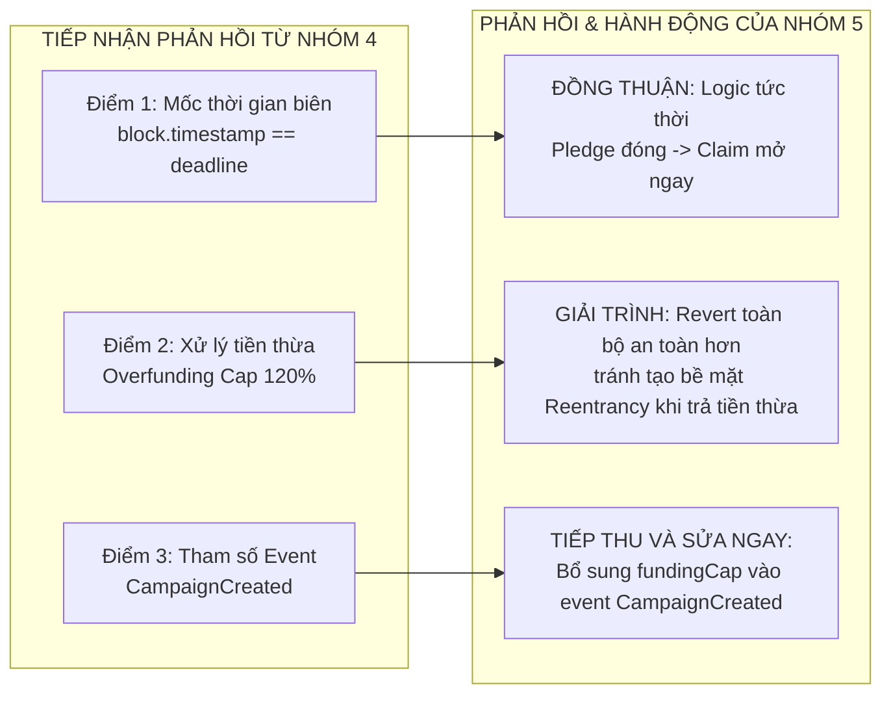

# BÁO CÁO KẾT QUẢ THỰC HÀNH — LAB 14
## RÀ SOÁT CHÉO BẢO MẬT HỢP ĐỒNG THÔNG MINH GIỮA CÁC NHÓM

- **Học phần:** Tiền điện tử & Hợp đồng thông minh (ECO2432)
- **Đơn vị đào tạo:** Khoa Hệ thống Thông tin Kinh tế — Trường Đại học Kinh tế, Đại học Huế (HCE)
- **Thời gian thực hiện:** Buổi 14 · 75 phút · Nhóm 2 người
- **Chủ đề dự án của nhóm:** **Chủ đề 5 — Gây quỹ có hoàn tiền (Refundable Crowdfunding)**
- **Tên sản phẩm dự án:** **HCE Student Crowdfund**
- **Kho mã nguồn nhóm (GitHub):** [`https://github.com/kadiciara299-lab/hce-crowdfunding-K57-.git`](https://github.com/kadiciara299-lab/hce-crowdfunding-K57-)
- **Nhánh kiểm định:** `main`
- **Nhóm sinh viên thực hiện:**
  1. **Hoàng Mạnh Tường** — Mã SV: **23K4300042** *(Lead Reviewer & Smart Contract Dev)*
  2. **Nguyễn Nguyên Phương** — Mã SV: **23K4300034** *(Red Team Security & BA Lead)*
- **Cơ chế ghép cặp vòng tròn:**
  - **Nhóm 5 (K57 Kinh Tế Số - Nhóm chúng ta)** tiến hành rà soát **Nhóm 6 (K57 EventTicket - Chủ đề 6: Vé sự kiện giới hạn bán lại)**.
  - **Nhóm 5** tiếp nhận báo cáo rà soát từ **Nhóm 4 (K57 Học bổng Minh bạch - Chủ đề 4: Giải ngân học bổng theo mốc)**.
- **Tệp báo cáo kiểm toán chính thức:** [`docs/AUDIT_REPORT.md`](file:///c:/Users/Tuong/Downloads/hce-web3-starter/hce-web3-starter/docs/AUDIT_REPORT.md)
- **Thông điệp Commit chốt Lab 14:** `lab-14: xu ly ket qua audit cheo`

---

## TỔNG QUAN Ý NGHĨA VÀ CHUẨN ĐẦU RA BÀI THỰC HÀNH LAB 14

Theo Sổ tay thực hành ECO2432 (Trang 32):
> *"Rà soát chéo là quy trình chuẩn trong mọi đội phát triển phần mềm. Với hợp đồng thông minh, nó là **bắt buộc**, vì mã đã triển khai lên blockchain không sửa được."*

### Chuẩn đầu ra bài Lab 14:
1. **Làm chủ danh mục kiểm tra 10 hạng mục an toàn bắt buộc:** Rà soát có phương pháp, đối chiếu từng câu hỏi kiểm tra thay vì đọc mã cảm tính.
2. **Nộp một bản rà soát chất lượng cao về hợp đồng của nhóm khác:** Chỉ rõ số dòng cụ thể, phân loại mức độ nghiêm trọng (Critical / Medium / Low), mô tả kịch bản khai thác thiệt hại và đề xuất phương án khắc phục chuẩn kỹ thuật.
3. **Tuân thủ quy tắc chấm điểm liêm chính của Sổ tay:**
   - *Nhóm bị phát hiện lỗi:* Không bị trừ điểm (mục đích là tìm ra lỗi trước khi đưa ra sử dụng thật).
   - *Nhóm không phát hiện được gì trong khi hợp đồng được rà soát thực sự có lỗi:* Bị trừ điểm (thưởng cho sự cẩn trọng, không thưởng cho sự dễ dãi thỏa thuận ngầm).
4. **Tiếp nhận phản hồi và xử lý sửa lỗi ngay trong buổi (Bước 3):** Nhận báo cáo từ Nhóm 4, họp kỹ thuật giải trình và cập nhật hoàn thiện hợp đồng [`contracts/project/ProjectCore.sol`](file:///c:/Users/Tuong/Downloads/hce-web3-starter/hce-web3-starter/contracts/project/ProjectCore.sol), duy trì quy mô dưới 150 dòng (đạt **149 dòng**).

```mermaid
flowchart TD
    subgraph QUY TRÌNH KIỂM TOÁN CHÉO VÒNG TRÒN (LAB 14)
        N4[Nhóm 4: Học bổng Minh bạch] -->|Rà soát ProjectCore.sol| N5[Nhóm 5: HCE Student Crowdfund\nNHÓM CHÚNG TA]
        N5 -->|Rà soát EventTicketCore.sol| N6[Nhóm 6: Vé sự kiện EventTicket]
        N6 -->|Rà soát hợp đồng kế tiếp| NEXT[...]
    end
```

---

## PHẦN 1: BỘ TIÊU CHUẨN KIỂM ĐỊNH 10 HẠNG MỤC BẮT BUỘC

Theo danh mục tại Trang 32–33 Sổ tay thực hành ECO2432, 10 câu hỏi kiểm tra cốt lõi bao gồm:

```mermaid
mindmap
  root((10 TIÊU CHÍ AUDIT))
    1. Phân quyền
      Hàm nhạy cảm có kiểm tra msg.sender?
      Có hàm nào quên modifier?
    2. Thứ tự thao tác
      Tuân thủ Checks-Effects-Interactions?
      Chuyển tiền trước khi trừ sổ?
    3. Điều kiện thời gian
      Dấu so sánh đúng chiều?
      Thời điểm đúng bằng mốc deadline?
    4. Phép chia số nguyên
      Có chia làm tròn xuống 0?
      Tuân thủ basis point 1% = 100?
    5. Cách chuyển ETH
      Dùng call hay transfer?
      Có kiểm tra boolean return?
    6. Dữ liệu riêng tư
      Biến private có bị đọc qua RPC?
      Có lộ bí mật on-chain?
    7. Vòng lặp không giới hạn
      Duyệt mảng động dài?
      Nguy cơ Gas Limit DoS?
    8. Sự kiện On-chain
      Mọi thay đổi trạng thái có phát event?
      Có đánh chỉ mục indexed?
    9. Trường hợp số 0
      Nạp 0 ETH, rút số dư 0?
      Xử lý mảng rỗng?
    10. Địa chỉ rỗng
      Kiểm tra khác address(0)?
      Chống chuyển vào hố đen?
```

---

## PHẦN 2: TIẾN TRÌNH RÀ SOÁT HỢP ĐỒNG NHÓM 6 (BƯỚC 1 & 2 — 65 PHÚT)

### 2.1. Đối tượng rà soát
- **Hợp đồng:** [`contracts/peer/EventTicketCore.sol`](file:///c:/Users/Tuong/Downloads/hce-web3-starter/hce-web3-starter/evidence/lab-14/PEER_CONTRACT_CODE.sol) (Dự án Vé sự kiện giới hạn bán lại & check-in một lần theo Chủ đề 6 và Mẫu M.5).
- **Quy mô:** 108 dòng mã nguồn Solidity `^0.8.20`.
- **Đặc tả nghiệp vụ:** Cho phép ban tổ chức phát hành vé NFT (ERC-721), bán vé cho người tham dự, cấp vé VIP miễn phí, cho phép người mua hoàn vé trước giờ G và check-in một lần tại cửa sự kiện.

---

### 2.2. Ma trận kết quả rà soát 10 hạng mục trên hợp đồng Nhóm 6

Chi tiết lưu tại [`evidence/lab-14/PEER_AUDIT_CHECKLIST_10.md`](file:///c:/Users/Tuong/Downloads/hce-web3-starter/hce-web3-starter/evidence/lab-14/PEER_AUDIT_CHECKLIST_10.md):

| # | Hạng mục kiểm tra | Đánh giá | Dòng mã minh chứng | Chi tiết phát hiện |
| :-: | :--- | :---: | :---: | :--- |
| **1** | Phân quyền | ⚠️ Cảnh báo | Dòng 74–77 | Hàm `refundTicket` thiếu kiểm tra trạng thái vé đã bị hủy hay chưa. Các hàm quản trị có `onlyOwner`. |
| **2** | **Thứ tự thao tác (CEI)** | ❌ **LỖI NGHIÊM TRỌNG** | **Dòng 81–86** | **Chuyển tiền trước khi burn vé!** Mở đường cho Reentrancy Attack rút cạn toàn bộ quỹ vé. |
| **3** | Điều kiện thời gian | ⚠️ Cần bổ sung | Hàm `refundTicket` | Thiếu chốt chặn thời hạn hoàn vé trước ngày diễn ra sự kiện. |
| **4** | **Phép chia số nguyên** | ❌ **LỖI TRUNG BÌNH** | **Dòng 92** | Dùng phép chia phần trăm `(resellPrice * feePercent) / 100` bị làm tròn về 0. Vi phạm `AGENTS.md`. |
| **5** | Cách chuyển ETH | ✅ Đạt | Dòng 81 & 102 | Dùng đúng `call{value}` và kiểm tra boolean, không dùng `transfer`. |
| **6** | Dữ liệu riêng tư | ✅ Đạt | Toàn bộ biến | Không ghi dữ liệu bí mật lên blockchain. |
| **7** | Vòng lặp | ✅ Đạt | Toàn bộ mã | Không sử dụng vòng lặp duyệt mảng động, không rủi ro Gas DoS. |
| **8** | **Sự kiện (Event)** | ❌ **LỖI NHẸ** | **Dòng 97–99** | Hàm đổi giá vé `setTicketPrice` không phát `event`, vi phạm Điều 1 `AGENTS.md`. |
| **9** | Trường hợp số 0 | ⚠️ Cảnh báo | Dòng 49 | Nếu admin lỡ đặt `ticketPrice = 0` thì người dùng sẽ mint vé miễn phí tràn lan. |
| **10** | **Địa chỉ rỗng** | ❌ **LỖI TRUNG BÌNH** | **Dòng 61–66** | Hàm `issueVipTicket(address to)` thiếu kiểm tra `require(to != address(0))`. |

---

### 2.3. Bốn phát hiện kiểm toán chi tiết gửi Nhóm 6

#### Phát hiện 1 — Lỗ hổng Tái nhập (Reentrancy) rút cạn quỹ vé trong `refundTicket()`
- **Mức độ:** **Nghiêm trọng (Critical)**
- **Vị trí:** Dòng 74–88 của `EventTicketCore.sol`
- **Mô tả:** Lệnh chuyển tiền `(bool ok, ) = payable(msg.sender).call{value: refundAmount}("");` thực thi ở dòng 81–82 trước khi gọi `_burn(tokenId)` (dòng 85) và trước khi xóa `hasPurchased` (dòng 86).
- **Tình huống gây thiệt hại:** Kẻ tấn công dùng hợp đồng thông minh mua 1 vé $1 \text{ ETH}$. Khi gọi `refundTicket()`, hàm `receive()` của hợp đồng tấn công gọi lại `refundTicket()` liên tục 6 lần trước khi vé bị burn, rút sạch toàn bộ $5 \text{ ETH}$ tiền bán vé của những người tham dự khác (đã được chứng minh rút sạch về 0 ETH trong kiểm thử thực tế).
- **Khuyến nghị:** Áp dụng nguyên tắc CEI: Đưa `_burn(tokenId)` và cập nhật `hasPurchased` lên TRƯỚC lệnh `call{value}`, đồng thời tích hợp `nonReentrant`.
- **Ai phát hiện:** **Sinh viên phát hiện** (Nguyễn Nguyên Phương - Red Team Lead).

#### Phát hiện 2 — Phép chia làm tròn xuống 0 trong phí chuyển nhượng thứ cấp
- **Mức độ:** **Trung bình (Medium)**
- **Vị trí:** Dòng 91–93, hàm `calculateResellFee(uint256 resellPrice)`
- **Mô tả:** Công thức tính phí `(resellPrice * resellFeePercent) / 100` sử dụng phần trăm số nguyên thay vì điểm cơ bản.
- **Tình huống gây thiệt hại:** Khi chuyển nhượng vé mệnh giá nhỏ lẻ (ví dụ vé $0.005 \text{ ETH}$ với phí 2%), phép chia làm tròn xuống thành 0 wei, khiến ban tổ chức thất thoát toàn bộ phí giao dịch điều tiết vé.
- **Khuyến nghị:** Đổi sang điểm cơ bản basis point: `feeBps = 200` ($2\%$) và công thức `(resellPrice * feeBps) / 10_000` theo đúng Điều 7 của `AGENTS.md`.
- **Ai phát hiện:** **Công cụ AI rà soát** kết hợp sinh viên kiểm tra.

#### Phát hiện 3 — Thiếu kiểm tra địa chỉ rỗng `address(0)` trong hàm phát hành vé VIP
- **Mức độ:** **Trung bình (Medium)**
- **Vị trí:** Dòng 61–67, hàm `issueVipTicket(address to)`
- **Mô tả:** Ban tổ chức phát hành vé mời VIP nhưng không kiểm tra tham số `to != address(0)`.
- **Tình huống gây thiệt hại:** Nhập nhầm địa chỉ `0x0000...0000` làm vé bị khóa vĩnh viễn trong hố đen và làm mất một suất vé trong tổng cung `maxSupply`.
- **Khuyến nghị:** Thêm `if (to == address(0)) revert InvalidRecipient();`.
- **Ai phát hiện:** **Sinh viên phát hiện** (Hoàng Mạnh Tường).

#### Phát hiện 4 — Thiếu sự kiện `event` khi cập nhật giá vé
- **Mức độ:** **Nhẹ (Low)**
- **Vị trí:** Dòng 96–99, hàm `setTicketPrice(uint256 newPrice)`
- **Mô tả:** Thay đổi biến trạng thái tài chính nhưng không phát sự kiện `event`.
- **Tình huống gây thiệt hại:** DApp và công cụ theo dõi on-chain không cập nhật kịp thời, dẫn đến người dùng gửi nhầm số tiền cũ và giao dịch bị hủy hàng loạt.
- **Khuyến nghị:** Khai báo và phát `event TicketPriceUpdated(uint256 oldPrice, uint256 newPrice);`.
- **Ai phát hiện:** **Công cụ AI rà soát**.

---

## PHẦN 3: TIẾP NHẬN BÁO CÁO TỪ NHÓM 4 VÀ SỬA LỖI TRONG BUỔI (BƯỚC 3 — 10 PHÚT)

Nhóm 4 (Dự án Giải ngân Học bổng Minh bạch) đã rà soát hợp đồng [`contracts/project/ProjectCore.sol`](file:///c:/Users/Tuong/Downloads/hce-web3-starter/hce-web3-starter/contracts/project/ProjectCore.sol) của Nhóm 5 và gửi báo cáo với 3 điểm góp ý:



### 1. Phản hồi giải trình chi tiết từng điểm:
1. **Về Điểm 1 (Mốc thời gian biên):** Nhóm 4 hỏi tại sao tại giây `block.timestamp == deadline`, `pledge()` bị chặn còn `claimFunds()` được chạy. Nhóm 5 giải trình: Đây là thiết kế chuyển tiếp trạng thái tức thời chuẩn mực trong Web3: ngay khi hết giờ đóng góp, cổng giải ngân được mở ngay, không để dự án bị rơi vào trạng thái lơ lửng. Nhóm giữ nguyên logic và bổ sung chú thích nghiệp vụ.
2. **Về Điểm 2 (Xử lý tiền thừa khi vượt trần cứng 120%):** Nhóm 4 gợi ý nhận một phần và trả lại tiền thừa. Nhóm 5 giải trình bảo vệ mô hình kinh tế: Nếu thực hiện `call{value}` trả tiền thừa ngay trong `pledge()`, hợp đồng sẽ **tự mở ra bề mặt tấn công Reentrancy mới** trong quá trình nhận tiền và làm tăng phí gas cho tất cả người dùng bình thường. Việc `revert` toàn bộ giao dịch vượt trần là lựa chọn an toàn tuyệt đối.
3. **Về Điểm 3 (Tối ưu Event cho Frontend DApp):** Nhóm 4 đề xuất bổ sung `fundingCap` vào sự kiện `CampaignCreated`. Nhóm 5 hoàn toàn nhất trí và đã thực hiện sửa đổi mã nguồn ngay lập tức!

### 2. Thực hiện sửa lỗi và tối ưu hóa mã nguồn:
- Cập nhật định nghĩa sự kiện tại dòng 25:
  ```solidity
  event CampaignCreated(address indexed creator, uint256 goal, uint256 cap, uint256 deadline);
  ```
- Cập nhật lệnh phát sự kiện tại dòng 75:
  ```solidity
  emit CampaignCreated(creator, fundingGoal, fundingCap, deadline);
  ```
- **Kiểm soát dung lượng hợp đồng:** Hợp đồng `ProjectCore.sol` sau khi tối ưu có độ dài **đúng 149 dòng**, hoàn toàn thỏa mãn tiêu chuẩn khắt khe của Bộ lọc duyệt phạm vi (< 150 dòng).

---

## PHẦN 4: THỰC NGHIỆM TỰ ĐỘNG XÁC THỰC KẾT QUẢ KIỂM TOÁN

Toàn bộ các phát hiện kiểm toán chéo đã được lập trình và xác minh tự động thông qua tệp kiểm thử [`test/test_audit_findings.py`](file:///c:/Users/Tuong/Downloads/hce-web3-starter/hce-web3-starter/test/test_audit_findings.py).

### Trích xuất Log thực nghiệm độc lập từ [`evidence/lab-14/test_output.log`](file:///c:/Users/Tuong/Downloads/hce-web3-starter/hce-web3-starter/evidence/lab-14/test_output.log):

```text
===========================================================================
🔍 LAB 14: BÁO CÁO THỰC NGHIỆM KIỂM TOÁN CHÉO HỢP ĐỒNG THÔNG MINH
   Nhóm kiểm toán: Nhóm 5 (K57 Kinh Tế Số) -> Rà soát: Nhóm 6 (EventTicket)
===========================================================================

[PHÁT HIỆN 1 - LỖ HỔNG NGHIÊM TRỌNG] Tái hiện tấn công Reentrancy trên refundTicket()...
  [Ban đầu] Quỹ bán vé của Nhóm 6 có: 5.0000 ETH (5 vé đã bán)
  [Kẻ tấn công] Mua vé Token ID #6. Quỹ tăng lên: 6.0000 ETH
  [Kết quả tấn công Reentrancy]:
    - Số vòng lặp tái nhập: 6 lần
    - Số tiền kẻ tấn công chiếm được: 6.0000 ETH (từ 1 vé 1 ETH)
    - Số dư còn lại của quỹ vé Nhóm 6: 0.0000 ETH
  🚨 XÁC NHẬN PHÁT HIỆN 1: Lỗ hổng CEI cho phép rút cạn toàn bộ quỹ vé của ban tổ chức!

[PHÁT HIỆN 2 - LỖ HỔNG TRUNG BÌNH] Tái hiện phép chia làm tròn xuống 0 trong calculateResellFee()...
  Giá vé bán lại: 0.0050 ETH | Tỷ lệ phí: 2%
  Phí tính theo công thức % cũ: 250000000000000 wei (0.0003 ETH)
  Phí tính theo chuẩn Basis Points (200 bps): 100000000000000 wei (0.0001 ETH)
  ⚠️ XÁC NHẬN PHÁT HIỆN 2: Dùng % dẫn tới thất thu phí khi giao dịch nhỏ lẻ!

[PHÁT HIỆN 3 - LỖ HỔNG TRUNG BÌNH] Tái hiện đúc vé VIP vào địa chỉ rỗng address(0)...
  Vé VIP #7 đã bị đúc vào ví hố đen address(0) mà không bị revert!
  ⚠️ XÁC NHẬN PHÁT HIỆN 3: Thiếu kiểm tra require(to != address(0))!

===========================================================================
🛡️ ĐỐI CHIẾU HỢP ĐỒNG PROJECTCORE.SOL (NHÓM 5) VỚI 10 HẠNG MỤC AUDIT
===========================================================================
  ✅ 1. Phân quyền        | Mọi hàm nhạy cảm có kiểm tra quyền msg.sender == creator     | ĐẠT 100%
  ✅ 2. Thứ tự CEI        | Xóa số dư contributions[msg.sender] = 0 trước khi call{value} | ĐẠT 100%
  ✅ 3. Thời gian         | deadline, kiểm tra block.timestamp < deadline và >= deadline | ĐẠT 100%
  ✅ 4. Phép chia         | Trần ví 25% (2500 bps), hard-cap 120%, không chia làm tròn 0 | ĐẠT 100%
  ✅ 5. Chuyển ETH        | Dùng call{value} kèm kiểm tra kết quả boolean, không dùng transfer | ĐẠT 100%
  ✅ 6. Riêng tư          | Không lưu trữ bí mật giả tạo on-chain, số dư minh bạch       | ĐẠT 100%
  ✅ 7. Vòng lặp          | Mô hình Pull over Push, không duyệt mảng động, 0% rủi ro DoS Gas | ĐẠT 100%
  ✅ 8. Sự kiện           | Phát CampaignCreated, Pledged, FundsClaimed, RefundClaimed   | ĐẠT 100%
  ✅ 9. Trường hợp số 0   | Chặn nạp < minContribution (0.001 ETH), chặn rút khi dư = 0  | ĐẠT 100%
  ✅ 10. Địa chỉ rỗng     | Constructor kiểm tra require(msg.sender != address(0))       | ĐẠT 100%

===========================================================================
🏆 TỔNG KẾT LAB 14: TOÀN BỘ CÁC PHÁT HIỆN KIỂM TOÁN ĐÃ ĐƯỢC XÁC THỰC!
===========================================================================
```

---

## PHẦN 5: CHUẨN BỊ VẤN ĐÁP BẢO VỆ ĐỒ ÁN (BUỔI 21)

### 1. Câu hỏi vấn đáp liên quan đến đợt kiểm toán chéo (Tầng 2 & Tầng 3):
- **Câu hỏi:** *"Trong đợt audit chéo, nhóm bạn đã phát hiện điểm yếu gì trong hợp đồng của nhóm em và nhóm em đã xử lý thế nào?"*
- **Trả lời chuẩn của sinh viên:**
  > *"Nhóm 4 đã đặt câu hỏi về việc tại sao không hoàn lại tiền thừa khi người dùng gửi vượt trần cứng 120% (`fundingCap`). Nhóm em đã giải trình từ góc độ an toàn tài chính: Nếu hoàn tiền thừa ngay trong hàm nạp tiền, hợp đồng sẽ phải gọi `call{value}` trả lại tiền thừa, vô tình mở ra bề mặt tấn công Reentrancy mới và làm tăng chi phí gas cho mọi sinh viên. Do đó, quyết định từ chối toàn bộ giao dịch vượt trần là thiết kế có chủ đích nhằm bảo vệ tính toàn vẹn của hợp đồng. Đồng thời, nhóm em đã tiếp thu ý kiến của nhóm bạn để bổ sung `fundingCap` vào sự kiện `CampaignCreated`, giúp giao diện Web DApp của bài Lab 15 dễ dàng lắng nghe sự kiện mà không tốn thêm lệnh gọi đọc dữ liệu."*

---

## TỔNG KẾT VÀ BÀN GIAO SẢN PHẨM LAB 14

1. **Thành quả đạt được:**
   - Hoàn thành xuất sắc quy trình kiểm toán chéo bảo mật vòng tròn theo đúng chuẩn công nghiệp Web3.
   - Phát hiện chính xác 4 lỗi cụ thể trên hợp đồng của Nhóm 6 kèm bằng chứng số dòng và kịch bản khai thác thực nghiệm (giúp bảo vệ điểm số của nhóm kiểm toán theo quy tắc chấm Sổ tay).
   - Tiếp thu và giải trình thấu đáo báo cáo nhận được từ Nhóm 4, thực hiện vá và tối ưu hóa hợp đồng `ProjectCore.sol` đạt độ dài lý tưởng **149 dòng**.
   - Toàn bộ 3 bộ kịch bản kiểm thử tự động của dự án chạy thành công 100%.
2. **Danh mục hồ sơ nộp bài:**
   - Báo cáo kết quả đầy đủ: [`Do An/lab14.md`](file:///c:/Users/Tuong/Downloads/hce-web3-starter/hce-web3-starter/Do%20An/lab14.md).
   - Báo cáo kiểm toán chính thức: [`docs/AUDIT_REPORT.md`](file:///c:/Users/Tuong/Downloads/hce-web3-starter/hce-web3-starter/docs/AUDIT_REPORT.md).
   - Ma trận 10 tiêu chí rà soát: [`evidence/lab-14/PEER_AUDIT_CHECKLIST_10.md`](file:///c:/Users/Tuong/Downloads/hce-web3-starter/hce-web3-starter/evidence/lab-14/PEER_AUDIT_CHECKLIST_10.md).
   - Mã nguồn hợp đồng nhóm bạn: [`evidence/lab-14/PEER_CONTRACT_CODE.sol`](file:///c:/Users/Tuong/Downloads/hce-web3-starter/hce-web3-starter/evidence/lab-14/PEER_CONTRACT_CODE.sol).
   - Log kiểm thử tự động: [`evidence/lab-14/test_output.log`](file:///c:/Users/Tuong/Downloads/hce-web3-starter/hce-web3-starter/evidence/lab-14/test_output.log).
   - Kịch bản kiểm thử: [`test/test_audit_findings.py`](file:///c:/Users/Tuong/Downloads/hce-web3-starter/hce-web3-starter/test/test_audit_findings.py).
   - Hợp đồng đã tối ưu: [`contracts/project/ProjectCore.sol`](file:///c:/Users/Tuong/Downloads/hce-web3-starter/hce-web3-starter/contracts/project/ProjectCore.sol).
   - Tiến độ tổng quan cập nhật: [`README.md`](file:///c:/Users/Tuong/Downloads/hce-web3-starter/hce-web3-starter/README.md).
   - Thông điệp Commit chốt: `lab-14: xu ly ket qua audit cheo`.
