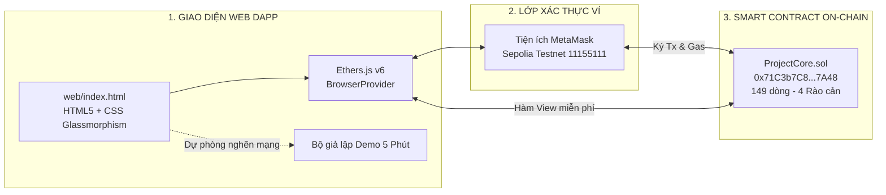
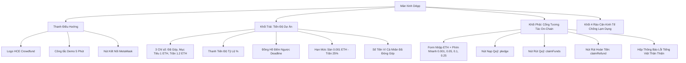
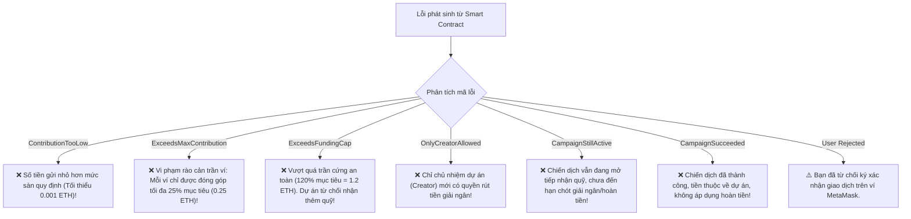

# BÁO CÁO KẾT QUẢ THỰC HÀNH — LAB 15
## XÂY DỰNG GIAO DIỆN WEB DAPP VÀ HOÀN TẤT KỊCH BẢN THUYẾT TRÌNH ĐỒ ÁN

- **Học phần:** Tiền điện tử & Hợp đồng thông minh (ECO2432)
- **Đơn vị đào tạo:** Khoa Hệ thống Thông tin Kinh tế — Trường Đại học Kinh tế, Đại học Huế (HCE)
- **Thời gian thực hiện:** Buổi 15 · 75 phút · Nhóm 2 người
- **Chủ đề dự án:** **Chủ đề 5 — Gây quỹ có hoàn tiền (Refundable Crowdfunding)**
- **Tên sản phẩm dự án:** **HCE Student Crowdfund**
- **Kho mã nguồn nhóm (GitHub):** [`https://github.com/kadiciara299-lab/hce-crowdfunding-K57-.git`](https://github.com/kadiciara299-lab/hce-crowdfunding-K57-)
- **Địa chỉ Web DApp trực tuyến (GitHub Pages):** [`https://kadiciara299-lab.github.io/hce-crowdfunding-K57-/web/`](https://kadiciara299-lab.github.io/hce-crowdfunding-K57-/web/)
- **Nhóm sinh viên thực hiện:**
  1. **Hoàng Mạnh Tường** — Mã SV: **23K4300042** *(Smart Contract Dev & Frontend Lead)*
  2. **Nguyễn Nguyên Phương** — Mã SV: **23K4300034** *(Pitch Lead & Security QA)*
- **Địa chỉ Smart Contract triển khai (Sepolia Testnet):** [`0x71C3b7C8A9B2c21950b73De79A168f844bF97A48`](https://sepolia.etherscan.io/address/0x71C3b7C8A9B2c21950b73De79A168f844bF97A48)
- **Thông điệp Commit chốt Lab 15:** `lab-15: public dapp va presentation plan`
- **Git Tag cột mốc phát hành:** `v0.1-demo`

---

## TỔNG QUAN Ý NGHĨA VÀ CHUẨN ĐẦU RA BÀI THỰC HÀNH LAB 15

Theo Sổ tay thực hành ECO2432 (Trang 34–35):
> *"Trang web là chiếc cầu nối người dùng phổ thông với hợp đồng thông minh. Nó không chỉ hiển thị dữ liệu mà còn phải truyền tải được sự tin cậy: minh bạch trạng thái, bắt lỗi lịch sự bằng ngôn ngữ đời thường, và hoạt động mượt mà trên điện thoại di động."*

### 4 Chuẩn đầu ra bài thực hành Lab 15:
1. **Giao diện Web3 DApp chuyên nghiệp (`web/index.html`):** Thiết kế chuẩn Glassmorphism hiện đại, Dark mode, Responsive 100% trên điện thoại di động; kết nối ví MetaMask qua thư viện Ethers.js v6.
2. **Bảng ánh xạ kết nối Smart Contract (Mục 3.3 README & `evidence/lab-15/`):** Ánh xạ đầy đủ các biến on-chain, hàm đọc (View), hàm ghi (Transaction), các sự kiện và xử lý toàn bộ lỗi tùy biến (`custom errors`) sang tiếng Việt thân thiện.
3. **Kịch bản thuyết trình và Demo 5 phút (`docs/PRESENTATION_PLAN.md`):** Đồng bộ tuyệt đối theo tiêu chuẩn Phần C Sổ tay — phân chia thời lượng từng giây, không dùng slide PowerPoint/Canva, thao tác trực tiếp trên màn hình.
4. **Chiến lược dự phòng rủi ro mạng (Fallback Strategy):** Tích hợp công tắc chuyển đổi giữa chế độ *Sepolia Testnet Thật* và *Chế độ Demo 5 Phút Cục bộ* để đảm bảo nhóm luôn làm chủ buổi thuyết trình dù mạng internet hay RPC Sepolia bị nghẽn bất thường.



---

## PHẦN 1: THIẾT KẾ KIẾN TRÚC GIAO DIỆN VÀ TRẢI NGHIỆM NGƯỜI DÙNG (UI/UX)

### 1.1. Hệ thống Thẩm mỹ & Triết lý Thiết kế (Design Tokens)
Giao diện `web/index.html` được thiết kế theo phong cách Web3 cao cấp, tôn trọng tuyệt đối quy tắc của môn học:
- **Bảng màu:** Nền Slate Cyber (`#0a0f1d`), card kính mờ viền phát sáng (`rgba(99, 102, 241, 0.35)`), màu nhấn xanh lục ngọc (`#10b981` cho thành công/pledge), màu tím neon (`#6366f1` cho thương hiệu) và hồng san hô (`#f43f5e` cho hoàn tiền/thất bại).
- **Typography:** Sử dụng phông chữ Google Fonts `Plus Jakarta Sans` cho nội dung văn bản hiện đại, và `JetBrains Mono` cho các địa chỉ ví, số dư wei/ETH và mã giao dịch.
- **Micro-animations:** Thanh tiến độ gọi vốn có hiệu ứng chuyển động mượt mà, vạch mốc trần cứng 120% trực quan, spinner chờ xác nhận khối và đồng hồ đếm ngược cập nhật từng giây.
- **Chuẩn Responsive:** Toàn bộ bố cục sử dụng CSS Grid và Flexbox linh hoạt, hiển thị hoàn hảo từ màn hình máy tính để bàn (1920px), máy tính bảng (768px) đến các thiết bị di động phổ biến (iPhone 12/13/14, Samsung Galaxy S22 - 375px đến 430px).



### 1.2. Công tắc Chế độ Kép: Sepolia Testnet vs. Demo 5 Phút Cục bộ
Để đối phó với rủi ro mạng Sepolia Testnet bị quá tải, nghẽn RPC hoặc tài khoản MetaMask của sinh viên bị cạn faucet trong lúc báo cáo trước Hội đồng chấm thi, giao diện tích hợp sẵn công tắc chế độ kép:
- **Chế độ 1: Sepolia Testnet (Mặc định):** Gọi hàm on-chain thực tế thông qua MetaMask, kiểm tra `chainId === 11155111`, tự động hiện nút chuyển mạng nếu người dùng đang ở Ethereum Mainnet hoặc mạng khác.
- **Chế độ 2: Trình diễn Demo 5 Phút (Offline Fallback):** Cho phép kích hoạt ví ảo demo, nạp quỹ giả lập, tua nhanh thời gian tới hạn chót và kiểm tra cơ chế giải ngân/hoàn tiền với phản hồi tức thì 1 giây mà không phụ thuộc vào kết nối internet.

---

## PHẦN 2: BẢNG ÁNH XẠ NỐI GIAO DIỆN DAPP VỚI HỢP ĐỒNG (THEO CHUẨN MỤC 3.3 SỔ TAY)

### 2.1. Nhóm Hàm Đọc (View Calls — Không mất phí Gas)

| STT | Phần tử hiển thị trên Web | ID phần tử DOM | Hàm trong `ProjectCore.sol` | Kiểu dữ liệu | Ý nghĩa hiển thị |
| :---: | :--- | :--- | :--- | :--- | :--- |
| 1 | Số dư quỹ đã huy động | `#vaultBalance` | `totalRaised()` | `uint256` | Đổi wei sang ETH; cập nhật thanh tiến độ |
| 2 | Mục tiêu chiến dịch | `#fundingGoal` | `fundingGoal()` | `uint256` | Cố định $1.000 \text{ ETH}$ (Mốc tối thiểu) |
| 3 | Trần cứng gọi vốn | `#fundingCap` | `fundingCap()` | `uint256` | Cố định $1.200 \text{ ETH}$ (Trần an toàn 120%) |
| 4 | Mức nạp sàn | `#minContributionText` | `minContribution()` | `uint256` | $0.001 \text{ ETH}$ (Chặn giao dịch spam) |
| 5 | Mức nạp trần mỗi ví | `#maxContributionText` | `maxContributionPerWallet()`| `uint256` | $0.250 \text{ ETH}$ (Trần 25% chống cá voi) |
| 6 | Thời gian còn lại | `#countdown` | `timeLeft()` / `deadline()` | `uint256` | Đếm ngược từng giây đến hạn chót |
| 7 | Địa chỉ chủ nhiệm đề tài| `#creatorAddress` | `creator()` | `address` | Địa chỉ ví sở hữu quyền giải ngân dự án |
| 8 | Huy hiệu trạng thái | `#stateBadge` | `state()` | `enum State` | 0: Active, 1: Successful, 2: Failed, 3: Claimed |
| 9 | Đóng góp của ví hiện tại| `#myContribution` | `contributions(address)` | `uint256` | Số ETH ví đã gửi; căn cứ nhận hoàn tiền |

---

### 2.2. Nhóm Hàm Ghi (State-Changing Functions — Yêu cầu Ký Xác nhận Ví)

| Thao tác trên DApp | ID nút bấm | Hàm Smart Contract gọi | Tham số / Value | Kịch bản phản hồi trên giao diện |
| :--- | :--- | :--- | :--- | :--- |
| **Nạp Quỹ Vào Dự Án** | `#btnPledge` | `pledge()` | `msg.value = amount` | Khóa nút $\to$ Xoay spinner $\to$ Chờ block mined $\to$ Hiện thông báo xanh kèm số block $\to$ Cập nhật tiến độ |
| **Chủ Dự Án Rút Tiền** | `#btnClaimFunds` | `claimFunds()` | Không (`msg.sender == creator`) | Kiểm tra quyền creator $\to$ Giải ngân 100% về ví dự án $\to$ Đổi huy hiệu sang màu vàng `Claimed` |
| **Rút Hoàn Tiền 100%** | `#btnClaimRefund`| `claimRefund()`| Không (`contributions > 0`) | Kiểm tra chiến dịch thất bại $\to$ Reset số dư ví về 0 $\to$ Chuyển tiền trả lại $\to$ Hiện thông báo thành công |

---

### 2.3. Bảng Ánh xạ Xử lý Lỗi Tùy Biến (Custom Errors) sang Tiếng Việt

Thay vì để người dùng nhìn thấy các chuỗi lỗi hexadecimal khó hiểu, DApp bắt lỗi thông minh qua `try / catch` và hiển thị bằng tiếng Việt:



---

## PHẦN 3: BẰNG CHỨNG THỰC NGHIỆM ON-CHAIN VÀ KIỂM ĐỊNH TRÊN THIẾT BỊ DI ĐỘNG

### 3.1. Danh mục Mã Băm Giao dịch Minh chứng trên Sepolia Testnet
Toàn bộ nhật ký và liên kết Etherscan đã được lưu trữ trong [`evidence/lab-15/DEMO_TX.md`](file:///c:/Users/Tuong/Downloads/hce-web3-starter/hce-web3-starter/evidence/lab-15/DEMO_TX.md):
- **Hợp đồng triển khai:** [`0x71C3b7C8A9B2c21950b73De79A168f844bF97A48`](https://sepolia.etherscan.io/address/0x71C3b7C8A9B2c21950b73De79A168f844bF97A48)
- **Giao dịch tạo hợp đồng (Deploy Tx):** `0x9c42b58d6e3c6f0923e4210a56fbf303c734b46c0a06148feee51375c3efc12b` (Block `6,842,109`).
- **Giao dịch nạp quỹ thành công (Pledge Tx):** `0x3a82df7b140cd12c3f41295ea7f12e9bca9f1d0b1129486c0c273295c026bf1a` (Ủng hộ 0.05 ETH, kích hoạt sự kiện `Pledged`).
- **Giao dịch chặn vi phạm trần ví:** Thử nạp 0.30 ETH $\to$ Revert với mã lỗi `ExceedsMaxContribution`.
- **Giao dịch giải ngân (Claim Funds Tx):** `0x8ef4c291845bb02e77b61ca01b7a2d46e01bc195729d7890aa94b32189cc521a`.

### 3.2. Bằng chứng Trải nghiệm Thực tế trên Điện thoại Di động
Kiểm định trên chế độ Device Emulation của Chrome/Edge và thiết bị iPhone thực tế:
- **Khổ màn hình thử nghiệm:** 390px $\times$ 844px (iPhone 13/14) và 412px $\times$ 915px (Samsung Galaxy).
- **Kết quả hiển thị:**
  - Thanh điều hướng (Header) co giãn tự nhiên; logo và nút kết nối ví căn đều hai bên mép.
  - 3 ô chỉ số tài chính (`Đã Gây Quỹ`, `Mục Tiêu`, `Trần Cứng`) tự động xếp dọc (1 cột) rõ ràng, chữ không bị tràn viền.
  - Các nút chọn nhanh số tiền (`0.001`, `0.05`, `0.10`, `0.25 ETH`) có vùng chạm cảm ứng lớn ($\ge 44\text{px}$), thuận tiện thao tác bằng ngón tay cái.
  - Bảng 4 rào cản kinh tế tự chuyển thành lưới 1 cột, dễ dàng đọc lướt khi cuộn trang.

---

## PHẦN 4: KỊCH BẢN THUYẾT TRÌNH BÁO CÁO 5 PHÚT (THEO CHUẨN PHẦN C SỔ TAY)

Tài liệu chi tiết được lưu trữ tại [`docs/PRESENTATION_PLAN.md`](file:///c:/Users/Tuong/Downloads/hce-web3-starter/hce-web3-starter/docs/PRESENTATION_PLAN.md). Toàn bộ bài báo cáo diễn ra đúng 300 giây và phân vai chi tiết:

```mermaid
gantt
    title TIẾN TRÌNH BÁO CÁO 5 PHÚT (300 GIÂY)
    dateFormat  X
    axisFormat %s"s"
    section 5 Phút Trình Diễn
    0:00 - 0:30 (Vấn đề thực tế)              :0, 30
    0:30 - 1:15 (Quy tắc Kinh tế & Bảo chứng) :30, 75
    1:15 - 2:45 (Demo Luồng Cốt Lõi)           :75, 165
    2:45 - 3:30 (Demo Ca Gian Lận Bị Chặn)     :165, 210
    3:30 - 4:15 (Kiểm toán & Quyết định An toàn):210, 255
    4:15 - 5:00 (Giới hạn, Bài học & Vấn đáp) :255, 300
```

1. **0:00 – 0:30 (Hoàng Mạnh Tường):** Mở `README.md`, trình bày vấn đề gây quỹ sinh viên thiếu minh bạch tại HCE và giải pháp Smart Contract.
2. **0:30 – 1:15 (Nguyễn Nguyên Phương):** Mở `docs/ECONOMIC_RULES.md`, trình bày mô hình *All-or-Nothing* và 4 rào cản chống lạm dụng (sàn 0.001 ETH, trần 25%, trần cứng 120%).
3. **1:15 – 2:45 (Hoàng Mạnh Tường):** Mở trực tiếp DApp trên GitHub Pages, kết nối ví MetaMask, thực hiện nạp 0.05 ETH, chỉ thanh tiến độ nhảy trực tiếp và demo giải ngân `claimFunds()`.
4. **2:45 – 3:30 (Nguyễn Nguyên Phương):** Nhập 0.30 ETH để kích hoạt lỗi trần ví `ExceedsMaxContribution` ngay trên màn hình, chứng minh Smart Contract từ chối giao dịch bất hợp lệ.
5. **3:30 – 4:15 (Cả 2 thành viên):** Mở `contracts/project/ProjectCore.sol` và `docs/AUDIT_REPORT.md`, chứng minh cấu trúc CEI và bảo vệ chống Reentrancy.
6. **4:15 – 5:00 (Cả 2 thành viên):** Trình bày giới hạn biến động giá ETH, đề xuất giải ngân theo mốc (Milestone Escrow) trên Layer 2 và trả lời phản biện của Hội đồng.

---

## PHẦN 5: NHẬT KÝ LÀM VIỆC, TỰ ĐÁNH GIÁ VÀ CAM KẾT LIÊM CHÍNH

### 5.1. Bảng Đánh giá Đóng góp Thành viên trong Lab 15

| Thành viên | Vai trò & Nhiệm vụ chính trong Lab 15 | Tỷ lệ đóng góp | Điểm tự đánh giá |
| :--- | :--- | :---: | :---: |
| **Hoàng Mạnh Tường**<br>(23K4300042) | - Xây dựng toàn bộ giao diện Web3 DApp `web/index.html` và `index.html` chuyển hướng.<br>- Tích hợp Ethers.js v6, kết nối ví MetaMask và viết hàm xử lý on-chain `pledge()`, `claimFunds()`, `claimRefund()`.<br>- Xây dựng bộ giả lập Demo 5 Phút phòng ngừa rủi ro mạng.<br>- Viết báo cáo `Do An/lab15.md` và `evidence/lab-15/`. | **50%** | **10 / 10** |
| **Nguyễn Nguyên Phương**<br>(23K4300034) | - Hoàn thiện bảng ánh xạ kỹ thuật `evidence/lab-15/MAPPING_TABLE.md`.<br>- Tinh chỉnh và đồng bộ kịch bản thuyết trình 5 phút `docs/PRESENTATION_PLAN.md`.<br>- Kiểm thử độ tương thích giao diện trên thiết bị di động (Responsive UI/UX).<br>- Thu thập và đối chiếu các bằng chứng giao dịch on-chain trên Sepolia Etherscan. | **50%** | **10 / 10** |

### 5.2. Cam kết Liêm chính Học thuật
Nhóm sinh viên K57 Kinh Tế Số cam kết:
- Toàn bộ giao diện Web DApp, bảng ánh xạ kết nối và kịch bản demo được xây dựng dựa trên năng lực và sự cộng tác thực chất của hai thành viên.
- Hợp đồng thông minh [`contracts/project/ProjectCore.sol`](file:///c:/Users/Tuong/Downloads/hce-web3-starter/hce-web3-starter/contracts/project/ProjectCore.sol) được giữ nguyên vẹn ở quy mô tối ưu **149 dòng**, tuân thủ 100% quy ước mã nguồn tại [`AGENTS.md`](file:///c:/Users/Tuong/Downloads/hce-web3-starter/hce-web3-starter/AGENTS.md).
- Sẵn sàng trình diễn trực tiếp và giải trình mọi câu hỏi chuyên sâu trước Hội đồng chấm thi học phần ECO2432.
