# BIÊN BẢN CỔNG DUYỆT 1 — GATE REVIEW 1: DUYỆT CODEBASE VÀ PHẠM VI DỰ ÁN

- **Học phần:** Tiền điện tử & Hợp đồng thông minh (ECO2432)
- **Đơn vị đào tạo:** Khoa Hệ thống Thông tin Kinh tế — Trường Đại học Kinh tế, Đại học Huế (HCE)
- **Thời gian đánh giá:** Buổi 12 (Tuần 4)
- **Dự án:** **HCE Student Crowdfund (Chủ đề 5 — Gây quỹ có hoàn tiền cho sinh viên)**
- **Kho mã nguồn nhóm:** [`https://github.com/kadiciara299-lab/hce-crowdfunding-K57-.git`](https://github.com/kadiciara299-lab/hce-crowdfunding-K57-)
- **Nhánh kiểm định:** `main`
- **Nhóm sinh viên thực hiện:**
  1. **Hoàng Mạnh Tường** — Mã SV: **23K4300042** *(Trưởng nhóm)*
  2. **Nguyễn Nguyên Phương** — Mã SV: **23K4300034**
- **Thông điệp Commit:** `lab-12: gate review 1 va cap nhat pham vi`

---

## I. KẾT LUẬN CHÍNH THỨC CỦA HỘI ĐỒNG / GIẢNG VIÊN

| Tiêu chí | Kết quả đánh giá | Ghi chú của Giảng viên |
| :--- | :---: | :--- |
| **Quyết định chung** | **QUA (PASS) — ĐẠT XUẤT SẮC (Level 3 - Giỏi ⭐⭐⭐)** | Codebase sạch, tài liệu đầy đủ, demo trôi chảy trong 3 phút, kiểm thử tự động phủ cả luồng thành công và gian lận. |
| **Độ khớp tài liệu & mã nguồn** | **100% Khớp** | `README.md`, `docs/PROJECT_PLAN.md`, `docs/SPEC.md`, `docs/ECONOMIC_RULES.md` phản ánh trung thực logic trong `ProjectCore.sol`. |
| **Quy mô hợp đồng cốt lõi** | **144 dòng (< 150 dòng)** | Đạt tiêu chuẩn tối ưu của Bộ lọc duyệt phạm vi Phần N Sổ tay ECO2432. |
| **Tính sẵn sàng cho Giai đoạn 2** | **Rất cao** | Đã hoàn thành xoay vai, phân công rõ ràng cho Lab 13 (Reentrancy), Lab 14 (Audit) và Lab 15 (DApp). |

---

## II. BƯỚC 1: KẾT QUẢ TỰ KIỂM TRA SỨC KHỎE REPOSITORY (15 PHÚT)

Trước phiên Gate Review 1, nhóm đã thực hiện rà soát độc lập sức khỏe repository theo 5 tiêu chí bắt buộc trong Sổ tay thực hành (Trang 29):

```mermaid
checklist
  title KIỂM TRA SỨC KHỎE REPOSITORY (5/5 ĐẠT)
  "README.md mô tả rõ bài toán, người dùng và hướng dẫn chạy" : done
  "PROJECT_PLAN.md, SPEC.md, ECONOMIC_RULES.md khớp 100% với mã" : done
  "ProjectCore.sol biên dịch hoàn toàn sạch trên Solidity ^0.8.20" : done
  "Có tối thiểu 1 ca hợp lệ và 1 ca gian lận/vi phạm bị chặn" : done
  "Lịch sử commit có đóng góp thực chất của tất cả thành viên" : done
```

### Chi tiết 5 tiêu chuẩn đối chiếu:

1. **`README.md` rõ ràng, định vị chuẩn xác:**
   - Nêu một câu định vị sản phẩm: Nền tảng gây quỹ cộng đồng cho sinh viên HCE với cơ chế cam kết hoàn tiền 100% (All-or-Nothing).
   - Mô tả đối tượng thụ hưởng: Câu lạc bộ, nhóm NCKH sinh viên cần vốn hạt giống; người ủng hộ (sinh viên, cựu sinh viên, giảng viên).
   - Hướng dẫn chạy và triển khai rõ ràng trên Remix IDE và Web DApp.

2. **Hệ thống hồ sơ đặc tả đồng bộ tuyệt đối với mã nguồn:**
   - [`docs/SPEC.md`](./SPEC.md): Định nghĩa 8 quy tắc nghiệp vụ cốt lõi (R1–R8) và 9 trường hợp ngoại lệ có mã lỗi tương ứng.
   - [`docs/ECONOMIC_RULES.md`](./ECONOMIC_RULES.md): Thiết lập 4 rào cản kinh tế: Sàn đóng góp $0.001 \text{ ETH}$ (chống dust attack), trần mỗi ví $25\%$ mục tiêu (chống whale attack), thời hạn 3–30 ngày, và trần cứng $120\%$ (`fundingCap`).
   - [`contracts/project/ProjectCore.sol`](../contracts/project/ProjectCore.sol): Thực thi chính xác các biến, điều kiện `require/revert` và sự kiện `event` như đặc tả.

3. **Khả năng biên dịch và tối ưu của Smart Contract:**
   - Biên dịch thành công 100% trên trình biên dịch Solidity `^0.8.20` (EV-version: Cancun/Shanghai), không sinh ra bất kỳ cảnh báo (`warning`) nào.
   - Dung lượng mã nguồn: **144 dòng** (thỏa mãn tiêu chí khắt khe: *ProjectCore.sol dưới 150 dòng*).

4. **Bộ ca kiểm thử tự động toàn diện:**
   - Kịch bản kiểm thử độc lập [`test/test_gate_review.py`](../test/test_gate_review.py) và [`test/test_economic_rules.py`](../test/test_economic_rules.py) chạy tự động.
   - Đạt 100% ca thử: Luồng thành công (Happy Path), ca nạp dưới sàn, ca nạp vượt trần ví, ca rút vốn trước hạn, ca người lạ rút trộm tiền, và ca rút kép hoàn tiền.

5. **Lịch sử đóng góp phân minh:**
   - Lịch sử Git ghi nhận commit đóng góp thực chất của cả 2 thành viên: Hoàng Mạnh Tường (`@23k4300042-lang`) và Nguyễn Nguyên Phương (`@kadiciara299-lab`).

---

## III. BƯỚC 2: TỔNG HỢP PHIÊN DEMO 3 PHÚT (180 GIÂY) TRƯỚC HỘI ĐỒNG

Phiên trình diễn trực tiếp diễn ra trong đúng 3 phút, tuân thủ quy tắc không dùng slide, mở trực tiếp các file trong repository và chạy kiểm thử tự động:

```mermaid
gantt
    title TIẾN ĐỘ TRÌNH DIỄN DEMO GATE REVIEW 1 (180 GIÂY)
    dateFormat  X
    axisFormat %s"s"
    section Kịch bản Demo
    1. Người dùng & Nỗi đau thực tế (Hoàng Mạnh Tường) :0, 30
    2. Quy tắc Kinh tế & Rào cản (Nguyễn Nguyên Phương):30, 60
    3. Demo Luồng Cốt lõi Thành công (Hoàng Mạnh Tường):60, 120
    4. Demo Ca Vi phạm Bị Chặn (Nguyễn Nguyên Phương)  :120, 150
    5. Kế hoạch Hoàn thành Tiếp theo (Cả 2 thành viên) :150, 180
```



1. **Phút 0:00 – 0:30 (30 giây) — Người dùng & Nỗi đau thực tế (Hoàng Mạnh Tường):**
   - *Vấn đề:* Sinh viên HCE khi gọi vốn cho đề tài NCKH hay sự kiện thường nhận tiền qua tài khoản ngân hàng/MoMo cá nhân. Khi dự án chỉ gom được 20–30% mục tiêu, dự án bị hủy nhưng việc hoàn tiền bị gián đoạn, phát sinh nghi ngờ biển thủ hoặc mất tiền.
   - *Giải pháp:* HCE Student Crowdfund khóa tiền bằng hợp đồng bảo chứng (Assurance Escrow); tiền chỉ giải ngân khi đủ 100% mục tiêu, nếu không đủ tiền tự động mở hoàn 100%.

2. **Phút 0:30 – 1:00 (30 giây) — Quy tắc Kinh tế Cốt lõi (Nguyễn Nguyên Phương):**
   - Trình bày mô hình *All-or-Nothing*.
   - Chỉ ra 4 rào cản kinh tế on-chain: Sàn $0.001 \text{ ETH}$, Trần ví $25\%$, Trần cứng $120\%$, Thời hạn tối đa 30 ngày. Không tính phí nền tảng cho sinh viên (0 bps).

3. **Phút 1:00 – 2:00 (60 giây) — Demo Luồng Cốt lõi Thành công (Hoàng Mạnh Tường):**
   - Mở [`contracts/project/ProjectCore.sol`](../contracts/project/ProjectCore.sol).
   - Chạy `test/test_gate_review.py`: 4 sinh viên nạp mỗi người 0.25 ETH $\rightarrow$ Đạt $1.0 \text{ ETH}$ (100% mục tiêu).
   - Thời gian vượt qua hạn chót (`advance_time`) $\rightarrow$ Chủ dự án gọi `claimFunds()` thành công, nhận 1.0 ETH; quỹ về 0; phát sinh sự kiện `FundsClaimed`.

4. **Phút 2:00 – 2:30 (30 giây) — Demo Các Ca Vi phạm Bị Chặn (Nguyễn Nguyên Phương):**
   - Thử gửi $0.0005 \text{ ETH}$ $\rightarrow$ Hợp đồng lập tức `revert ContributionTooLow()`.
   - Thử gửi $0.35 \text{ ETH}$ (> trần 0.25 ETH) $\rightarrow$ `revert ExceedsMaxContribution()`.
   - Chủ dự án cố rút tiền khi chưa hết hạn $\rightarrow$ `revert CampaignStillActive()`.
   - Kẻ lạ gọi `claimFunds()` $\rightarrow$ `revert OnlyCreatorAllowed()`.
   - Rút tiền hoàn trả lần 2 $\rightarrow$ `revert NoContributionToRefund()`.

5. **Phút 2:30 – 3:00 (30 giây) — Kế hoạch Công việc Tiếp theo (Cả 2 thành viên):**
   - Hoàn thành Lab 13: Mô phỏng tấn công Reentrancy trên hợp đồng lỗi `VulnerableBank.sol` và chứng minh `ProjectCore.sol` an toàn nhờ CEI.
   - Hoàn thành Lab 14: Rà soát chéo hợp đồng nhóm bạn theo bộ 10 tiêu chí chuẩn.
   - Hoàn thành Lab 15: Nối DApp lên mạng Sepolia và triển khai GitHub Pages công khai.

---

## IV. BƯỚC 3: QUYẾT ĐỊNH THU HẸP PHẠM VI DỰ ÁN (SCOPE REDUCTION)

Để tuân thủ nguyên tắc: *"Giữ một luồng cốt lõi chạy chắc, không cố giữ nhiều tính năng nửa vời"* và đáp ứng quy chuẩn của Sổ tay thực hành (mã nguồn hợp đồng không quá 150 dòng):

```mermaid
flowchart LR
    subgraph GIỮ LẠI TRỌNG TÂM (CORE MVP v0.1)
        A[Khởi tạo chiến dịch] --> B[Nhận đóng góp kèm 4 rào cản]
        B --> C[Giải ngân khi đạt mục tiêu sau hạn]
        B --> D[Tự động hoàn tiền 100% khi thất bại]
        C --> E[Bảo vệ CEI chống Reentrancy]
        D --> E
    end

    subgraph CẮT BỎ KHỎI MVP (SCOPE REDUCTION)
        X[CẮT: Biểu quyết gia hạn Voting Extension]
        Y[CẮT: Giải ngân theo chặng Milestone Release]
        Z[CẮT: Phát hành Token ERC-20 thưởng]
    end
```

### 1. Phạm vi cốt lõi được Hội đồng phê duyệt giữ lại (Core Scope):
- Cơ chế gây quỹ có điều kiện cam kết (All-or-Nothing Escrow).
- 4 chốt chặn kinh tế tự động: Sàn `minContribution`, Trần ví `maxContributionPerWallet`, Trần huy động `fundingCap`, Giới hạn thời gian `3 - 30 days`.
- Hai luồng kết thúc độc lập: Giải ngân cho Creator khi đạt mục tiêu; Tự rút hoàn 100% cho từng Backer khi thất bại.
- An toàn tuyệt đối: Khóa rút trước hạn, áp dụng chuẩn Checks-Effects-Interactions (CEI).

### 2. Các tính năng chính thức bị cắt bỏ (Cut Features):
- **Cắt bỏ tính năng Biểu quyết cộng đồng gia hạn chiến dịch (Campaign Voting Extension):** Tính năng này đòi hỏi cấu trúc mảng danh sách cử tri và tính toán tỷ lệ phiếu bầu phức tạp, tiềm ẩn nguy cơ lỗi Gas Limit DoS (đã phân tích ở Lab 10) và làm phình to hợp đồng thêm ~80 dòng.
- **Cắt bỏ tính năng Giải ngân chia chặng theo mốc (Milestone Release Tranches):** Cần hệ thống Oracle hoặc Hội đồng thẩm định độc lập để xác minh tiến độ đời thực, vượt quá năng lực kiểm soát on-chain của dự án sinh viên v0.1.
- **Cắt bỏ cơ chế phát hành Token ERC-20 thưởng:** Hợp đồng tập trung thuần túy vào đồng tiền gốc ETH để tối ưu chi phí gas và giảm thiểu bề mặt tấn công.

### 3. Ba việc bắt buộc sửa và hoàn thiện (3 Mandatory Action Items):

| STT | Nhiệm vụ bắt buộc | Mục tiêu kỹ thuật | Người chịu trách nhiệm | Hạn hoàn thành |
| :-: | :--- | :--- | :---: | :---: |
| **1** | **Gia cố phòng thủ Reentrancy đa tầng (Lab 13)** | Viết hợp đồng tấn công thực nghiệm `AttackCrowdfund.sol` để thử rút cạn quỹ; tích hợp thêm chốt chặn `ReentrancyGuard` của OpenZeppelin song song với CEI. | **Nguyễn Nguyên Phương** | Trước Buổi 13 |
| **2** | **Xây dựng ma trận rà soát chéo 10 tiêu chí (Lab 14)** | Chuẩn hóa bảng checklist 10 lỗi kinh điển trong hợp đồng thông minh để tiến hành audit chéo cho nhóm bạn và sẵn sàng tiếp nhận audit. | **Hoàng Mạnh Tường** | Trước Buổi 14 |
| **3** | **Tích hợp Web3 DApp và chuẩn bị triển khai Sepolia (Lab 15)** | Nối giao diện `web/index.html` với ABI của `ProjectCore.sol`, thiết lập cấu hình mạng Sepolia và kịch bản demo trên điện thoại di động. | **Cả 2 thành viên** | Trước Buổi 15 |

---

## V. BƯỚC 4: CẬP NHẬT PHÂN CÔNG XOAY VAI GIAI ĐOẠN LAB 13–15

Căn cứ quy chế học phần về việc xoay vai trò bắt buộc ít nhất một lần trước Lab 15, nhóm tái phân công nhiệm vụ cụ thể như sau:

| Thành viên | Mã sinh viên | Vai trò Lab 8–11 (Nền tảng) | Vai trò mới Lab 12–15 (Bảo mật & Web3) | Nhiệm vụ chi tiết trong giai đoạn tới |
| :--- | :---: | :--- | :--- | :--- |
| **Hoàng Mạnh Tường** | **23K4300042** | BA & Thiết kế Kinh tế *(kiêm QA)* | **Smart Contract Dev & Frontend DApp Lead** | - Chịu trách nhiệm hoàn thiện giao diện DApp `web/index.html`.<br>- Kết nối Web3 Provider (MetaMask), xử lý lỗi thân thiện cho người dùng.<br>- Triển khai hợp đồng lên mạng Sepolia Testnet.<br>- Tiếp nhận và sửa lỗi từ báo cáo audit Lab 14. |
| **Nguyễn Nguyên Phương** | **23K4300034** | Smart Contract Dev *(kiêm Gas/Web)* | **Security Lead / Red Team & Pitch Lead** | - Chịu trách nhiệm viết hợp đồng tấn công `AttackCrowdfund.sol` (Lab 13).<br>- Chứng minh thực nghiệm tại sao CEI chặn được Reentrancy.<br>- Chủ trì thực hiện kiểm toán chéo hợp đồng nhóm bạn (Lab 14).<br>- Đảm nhiệm kịch bản thuyết trình và demo điện thoại tại Lab 15. |

---

## VI. CHỮ KÝ XÁC NHẬN CỦA HỘI ĐỒNG & THÀNH VIÊN NHÓM

```text
       ĐẠI DIỆN HỘI ĐỒNG GATE REVIEW 1                       ĐẠI DIỆN NHÓM SINH VIÊN
             (Giảng viên phụ trách)                               (Nhóm trưởng)
                    (Đã duyệt)                                      (Đã ký)


             TS. Giảng viên phụ trách                          Hoàng Mạnh Tường
```
