# PRESENTATION PLAN — Kịch bản Báo cáo & Demo Sản phẩm (5 Phút)

**Dự án:** HCE Student Crowdfund (Nền tảng Gây quỹ Dự án Sinh viên có Hoàn tiền)  
**Nhóm sinh viên:** K57 Kinh Tế Số — Trường Đại học Kinh tế, Đại học Huế (HCE)  
**Thành viên:**  
- **Hoàng Mạnh Tường** (23K4300042) — Smart Contract & Frontend Lead  
- **Nguyễn Nguyên Phương** (23K4300034) — Pitch Lead & Security QA  
**Thời lượng:** Đúng 5 phút (300 giây) · Không dùng slide PowerPoint/Canva · Mở và tương tác trực tiếp trên các artifact của repository và Web3 DApp thực tế.  
**Địa chỉ DApp Trực tuyến:** [`https://kadiciara299-lab.github.io/hce-crowdfunding-K57-/web/`](https://kadiciara299-lab.github.io/hce-crowdfunding-K57-/web/)  
**Hợp đồng Sepolia:** [`0x71C3b7C8A9B2c21950b73De79A168f844bF97A48`](https://sepolia.etherscan.io/address/0x71C3b7C8A9B2c21950b73De79A168f844bF97A48)  

---

## 1. Phân vai và Kịch bản chi tiết từng giây (5-Minute Script)

```mermaid
gantt
    title KỊCH BẢN THUYẾT TRÌNH TRỰC TIẾP (5 PHÚT)
    dateFormat  X
    axisFormat %s"s"
    section Kịch bản
    1. Người dùng & Vấn đề (Hoàng Mạnh Tường)           :0, 30
    2. Quy tắc Kinh tế & Bảo chứng (Nguyễn Nguyên Phương):30, 75
    3. Demo Luồng Cốt lõi Thành công (Hoàng Mạnh Tường)  :75, 165
    4. Demo Ca Gian lận Bị Chặn (Nguyễn Nguyên Phương)  :165, 210
    5. An toàn & Lộ trình Tiếp theo (Cả 2 thành viên)   :210, 300
```

| Mốc thời gian | Nội dung trình bày | Người phụ trách | Artifact & Thao tác Trực tiếp trên Màn hình |
| :---: | :--- | :---: | :--- |
| **0:00 – 0:30** *(30 giây)* | **Người dùng và Bài toán thực tế:** - Giới thiệu tên sản phẩm: *HCE Student Crowdfund* — Nền tảng gây quỹ sinh viên minh bạch bằng Hợp đồng thông minh. - **Nỗi đau thực tế:** Sinh viên làm đồ án nghiên cứu khoa học, dự án khởi nghiệp kêu gọi quyên góp qua số tài khoản cá nhân thường gặp vấn đề: Dự án không thành công thì tiền bị chiếm dụng hoặc người ủng hộ mất niềm tin, không có cách nào đòi lại. | **Hoàng Mạnh Tường** *(Nhóm trưởng / BA)* | Mở trực tiếp trang chủ repository [`README.md`](file:///c:/Users/Tuong/Downloads/hce-web3-starter/hce-web3-starter/README.md) và chỉ vào phần *1. Giới thiệu Dự án*. |
| **0:30 – 1:15** *(45 giây)* | **Quy tắc Kinh tế & Quyền lợi Bảo chứng:** - Giới thiệu cơ chế **All-or-Nothing (Được ăn cả, ngã về không)**: Nếu không đạt chỉ tiêu đúng hạn, tiền tự động hoàn trả 100%. - Giới thiệu **4 rào cản chống lạm dụng**: Sàn $0.001 \text{ ETH}$ (chống spam), trần ví $25\%$ ($0.25 \text{ ETH}$ — chống cá voi độc quyền), trần cứng $120\%$ (an toàn vốn) và thời hạn đóng quỹ $3-30$ ngày. | **Nguyễn Nguyên Phương** *(Smart Contract / Dev)* | Mở [`docs/ECONOMIC_RULES.md`](file:///c:/Users/Tuong/Downloads/hce-web3-starter/hce-web3-starter/docs/ECONOMIC_RULES.md) và chỉ vào bảng phân tích 4 rào cản cùng sơ đồ trạng thái dòng tiền. |
| **1:15 – 2:45** *(90 giây)* | **Demo Trực tiếp Luồng Cốt lõi (Live Action):** - Mở Web3 DApp tại URL GitHub Pages. - Bấm **Kết nối ví MetaMask** (hoặc kích hoạt chế độ Demo 5 phút nếu mạng nghẽn). - Nhập số tiền ủng hộ $0.05 \text{ ETH}$ $\to$ Bấm **Nạp Quỹ Vào Chiến Dịch (Pledge)**. - Quan sát thanh tiến độ nhảy trực tiếp, số dư tăng lên và đồng hồ đếm ngược hiển thị thời gian thực. - Giả lập mốc đạt mục tiêu: Creator bấm **Chủ Dự Án Rút Tiền (Claim Funds)** $\to$ Hợp đồng giải ngân toàn bộ quỹ về ví thực hiện dự án. | **Hoàng Mạnh Tường** *(Contract & Frontend Lead)* | Thao tác trực tiếp trên giao diện [`web/index.html`](file:///c:/Users/Tuong/Downloads/hce-web3-starter/hce-web3-starter/web/index.html) hoặc liên kết GitHub Pages trực tuyến; mở Sepolia Etherscan kiểm tra mã băm giao dịch. |
| **2:45 – 3:30** *(45 giây)* | **Demo Ca Vi phạm & Gian lận Bị Chặn:** - **Ca 1 (Vi phạm trần ví):** Thử nạp $0.30 \text{ ETH}$ ($> 0.25 \text{ ETH}$) $\to$ DApp chặn lại ngay lập tức và báo lỗi `ExceedsMaxContribution`. - **Ca 2 (Gian lận rút tiền):** Dùng ví lạ không phải Creator bấm Claim $\to$ Bị chặn với lỗi `OnlyCreatorAllowed`. - **Ca 3 (Đòi hoàn tiền sai luật):** Chiến dịch đã thành công mà đòi rút tiền $\to$ Bị từ chối với lỗi `CampaignSucceeded`. | **Nguyễn Nguyên Phương** *(Security / QA Lead)* | Thao tác nhập số vượt trần trên form DApp hoặc mở mã kiểm thử [`test/test_economic_rules.py`](file:///c:/Users/Tuong/Downloads/hce-web3-starter/hce-web3-starter/test/test_economic_rules.py) chứng minh 5 ca kiểm thử xanh 100%. |
| **3:30 – 4:15** *(45 giây)* | **Kết quả Audit & Quyết định An toàn Kỹ thuật:** - Trình bày lỗ hổng bảo mật Reentrancy và DoS qua vòng lặp mà nhóm đã phân tích và phòng thủ. - Chứng minh cấu trúc **Checks-Effects-Interactions (CEI)** kết hợp khóa `nonReentrant` đã triệt tiêu hoàn toàn rủi ro bị rút cạn quỹ. - Hợp đồng gọn gàng, đúng 149 dòng, tuân thủ nghiêm ngặt chuẩn `AGENTS.md`. | **Cả 2 thành viên** | Mở [`contracts/project/ProjectCore.sol`](file:///c:/Users/Tuong/Downloads/hce-web3-starter/hce-web3-starter/contracts/project/ProjectCore.sol) và [`docs/AUDIT_REPORT.md`](file:///c:/Users/Tuong/Downloads/hce-web3-starter/hce-web3-starter/docs/AUDIT_REPORT.md). |
| **4:15 – 5:00** *(45 giây)* | **Giới hạn, Bài học và Hướng phát triển:** - **Giới hạn:** Rủi ro trượt giá ETH khi giải ngân; việc kiểm tra nghiệm thu đời thực sau khi rút tiền vẫn cần ủy ban sinh viên chấm điểm. - **Nâng cấp tiếp theo:** Bổ sung cơ chế giải ngân theo từng cột mốc (Milestone-based Escrow) và tích hợp mạng Layer 2 (Base/Arbitrum) để tối ưu hóa phí gas cho sinh viên. | **Cả 2 thành viên** | Mở [`Do An/lab15.md`](file:///c:/Users/Tuong/Downloads/hce-web3-starter/hce-web3-starter/Do%20An/lab15.md) và sẵn sàng trả lời phản biện của Hội đồng. |

---

## 2. Tiêu chuẩn Trình diễn và Chiến lược Dự phòng Rủi ro (Fallback Strategy)

1. **Quy tắc không dùng slide trình chiếu:**  
   Tuyệt đối không sử dụng slide PowerPoint hay Canva. Toàn bộ 5 phút trình bày được thực hiện thông qua việc chuyển đổi linh hoạt giữa giao diện DApp thực tế, trình duyệt Etherscan, và các tài liệu markdown trên kho GitHub.
2. **Chiến lược đối phó rủi ro mạng (Network Fallback):**
   - **Tùy chọn A (Ưu tiên):** Kết nối ví MetaMask trực tiếp trên Ethereum Sepolia Testnet với địa chỉ hợp đồng `0x71C3b7C8A9B2c21950b73De79A168f844bF97A48`.
   - **Tùy chọn B (Dự phòng khẩn cấp khi mạng Sepolia bị nghẽn/hết faucet):** Bật công tắc **"Demo 5 Phút"** ngay trên thanh điều hướng của giao diện DApp. Hệ thống sẽ kích hoạt bộ mô phỏng trạng thái on-chain cục bộ, cho phép demo đầy đủ mọi luồng nạp tiền, trần ví, thành công, giải ngân và hoàn tiền với tốc độ phản hồi 1 giây mà không bị phụ thuộc vào kết nối mạng bên ngoài.
