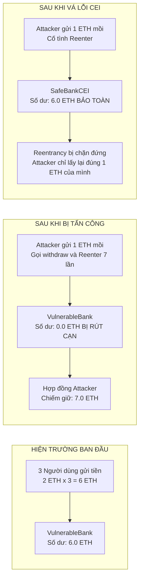

# BẰNG CHỨNG THỰC NGHIỆM VỤ TẤN CÔNG REENTRANCY & VÁ LỖI AN TOÀN — LAB 13

- **Học phần:** Tiền điện tử & Hợp đồng thông minh (ECO2432)
- **Hợp đồng thí nghiệm:** [`contracts/training/VulnerableBank.sol`](../../contracts/training/VulnerableBank.sol)
- **Hợp đồng vá lỗi:** [`contracts/training/SafeBank.sol`](../../contracts/training/SafeBank.sol)
- **Hợp đồng sản phẩm nhóm:** [`contracts/project/ProjectCore.sol`](../../contracts/project/ProjectCore.sol)
- **Người thực nghiệm:** Hoàng Mạnh Tường & Nguyễn Nguyên Phương

---

## 1. ĐỐI CHIẾU SỐ DƯ TRƯỚC VÀ SAU KHI TẤN CÔNG RÚT CẠN (THE DRAIN)



### Bảng biến động số dư ngân hàng qua các giai đoạn thực nghiệm:

| Giai đoạn | Hành động thực hiện | Số dư VulnerableBank | Số dư Attacker Contract | Trạng thái bảo mật |
| :--- | :--- | :---: | :---: | :---: |
| **Giai đoạn 1: Hiện trường** | 3 người dùng (`0xUserA`, `0xUserB`, `0xUserC`) nạp mỗi người 2.0 ETH | **6.0000 ETH** | **0.0000 ETH** | An toàn danh nghĩa, nhưng tiềm ẩn lỗ hổng nghiêm trọng do lệnh chi tiền đi trước ghi sổ. |
| **Giai đoạn 2: Bị tấn công** | Kẻ tấn công triển khai `Attacker`, nạp 1.0 ETH mồi và kích hoạt `attack()` | **0.0000 ETH** *(Rút cạn 100%)* | **7.0000 ETH** *(Chiếm đoạt 6 ETH của nạn nhân)* | 🚨 **Bị cướp sạch tiền** qua 7 vòng lặp gọi lại liên tục trước khi dòng `balances[msg.sender] = 0` kịp chạy. |
| **Giai đoạn 3: Sau khi vá CEI** | Áp dụng `SafeBankCEI` (xóa số dư về 0 trước khi `call{value}`) | **6.0000 ETH** *(Bảo toàn 100%)* | **1.0000 ETH** *(Chỉ rút đúng tiền của mình)* | 🛡️ **An toàn tuyệt đối**: Vòng gọi lại thứ 2 gặp `balances == 0` lập tức dừng lại. |
| **Giai đoạn 4: Sau khi vá Guard** | Áp dụng `SafeBankGuard` (`nonReentrant` modifier) | **6.0000 ETH** *(Bảo toàn 100%)* | **1.0000 ETH** *(Chỉ rút đúng tiền của mình)* | 🛡️ **An toàn hai lớp**: Vòng gọi lại thứ 2 bị từ chối với lỗi `ReentrantCall()`. |

---

## 2. TRÍCH XUẤT NHẬT KÝ THỰC NGHIỆM TỰ ĐỘNG

Dữ liệu trích xuất từ tệp log [`evidence/lab-13/test_output.log`](./test_output.log):

```text
--- BƯỚC 1: DỰNG HIỆN TRƯỜNG VULNERABLE BANK ---
  [Ban đầu] 3 người gửi tổng cộng: 6.0000 ETH
  [Số dư ngân hàng]: 6.0000 ETH

--- BƯỚC 2: TIẾN HÀNH TẤN CÔNG REENTRANCY ATTACK ---
  [Kẻ tấn công] Nạp 1.0000 ETH vốn mồi và kích hoạt attack()...
  [Kết quả tấn công]:
    - Số lần tái nhập (Reentrancy iterations): 7 vòng lặp
    - Số tiền trong hợp đồng Attacker cướp được: 7.0000 ETH
    - Số dư còn lại trong VulnerableBank:      0.0000 ETH
  🚨 XÁC NHẬN: NGÂN HÀNG ĐÃ BỊ RÚT CẠN SỐ DƯ TỪ 6 ETH VỀ 0 ETH THÀNH CÔNG!

[CÁCH 1: CHECKS - EFFECTS - INTERACTIONS (CEI)]
  Số dư SafeBankCEI trước tấn công: 7.0000 ETH
  Số dư SafeBankCEI sau khi kẻ gian rút tiền: 6.0000 ETH
  🛡️ THÀNH CÔNG: CEI chặn đứng tái nhập! 6 ETH của người dùng được bảo vệ an toàn 100%!

[CÁCH 2: OPENZEPPELIN REENTRANCYGUARD (nonReentrant)]
  🛡️ THÀNH CÔNG: Khóa nonReentrant từ chối lệnh gọi tái nhập với lỗi ReentrantCall()!
```
