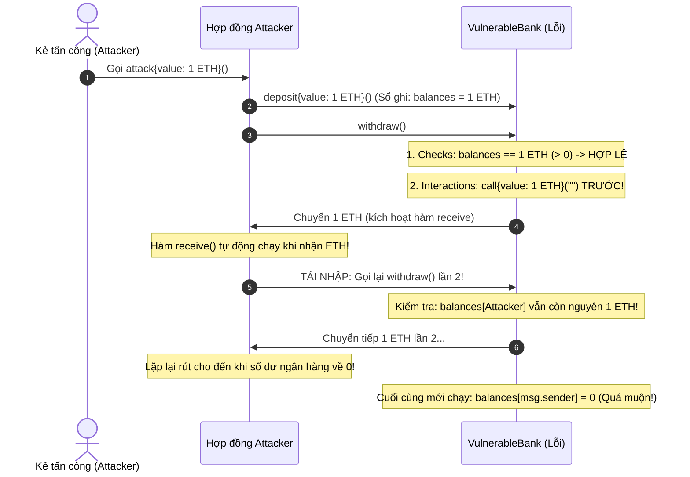

# PHÂN TÍCH CHUYÊN SÂU LỖ HỔNG TÁI NHẬP (REENTRANCY) & CHIẾN LƯỢC PHÒNG VỆ

- **Học phần:** Tiền điện tử & Hợp đồng thông minh (ECO2432)
- **Nhóm thực hiện:** Hoàng Mạnh Tường (23K4300042) & Nguyễn Nguyên Phương (23K4300034)

---

## 1. BA CÂU GIẢI THÍCH VÌ SAO THỨ TỰ DÒNG LỆNH LÀ THỨ CHẶN ĐƯỢC TẤN CÔNG

Theo yêu cầu chuẩn đầu ra Sổ tay thực hành (Trang 31): *"Ba câu giải thích vì sao thứ tự dòng lệnh là thứ chặn được tấn công"*:

> **1. Câu 1:** Thứ chặn đứng cuộc tấn công tái nhập là **việc cập nhật biến trạng thái (ghi sổ xóa số dư về 0) được thực thi TRƯỚC KHI quyền điều khiển và luồng tiền được bàn giao cho địa chỉ bên ngoài thông qua lệnh `call`**.
>
> **2. Câu 2:** Khi hàm `receive()` hoặc `fallback()` của kẻ tấn công tự động kích hoạt và cố tình gọi ngược lại hàm rút tiền lần thứ hai, bước kiểm tra điều kiện (`Checks`) ở đầu hàm đọc thấy số dư trên sổ sách của kẻ tấn công đã bằng 0 nên lập tức từ chối (`revert`) toàn bộ giao dịch gian lận.
>
> **3. Câu 3:** Ngược lại, nếu chi tiền trước rồi mới ghi sổ (vi phạm CEI), thì trong suốt thời gian hàm bên ngoài đang thực thi, số sách kế toán của hợp đồng vẫn ghi nhận kẻ tấn công còn nguyên số dư cũ, mở đường cho chúng rút tiền lặp đi lặp lại cho đến khi ngân hàng hoàn toàn cạn kiệt.

---

## 2. SƠ ĐỒ VÒNG LẶP TÁI NHẬP (CALL STACK & EXECUTION FLOW)



---

## 3. SO SÁNH 2 GIẢI PHÁP VÁ LỖI: CEI VS REENTRANCYGUARD

| Tiêu chí so sánh | Cách 1: Checks-Effects-Interactions (CEI) | Cách 2: Khóa chống gọi lại (`ReentrancyGuard`) |
| :--- | :--- | :--- |
| **Cơ chế bảo vệ** | Thay đổi thứ tự dòng lệnh: Ghi nhận trừ số dư về 0 trên bộ nhớ trạng thái (`state storage`) TRƯỚC KHI chuyển ETH ra ngoài. | Dùng biến cờ hiệu (`bool private _locked` hoặc `uint256 private _status`) để khóa cổng hàm: Khi đang chạy thì từ chối mọi lệnh gọi đệ quy lồng nhau. |
| **Phụ thuộc thư viện** | **Không phụ thuộc:** Là nguyên lý lập trình thuần túy, áp dụng được cho mọi ngôn ngữ và mọi phiên bản Solidity. | **Có phụ thuộc:** Cần import thư viện `@openzeppelin/contracts/utils/ReentrancyGuard.sol` hoặc tự khai báo modifier. |
| **Chi phí Gas** | **Tối ưu nhất (Rẻ nhất):** Không tốn thêm chi phí đọc/ghi biến cờ hiệu vào ô nhớ storage. | **Tốn thêm gas:** Mỗi lần gọi hàm tốn thêm khoảng $2.100 - 5.000 \text{ gas}$ cho việc đổi trạng thái biến khóa từ `1` sang `2` và ngược lại. |
| **Bản chất an toàn** | Giải quyết tận gốc vấn đề bất đối xứng thông tin kế toán giữa sổ sách và dòng tiền thực. | Là lớp vỏ bọc bảo vệ bên ngoài; nếu lập trình viên quên gắn modifier `nonReentrant` vào một hàm mới thì lỗ hổng vẫn lộ ra. |
| **Khuyến nghị chuẩn** | **BẮT BUỘC:** Là quy tắc số 1 trong ngành Web3. | **KHUYẾN NGHỊ PHÒNG THỦ CHIỀU SÂU (Defense-in-depth):** Kết hợp cả hai để tạo ra 2 lớp bảo vệ độc lập. |

---

## 4. ỨNG DỤNG BẢO VỆ CHO HỢP ĐỒNG `ProjectCore.sol` CỦA NHÓM

Trong đồ án **HCE Student Crowdfund**, nhóm áp dụng chiến lược phòng thủ hai lớp cho hàm hoàn tiền [`claimRefund()`](file:///c:/Users/Tuong/Downloads/hce-web3-starter/hce-web3-starter/contracts/project/ProjectCore.sol#L115-L138):

```solidity
function claimRefund() external nonReentrant {
    // 1. Checks: Kiem tra dieu kien han chot va that bai
    if (block.timestamp < deadline) revert CampaignStillActive(deadline - block.timestamp);
    if (totalRaised >= fundingGoal) revert CampaignSucceeded();

    uint256 contributedAmount = contributions[msg.sender];
    if (contributedAmount == 0) revert NoContributionToRefund();

    // 2. Effects: Xoa so du TRUOC tren bien trang thai de chong Reentrancy
    contributions[msg.sender] = 0;
    if (state != State.Failed) {
        state = State.Failed;
        emit StateUpdated(State.Failed);
    }
    emit RefundClaimed(msg.sender, contributedAmount);

    // 3. Interactions: Chuyen tien sau cung bang call{value}
    (bool success, ) = payable(msg.sender).call{value: contributedAmount}("");
    if (!success) revert TransferFailed();
}
```

- **Lớp bảo vệ 1 (CEI):** Dòng `contributions[msg.sender] = 0;` triệt tiêu quyền đòi tiền của ví ngay trước khi ETH được chuyển. Kẻ tấn công gọi lại sẽ gặp lỗi `NoContributionToRefund()`.
- **Lớp bảo vệ 2 (`nonReentrant`):** Ngăn chặn mọi cuộc gọi đệ quy lồng nhau ở cấp độ khung thực thi (EVM Call Frame). Kẻ tấn công gọi lại sẽ bị chặn với lỗi `ReentrantCall()`.
